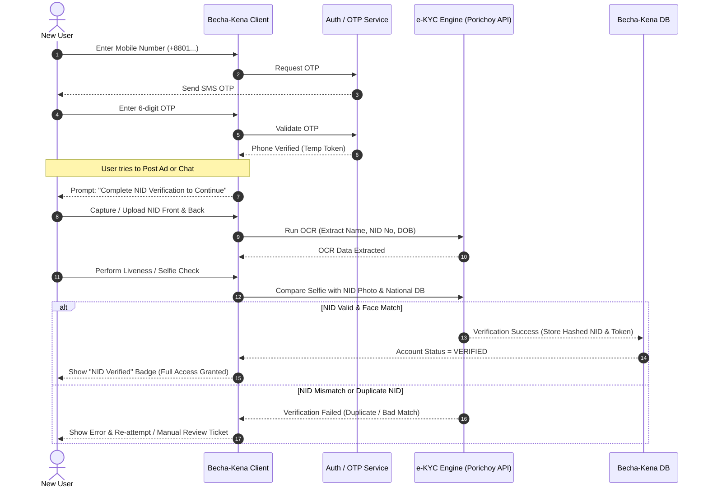
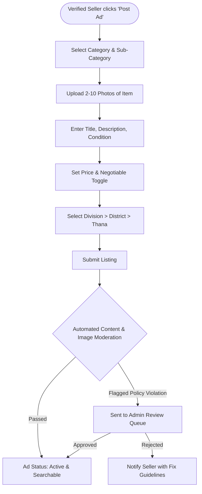
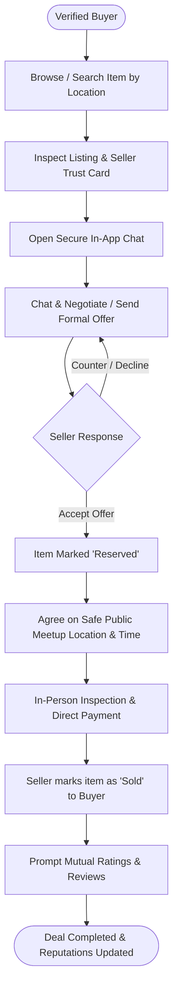
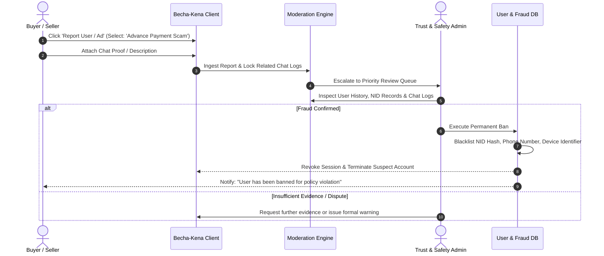

# Product Requirements Document (PRD)

## Project: Becha-Kena (Trust-First C2C Marketplace)
* **Document Version:** 1.0.0
* **Date:** November 2026
* **Status:** Ready for Review
* **Target Market:** Bangladesh (Urban & Semi-Urban peer-to-peer commerce)
* **Target Platforms:** Mobile-First (Responsive Web, Android, iOS)

---

## 1. Project Overview

### 1.1 Executive Summary
**Becha-Kena** is a trust-anchored peer-to-peer (C2C) classifieds and commerce platform designed specifically for Bangladesh. Unlike legacy classifieds where anyone with a disposable SIM card or burner Facebook account can post fraudulent ads, Becha-Kena enforces **mandatory National ID (NID) identity verification** as a prerequisite for listing, messaging, or transacting.

By combining familiar local classified workflows (browse, search, chat, deal) with a verified human identity layer, Becha-Kena eliminates anonymous fraud, bait-and-switch listings, and advance payment scams while fostering legal accountability.

### 1.2 The Core Problem
The current C2C second-hand market in Bangladesh (dominated by open classifieds and unvetted social media groups) suffers from a severe trust deficit:
1. **Disposable Identity & Impunity:** Criminals purchase unregistered or temporary SIM cards to open fake profiles, scam buyers for advance courier/booking fees (via bKash/Nagad), and vanish without a trace.
2. **Stolen & Counterfeit Goods:** High prevalence of stolen smartphones, cloned laptops, and counterfeit electronics sold with zero provenance or accountability.
3. **Ghost & Bait-and-Switch Listings:** Fake low prices posted by scrapers or scammers to phish phone numbers or lure victims into vulnerable physical locations.
4. **Seller Friction:** Genuine sellers waste hours dealing with trolls, bot inquiries, unverified lowballers, and abusive ghost buyers.
5. **No Legal Recourse:** Victims have virtually no actionable trail for Bangladesh Police / Cyber Crime Investigation Division because the perpetrator's real identity is never captured by the platform.

### 1.3 The Solution & Vision
Becha-Kena builds a digital marketplace where **trust is the core differentiator**:
* **Identity-Gated Participation:** Both buyers and sellers must complete an automated NID verification (OCR + biometric selfie match) before engaging in critical actions (posting ads, initiating chats, sending offers).
* **Privacy-Preserving Verification:** Real identity is verified behind the scenes; personal NID numbers and national database records are strictly protected and never displayed to public peers.
* **Traceable Accountability:** One person = One account. Malicious actors banned on Becha-Kena cannot spin up another account because their NID is permanently blacklisted.
* **Familiar & Fast Local Commerce:** Preserves the agility of local classifieds (in-person meetups, cash-on-delivery, direct negotiations) without heavy overhead.

### 1.4 Product Goals & Success Metrics (KPIs)

| Objective | Key Metric | Target (Post-Launch 6 Mo.) |
| :--- | :--- | :--- |
| **User Trust & Safety** | Scam/Fraud report rate per 1,000 transactions | < 0.2% |
| **Verification Conversion** | Onboarding-to-Verified completion rate | ≥ 75% |
| **Listing Quality** | Active verified listings with real responses | > 80% active engagement |
| **Deal Efficiency** | Median time from chat initiation to accepted offer | < 48 hours |
| **Retention** | 30-day seller and buyer return rate | ≥ 40% |

---

## 2. Target Users & Personas

### 2.1 Persona 1: "The Wary Tech Buyer" (Tanvir, 24)
* **Profile:** University student / junior software engineer living in Dhaka.
* **Need:** Wants to buy a pre-owned iPhone or gaming laptop to save money.
* **Pain Points:** 
  * Terrified of advance payment courier scams.
  * Fears purchasing stolen devices blacklisted by IMEI or locked to iCloud/MDM.
  * Exhausted by dealing with sketchy sellers on Facebook Marketplace.
* **Goals on Becha-Kena:** Wants to see verified seller credentials, inspect genuine product details, and negotiate securely before meeting in public.

### 2.2 Persona 2: "The Decluttering Seller" (Nusrat, 31)
* **Profile:** Working professional & mother in Chattogram.
* **Need:** Upgrading household furniture, baby gear, and old electronics.
* **Pain Points:** 
  * Does not want her personal phone number spammed or published online.
  * Hates ghost buyers who agree to buy and never show up.
  * Anxious about allowing strangers to pick up bulky items from her residence.
* **Goals on Becha-Kena:** List items quickly, communicate via private in-app chat, and filter out unserious, unverified buyers.

### 2.3 Persona 3: "The Casual Enthusiast Trader" (Rahim, 28)
* **Profile:** Gadget and motorbike enthusiast.
* **Need:** Frequently buys, uses, and resells smartphones, audio gear, and motorbikes.
* **Pain Points:** 
  * Struggles to build a trusted reputation on anonymous boards where reputation resets constantly.
  * Competes against spammy commercial refurbishers disguised as individual sellers.
* **Goals on Becha-Kena:** Maintain a permanent verified profile with reviews, verified transaction count, and quick sales velocity.

### 2.4 Internal Persona: "Trust & Safety / Operations Admin"
* **Profile:** Internal Becha-Kena compliance specialist.
* **Need:** Monitor flagged listings, review verification edge cases (manual fallback), and enforce immediate bans/investigations on reported bad actors.

---

## 3. Core Features

### 3.1 Identity & Verification Engine (The Trust Pillar)
* **Phone Number OTP Auth:** Primary login using Bangladeshi mobile numbers (`+8801...`).
* **Mandatory NID Verification (e-KYC):**
  * Front and back photo capture of National ID card (Smart NID or old laminated NID).
  * OCR extraction of full legal name, NID number, and date of birth.
  * Liveness selfie check matching user face against NID photo.
  * Integration with Porichoy API or licensed KYC provider for validation.
* **Single Identity Policy:** Strict 1 NID = 1 Account constraint. Re-registration with the same NID is blocked.
* **Trust Badging:** Visual "NID Verified" badge displayed on profile and ad listings.
* **Data Privacy & Masking:** Sensitive data (raw NID number, date of birth, home address) is encrypted at rest and never visible to other users. Only the verified first name and verified badge are public.

### 3.2 Listing & Inventory Management
* **Guest Browsing vs. Action Gate:** Unverified users can browse and search, but **posting an ad requires full NID verification**.
* **Guided Ad Creation:**
  * Multi-photo upload (minimum 2, up to 10 photos) with built-in client-side compression.
  * High-demand categories: Electronics (Mobiles, Computers, Cameras), Vehicles (Bikes, Cars), Home & Living (Furniture, Appliances), Fashion & Lifestyle.
  * Item Condition selection: *Brand New*, *Like New / Flawless*, *Used - Good*, *Used - Fair*, *For Parts*.
  * Serial / IMEI Verification (Optional for Sellers, highly recommended): IMEI hash check to prevent reposting previously reported stolen devices.
  * Price specification: Fixed, Negotiable, or Free Giveaway.
* **Structured Location Hierarchy:** Division -> District -> Thana/Area (e.g., Dhaka -> Mirpur -> Mirpur-10).
* **Ad Lifecycle:** Draft, Under Review, Active (30-day expiry with 1-click renewal), Sold, Expired, Removed.

### 3.3 Search & Discovery Engine
* **Contextual Search:** Fast keyword search with auto-complete for popular items and brands.
* **Faceted Filtering:**
  * Location / Distance radius (within specific Thana, City, or Division).
  * Category and sub-category drill-down.
  * Price range slider.
  * Condition filter.
  * Sort by: Date posted (newest), Price (low to high / high to low), Proximity.
* **Verified Seller Only Toggle:** Option to filter listings exclusively by sellers with verified transactions or top ratings.

### 3.4 In-App Communication & Deal Negotiation
* **Identity-Gated Chat:** Initiating or replying to a chat requires NID verification. Prevents burner account harassment.
* **Secure Messaging:**
  * Real-time text and photo messaging via WebSockets.
  * **No Phone Number Leakage:** Users negotiate without revealing their personal phone numbers until both parties choose to exchange contacts.
* **Formal "Make an Offer" System:**
  * Buyer sends a binding digital price offer.
  * Seller can Accept, Counter-offer, or Decline.
  * When an offer is accepted, the ad status switches to "Reserved".
* **Built-In Anti-Fraud Warning Banners:**
  * Dynamic banners in chat: *"Never send advance bKash/Nagad payments for courier charges. Inspect the item in person in a safe public spot."*
  * Automated regex detection warning users when someone requests advance money or off-platform payment transfers.

### 3.5 Trust, Rating & Reputation System
* **Post-Deal Review & Rating:** Once marked as "Sold" to a specific verified buyer, both parties can leave a 1-to-5 star rating and structured tags (e.g., *Accurate Description*, *Punctual*, *Quick Responder*).
* **Public Trust Card:** Profile shows:
  * NID Verified Status
  * Account Age / Member Since date
  * Total completed deals
  * Average rating and buyer feedback
* **Report & Dispute Flow:**
  * One-tap reporting on listings and chat threads with specific reasons (Counterfeit item, Stolen goods suspected, Advance fee requested, Abusive language, No-show).
  * System captures chat snapshot and listing metadata for compliance audit.

### 3.6 Moderation & Admin Control Center
* **Automated Content Moderation:** Keyword blacklist (prohibited weapons, illegal substances, adult products, counterfeit keywords).
* **Manual Review Queue:** Suspicious listings and user reports flagged for human moderation.
* **Fraud Blacklist (Kill Switch):**
  * One-click permanent ban that blacklists the offender's Phone Number, Device ID, and NID permanently.
  * Audit logs preserved for law enforcement handoff if legal inquiries/notices arrive.

---

## 4. User Flows

### Flow 1: User Onboarding & Mandatory NID Verification

---

### Flow 2: Creating a Listing (Verified Seller)

---

### Flow 3: Buyer Discovery, Negotiation & Deal Closure

---

### Flow 4: Abuse, Scam Reporting & Blacklisting Flow

---

## 5. Out-of-Scope Items (v1 / MVP Launch)

To ensure rapid market entry, technical feasibility, and legal clarity, the following items are **strictly out of scope** for the MVP release:

1. **In-Platform Escrow Payment Gateway:**
   * Holding funds directly in escrow (like Escrow.com or bKash merchant escrow) is deferred for post-MVP. Transactions remain peer-to-peer (Cash on Delivery or direct bank/MFS transfer at the time of in-person handover).
2. **Integrated Logistics & Nationwide Doorstep Courier:**
   * No built-in automated pickup/delivery integrations (e.g., Pathao Courier, Steadfast, RedX API) in v1. Physical handovers are arranged directly between parties in safe local public locations.
3. **B2C / Commercial Retailer Storefronts:**
   * No business accounts, bulk product uploaders, inventory ERP sync, or commercial merchant storefronts. The platform is purely focused on genuine consumer-to-consumer (C2C) pre-owned goods.
4. **Paid Listing Promotions & Ad Bidding:**
   * No featured ads, top-of-page sponsored bidding, or ad booster packages in MVP. All organic search results are ranked strictly by relevance and recency.
5. **Legally Binding Warranty & Return Guarantees:**
   * Becha-Kena provides identity verification and mutual accountability, but does not provide financial underwriting, warranties, or money-back guarantees for second-hand product defects.
6. **In-App Audio / Video Calling:**
   * Voice and video calls will not be built into the native chat engine for MVP; text and photo exchange are sufficient.
7. **BNPL (Buy Now, Pay Later) or Financing:**
   * No consumer credit or installment lending integration.

---

## 6. Non-Functional Requirements & Compliance

### 6.1 Security & Data Protection
* **Data Minimization:** Becha-Kena does not store raw, unencrypted NID images permanently on public web servers. Once verified, images are moved to encrypted cold storage with access restricted to certified compliance officers.
* **PII Privacy:** Personal identifiers (NID numbers) are stored as irreversible cryptographic hashes for duplicate detection (`HMAC-SHA-256` with salt).
* **Communication Encryption:** All client-to-server traffic encrypted via TLS 1.3. Chat messages encrypted in transit and at rest.

### 6.2 Performance & Scalability
* **Verification Speed:** Automated OCR and facial verification response within ≤ 30 seconds under normal API load.
* **Search Latency:** Full-text keyword and location search results returned in < 200ms for 95% of queries.
* **Media Optimization:** Mobile uploads automatically compressed to WebP/JPEG format under 300KB without visible quality loss.

### 6.3 Local Compliance
* Alignment with Bangladesh's **Cyber Security Act** and local personal data regulations.
* Audit trail capability to assist verified law enforcement requests upon formal legal warrant.

---

## 7. Release Milestones & Roadmap

* **Phase 1 (Sprint 1-4) - Foundation & Verification:** User authentication, NID OCR & liveness verification integration, profile creation with trust badge.
* **Phase 2 (Sprint 5-8) - Core Marketplace:** Category browsing, ad posting, image handling, search & filter engine.
* **Phase 3 (Sprint 9-11) - Communication & Safety:** In-app chat, offer system, anti-scam warnings, reporting and moderation console.
* **Phase 4 (Sprint 12) - Beta Testing & Dhaka Pilot:** Closed beta with 1,000 verified users in Dhaka targeting consumer electronics.
* **Phase 5 - Public Rollout & Nationwide Expansion.**

