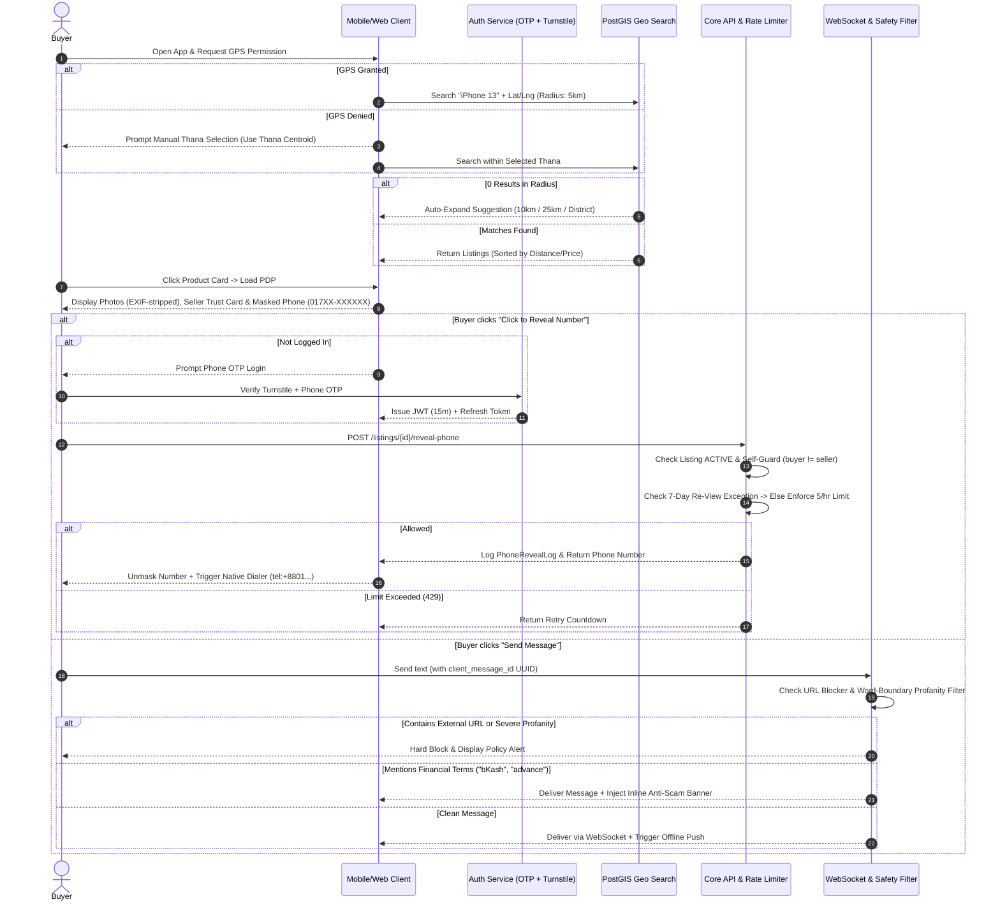
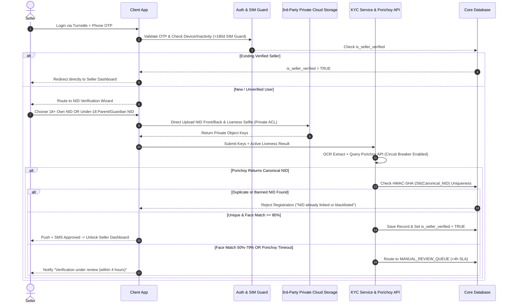
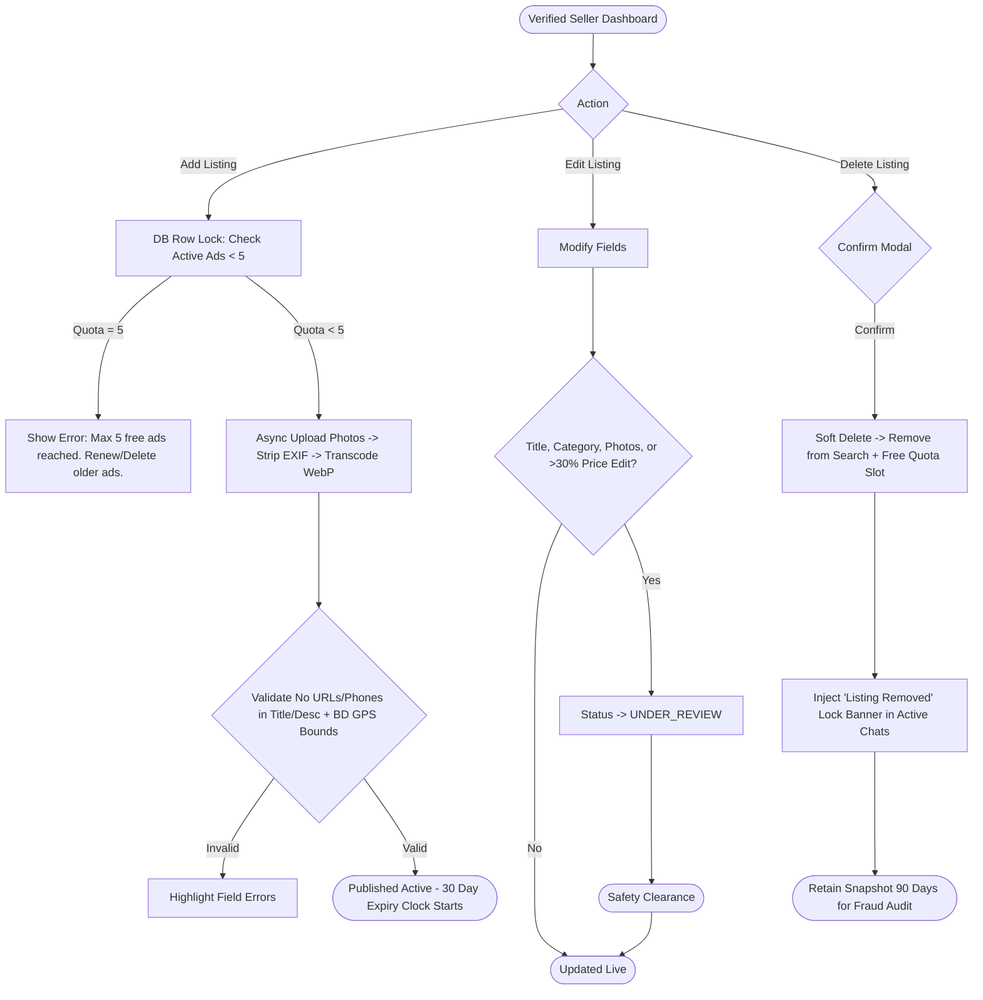
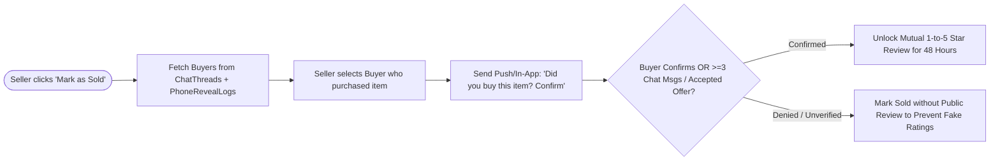
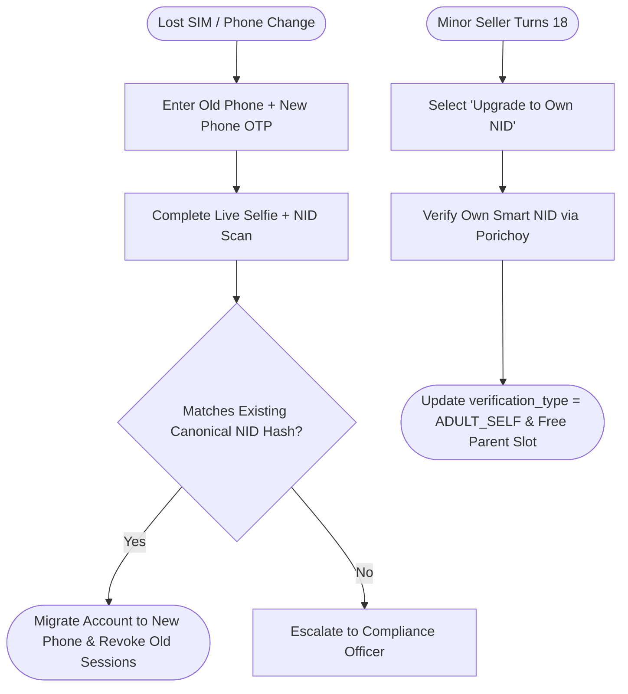

# Product Requirements Document (PRD)

## Project: Becha-Kena (Trust-First C2C Marketplace)
* **Document Version:** 4.0.0 (Final — All Business Logic & Validation Gaps Resolved)
* **Date:** November 2026
* **Status:** Finalized Specification (Post-Validation Audit)
* **Target Market:** Bangladesh (Urban & Semi-Urban C2C Peer-to-Peer Commerce)
* **Target Platforms:** Mobile-First (Responsive Web, Android, iOS)

---

## 1. Project Overview

### 1.1 Executive Summary
**Becha-Kena** is a trust-anchored peer-to-peer (C2C) classifieds and marketplace platform tailored for Bangladesh. To balance effortless buyer growth with uncompromised platform accountability, Becha-Kena employs an **asymmetric onboarding model**:
* **Buyers** register seamlessly via mobile number (SMS OTP), discover nearby items via **GPS-powered proximity search**, inspect verified seller profiles, and connect securely through **moderated in-app chat** or an anti-scraping **"Click to Reveal"** direct call mechanism.
* **Sellers** must complete mandatory **National ID (NID) e-KYC verification via the Porichoy API** before accessing the Seller Dashboard or publishing listings—including **Parental/Guardian NID verification** for under-18 student sellers.

### 1.2 The Core Problem
1. **Disposable Identity & Advance Fee Scams:** Scammers use burner SIMs to demand advance bKash/Nagad delivery fees and disappear.
2. **Stolen & Counterfeit Goods:** Zero identity verification allows stolen electronics and counterfeit items to circulate freely.
3. **Commercial Broker Spam:** Retailers flood C2C feeds with duplicate ads while pretending to be individuals.
4. **Harassment, Phishing & Contact Scraping:** Unmoderated chats expose users to phishing links and abuse, while plaintext numbers on public pages get harvested by automated scrapers.
5. **Identity Evading & Privacy Leaks:** Scammers re-register by switching between old 13/17-digit NIDs and 10-digit Smart NIDs, or leak sellers' home addresses via raw camera EXIF GPS metadata in uploaded photos.

### 1.3 Solution & Architectural Pillars
* **Asymmetric Trust Onboarding:** Mobile OTP for Buyers; mandatory **Porichoy Canonical NID Verification** for Sellers (1 Canonical NID = 1 Account).
* **Under-18 Inclusivity with Accountability:** Under-18 sellers authenticate through a verified Parent or Legal Guardian's NID and live selfie.
* **Hyper-Local GPS Discovery:** PostGIS-backed geolocation enables radius searches (`2km`–`25km`) while shielding exact street coordinates.
* **Anti-Scraping & Safe Communication:** Phone numbers are hidden behind an authenticated, rate-limited **"Click to Reveal"** firewall; in-app chats strip/block external URLs and multi-lingual profanity in real time.
* **Anti-Broker Listing Quota:** Standard sellers are capped at **5 active free listings** with automatic 30-day expiration.

### 1.4 Success Metrics (KPIs)

| Objective | Key Metric | Target (Post-Launch 6 Mo.) |
| :--- | :--- | :--- |
| **User Trust & Safety** | Scam/Fraud report rate per 1,000 transactions | < 0.2% |
| **Buyer Conversion** | Visitor-to-Phone-Verified Buyer onboarding | ≥ 60% |
| **Seller KYC Conversion** | New seller KYC start-to-Porichoy approval rate | ≥ 75% |
| **Manual KYC SLA** | Resolution time for fallback manual review queue | < 4 hours |
| **Scraping Mitigation** | Blocked unauthorized phone reveal attempts | 100% enforcement |
| **Chat Safety** | Automated blocking accuracy for URLs & slurs | > 99% |

---

## 2. User Roles, RBAC Matrix & User Stories

Becha-Kena operates on a **Unified Account Model**: every user begins as a Phone-Verified Buyer and upgrades seamlessly to a Verified Seller on the same account upon completing e-KYC.

### 2.1 Role-Based Access Control (RBAC) Matrix

#### A. Marketplace User Permissions

| Capability / Action | Guest (Unauth) | Buyer (`PHONE_VERIFIED`) | Seller (`KYC_PENDING`) | Verified Seller (`VERIFIED_SELLER`) |
| :--- | :---: | :---: | :---: | :---: |
| Browse & GPS Radius Search | ✅ | ✅ | ✅ | ✅ |
| View PDP (Specs, Photos, Distance) | ✅ | ✅ | ✅ | ✅ |
| Click to Reveal Phone Number | ❌ *(Login)* | ✅ *(5/hr, 7d re-view free)* | ✅ *(5/hr)* | ✅ *(5/hr, `!= self`)* |
| Moderated In-App Chat & Formal Offers | ❌ *(Login)* | ✅ | ✅ | ✅ *(`!= self`)* |
| Access Seller Dashboard & Analytics | ❌ | ❌ *(403 KYC Req.)* | ❌ *(Locked)* | ✅ |
| Add Listing (Max 5 Active Quota) | ❌ | ❌ | ❌ | ✅ |
| Edit / Delete / Renew Own Listings | ❌ | ❌ | ❌ | ✅ *(While not Sold/Del)* |
| Mark Sold & Submit Legitimate Review | ❌ | ✅ *(Confirmed)* | ❌ | ✅ *(Confirmed)* |
| Request Phone Migration / Account Recovery | ❌ | ✅ | ✅ | ✅ *(NID+Selfie Req.)* |

#### B. Internal Admin Least-Privilege Matrix

| Admin Action | Content Moderator | KYC Compliance Officer | Trust & Safety Lead |
| :--- | :---: | :---: | :---: |
| Review Flagged Listings & Chats | ✅ | ✅ | ✅ |
| Force-Hide / Remove Violating Ads | ✅ | ❌ | ✅ |
| Access `MANUAL_REVIEW_QUEUE` Pre-signed NID URLs | ❌ | ✅ *(Audited)* | ✅ *(Audited)* |
| Process Ban Appeals & Account Recovery | ❌ | ✅ | ✅ |
| Execute Global NID Blacklist Kill Switch | ❌ | ❌ | ✅ *(2FA + Audit Log)* |
| Export Forensic Legal Warrant Bundle | ❌ | ❌ | ✅ *(2FA + Audit Log)* |

---

### 2.2 Detailed User Stories

#### Buyer User Stories
* **B-01 (Low-Friction Auth):** As a Buyer, I want to sign up/login using only my Bangladeshi mobile number and SMS OTP so I can start contacting sellers quickly.
* **B-02 (GPS Search & Auto-Expansion):** As a Buyer, I want to search items near my GPS coordinates (with automatic manual Thana fallback if GPS is denied) and see broader radius suggestions if my local area has zero matches.
* **B-03 (PDP & Seller Trust Inspection):** As a Buyer, I want to view full product photos, condition specs, approximate distance, and the seller's **NID Verified** / **Guardian Verified** trust badge before making contact.
* **B-04 ("Click to Reveal" Phone & Direct Call):** As a logged-in Buyer, I want to click **"Click to Reveal Number"** to unmask the seller's phone number and dial directly (`tel:`), without repeated clicks on the same ad counting against my hourly limit.
* **B-05 (Moderated Chat & Deal Confirmation):** As a Buyer, I want to negotiate safely in-app (protected from phishing links and abusive language) and confirm completed deals to rate honest sellers.

#### Seller User Stories
* **S-01 (Smart Auth Routing):** As a Seller, when logging in via OTP, I want existing verified accounts routed directly to the **Seller Dashboard**, and unverified accounts routed to the **e-KYC Verification Wizard**.
* **S-02 (Porichoy e-KYC - Adult & Under-18 Guardian):** As a New Seller, I want to verify using my own NID (18+) OR link my Parent/Legal Guardian's NID (Under-18) via the **Porichoy API**, with secure 3rd-party private cloud storage for identity photos and a 4-hour manual review fallback if automated checks fail.
* **S-03 (Listing Creation with 5-Ad Cap & GPS):** As a Verified Seller, I want to publish up to **5 active free listings** with auto-compressed images (including Apple HEIC), GPS location pinning, and clear pricing.
* **S-04 (Dashboard CRUD, Re-Moderation & 30-Day Expiry):** As an Existing Seller, I want to **Add, Edit, Delete, and 1-Click Renew** listings. Major edits undergo safety re-moderation, deletions lock active chats gracefully, and I can mark items Sold to either chat buyers or phone-reveal buyers.
* **S-05 (SIM Recovery & Minor-to-Adult Upgrade):** As a Verified Seller, I want a secure recovery flow to update my mobile number if I lose my SIM, and Under-18 sellers want an upgrade path once they turn 18 and acquire their own NID.

---

## 3. Functional Requirements (Engineering Specification)

### 3.1 Authentication, Anti-Abuse & Account Lifecycle (`FR-AUTH`)
* **`FR-AUTH-01` Phone OTP & SMS Pumping Defense:**
  * Require **Cloudflare Turnstile / Firebase App Check** verification before triggering SMS dispatch.
  * Accept Bangladeshi prefixes only (`+8801[3-9]`). Generate 6-digit OTP (180s TTL, max 3 wrong attempts before invalidation, 60s resend cooldown, max 5 OTP requests/hr per IP/Device/Number).
  * Automatic failover to secondary SMS gateway on primary vendor failure.
* **`FR-AUTH-02` Recycled SIM Card Protection:**
  * If an account has been inactive for **> 180 days** and logs in from an unrecognized device fingerprint, enforce an optional 6-digit **Account Security PIN** or prompt re-verification check before granting Seller Dashboard access to prevent SIM-recycling account takeovers.
* **`FR-AUTH-03` Verified Phone Migration / Account Recovery (`MF-01`):**
  * Because `1 Canonical NID = 1 Account`, users who lose their SIM card can initiate **Phone Migration**: enter old phone number + complete a fresh **NID + Live Selfie check** matching the stored NID hash; upon match, migrate account ownership to the new OTP-verified mobile number and revoke old tokens.
* **`FR-AUTH-04` Session Revocation & Deactivation (`MF-07`):**
  * Short-lived JWTs (15 min) + Revocable Refresh Tokens. Redis `banned_users` blacklist checked on every WebSocket message and sensitive REST call.
  * User-initiated account deletion soft-deletes public profile/listings while retaining `nid_hash` and `PhoneRevealLogs` in compliance cold storage.

### 3.2 Identity Verification & Storage Engine (`FR-KYC`)
* **`FR-KYC-01` Age-Branched Verification & Under-18 Upgrade (`MF-04`):**
  * User chooses `ADULT_SELF` ($\ge 18$) or `MINOR_GUARDIAN` ($< 18$).
  * *Under-18 Rules:* Supports guardian `relationship` (`FATHER`, `MOTHER`, `ADULT_SIBLING`, `LEGAL_GUARDIAN` aged $\ge 21$). Guardian must provide NID front/back + complete the live selfie match. Max **2 minor accounts** per guardian NID.
  * *Contamination Rule:* If a minor account is permanently banned for confirmed fraud, **all linked accounts under that Guardian NID** are flagged/suspended pending compliance audit.
  * *Minor-to-Adult Upgrade:* At age 18+, minor users can submit their own Smart NID via `ADULT_SELF` flow to detach from the parent's slot.
* **`FR-KYC-02` Porichoy API Integration & Canonical NID Hashing (`EC-01`):**
  * Capture Smart NID (10-digit) or Laminated NID (13/17-digit) + active liveness selfie (randomized head-turn/blink challenge + moiré screen-replay detection).
  * Query **Porichoy API**. **CRITICAL:** Compute `HMAC-SHA-256` against the **Porichoy-resolved 10-digit canonical NID** (plus a secondary `DOB + Name` composite hash), closing the loophole where an old 13/17-digit banned user re-registers with a new 10-digit Smart NID.
* **`FR-KYC-03` Borderline Match & API Fallback (`EXC-02`, `EH-01`):**
  * Face match `< 50%`: Hard Reject. Match `>= 80%`: Auto-Approve. Match `50%–79%` (e.g., aging, beard, glasses): Route to `MANUAL_REVIEW_QUEUE`.
  * Porichoy API circuit breaker (2 retries with exponential backoff) automatically falls back to `MANUAL_REVIEW_QUEUE` (< 4h SLA) without discarding uploaded assets.
* **`FR-KYC-04` 3rd-Party Private Cloud Object Storage (`SEC-04`):**
  * NID images and selfies upload directly to private encrypted buckets (AES-256, `ACL: private`).
  * Accessed exclusively via **5–15 min pre-signed URLs** with `Cache-Control: no-store, private`. Pre-signed query tokens must be scrubbed from all application/APM logs.

### 3.3 Geolocation & GPS Discovery (`FR-GEO`)
* **`FR-GEO-01` Seller GPS Capture & Spatial Fallback (`MF-06`, `EH-06`):**
  * Capture device GPS (`latitude`, `longitude`) mapped to `Division > District > Thana` via reverse geocoding (nearest-neighbor `ST_Distance` fallback within 15km for river/border edge coordinates).
  * If GPS permission is denied or unavailable, user manually selects `Division > District > Thana`, using the Thana centroid as `location_point`.
  * **Privacy Masking:** Never return exact lat/lng to clients on PDP; expose rounded distance and Thana/neighborhood name only (e.g., *"~2.4 km away · Dhanmondi, Dhaka"*).
* **`FR-GEO-02` Proximity Search & Auto-Radius Expansion (`EC-07`):**
  * Radius filters: `2km`, `5km`, `10km`, `25km`, `All Bangladesh`.
  * If a narrow search (`2km`/`5km`) returns `0` results, UI automatically fetches and suggests results from the next expanded tier (`10km` / `District`).

### 3.4 Product Details Page & Anti-Scraping Firewall (`FR-PDP`)
* **`FR-PDP-01` Listing Display & Self-Guard (`EC-05`, `EC-08`):**
  * Guests and users view images, specs, distance, and Seller Trust Card (*Verified Name*, *NID Verified / Guardian Verified* badge, *Deal Count*, *Rating*).
  * Self-interaction blocked (`seller_id != buyer_id`): Sellers viewing their own PDP see *"Edit Listing"* instead of buyer contact buttons.
  * Accessing a deleted/sold PDP gracefully returns `410 Gone` (`LISTING_UNAVAILABLE`).
* **`FR-PDP-02` "Click to Reveal" Anti-Scraping Protection (`EXC-01`, `SEC-05`):**
  * Seller phone number is physically omitted from unauthenticated/initial PDP JSON payloads (sent masked as `017XX-XXXXXX`).
  * Clicking **"Click to Reveal Number"**:
    * Guests are prompted with OTP Login modal.
    * Logged-in users call `POST /api/listings/{id}/reveal-phone`.
    * **7-Day Re-View Exception:** If `(buyer_id, listing_id)` already exists in `PhoneRevealLogs` within the past 7 days, return the unmasked number immediately **without consuming rate-limit quota**.
    * **Multi-Dimensional Rate Limit:** Max **5 unique reveals/hour** & **20/day** per `user_id`, **10/hr** per `device_id`, **30/hr** per `IP /24 subnet`. Excess requests return `429` with retry countdown.
    * Activates native `tel:+8801XXXXXXXXX` link alongside anti-advance-payment warning banner.

### 3.5 Seller Dashboard, Quota & Listing CRUD (`FR-LST`)
* **`FR-LST-01` 5-Listing Quota with Concurrency Lock (`EC-04`):**
  * Max **5 active listings** (`ACTIVE`, `RESERVED`, `UNDER_REVIEW`) per verified seller.
  * Enforced inside a PostgreSQL transaction using `SELECT ... FOR UPDATE` on the seller's user row to prevent parallel request race conditions.
* **`FR-LST-02` Add Listing, Media Pipeline & EXIF Stripping (`SEC-01`, `EH-02`, `EH-05`):**
  * Per-photo asynchronous upload with individual retry buttons on slow 3G/4G.
  * Validate file magic bytes (JPEG, PNG, WebP, **Apple HEIC**).
  * **Mandatory EXIF Stripping:** Server/CDN transcodes photos to WebP (< 300KB) and **strips all EXIF metadata** (GPS coordinates, camera serials) to ensure buyers cannot extract seller home coordinates from product photos.
  * Async image OCR checks photos for printed/written phone numbers or QR codes attempting to bypass Click-to-Reveal.
* **`FR-LST-03` Edit Listing & Bait-and-Switch Re-Moderation:**
  * Modifying **Title**, **Category**, **Images**, or changing **Price by > 30%** automatically places the ad into `UNDER_REVIEW` until cleared.
  * **Automated Fast-Track (< 5 min):** A BullMQ moderation job immediately re-runs automated content checks (title/description URL/phone scan, image OCR, category price floor validation). If all checks pass, the listing auto-transitions back to `ACTIVE` without human intervention.
  * **Human Review Escalation (< 2h SLA):** If the automated check flags the edit (suspicious keyword, category mismatch, image OCR hit), it escalates to the Admin `MANUAL_REVIEW_QUEUE` with a **2-hour SLA** for human clearance.
  * **Seller Communication:** Seller receives an in-app notification: *"Your listing update is under brief safety review (usually < 5 minutes)."* If escalated, a second notification confirms *"An agent is reviewing your listing — you will hear back within 2 hours."*
  * During `UNDER_REVIEW`, the listing remains **visible in search results** at its last approved state; existing chats and Click-to-Reveal remain functional.
* **`FR-LST-04` Delete Listing & Chat Sync (`EXC-06`):**
  * Soft-delete (`status = 'DELETED'`) frees a quota slot immediately and removes the listing from search.
  * Injects immutable system banner in all linked chat threads: *"This listing has been removed by the seller."* and locks offers. Chat/listing snapshots remain preserved for **90 days** for fraud investigations.
* **`FR-LST-05` 30-Day Listing Expiry & 1-Click Renewal (`MF-02`):**
  * Active listings auto-expire after **30 days** (`ACTIVE` $\rightarrow$ `EXPIRED`). Push alert sent on Day 27; sellers can renew in 1 click if active count < 5.
* **`FR-LST-06` Listing Contact Phone & Alternate Number Logic:**
  * Each listing stores its own `contactPhone` field (separate from `users.phoneNumber`).
  * During listing creation, `contactPhone` is **pre-populated** with the seller's registered `users.phoneNumber`.
  * Seller may optionally enter a different verified Bangladeshi number as `contactPhone` for that specific listing (e.g., a shop landline or second SIM).
  * **Click-to-Reveal reads `listing.contactPhone`**, not `users.phoneNumber`, so the number revealed to buyers is always listing-specific.
  * `contactPhone` is validated against the same regex `^\+8801[3-9]\d{8}$` as the account phone.

### 3.6 Moderated In-App Chat & Formal Offers (`FR-CHT`)
* **`FR-CHT-01` Idempotent WebSocket Messaging (`EH-04`):**
  * Real-time chat over WebSockets (Redis Pub/Sub) with client-generated `client_message_id` UUIDs for offline deduplication and REST fallback.
* **`FR-CHT-02` Real-Time Safety Filter (Hard Block vs. Warning) (`EXC-03`):**
  * **Hard Block (Rejected Pre-Delivery):**
    * External URLs/domains (`http`, `https`, `.com`, `bit.ly`, `wa.me`, `t.me`, obfuscated `[dot]` patterns).
    * Severe Bengali Unicode, Banglish phonetic, and English profanity/slurs using **word-boundary (`\b`) matching** to prevent false positives.
  * **Non-Blocking Warning Trigger:** Financial terms (`bKash`, `Nagad`, `Rocket`, `advance`, `courier fee`) deliver normally but trigger an inline anti-scam warning banner reminding users never to pay in advance.
* **`FR-CHT-03` Atomic Offer Acceptance (`EXC-04`):**
  * Optimistic locking (`version` column) on `Listings`. First offer accepted atomically sets `status = 'RESERVED'` and `reserved_buyer_id`; concurrent accepts fail with `409 Conflict` and notify competing threads.
* **`FR-CHT-04` Formal Offer Auto-Expiry & 1-Thread-Per-Buyer Rule:**
  * **Offer TTL:** A formal price offer automatically expires after **72 hours** if the Seller does not Accept, Counter, or Decline. Buyer receives a push notification: *"Your offer on [Item] expired."* Offer status updates to `EXPIRED`. Seller is not penalized but receives a soft reminder.
  * **1 Thread Per Buyer Per Listing:** A Buyer may only have **1 active chat thread per listing**. If a Buyer clicks "Send Message" on the same listing again, the existing thread is re-opened (not duplicated). Enforced via unique MongoDB index `{ listingId: 1, buyerId: 1 }` on `chat_threads` and a `findOrCreate` pattern in `ChatService`.

### 3.7 Deal Attribution, Verified Reviews & Moderation (`FR-MOD`)
* **`FR-MOD-01` Online & Offline "Mark as Sold" Attribution (`MF-03`):**
  * Seller clicks "Mark as Sold" and picks the buyer from either (a) **Active Chat Threads** OR (b) **Logged Phone Reveals (`PhoneRevealLogs`)** on that listing.
  * Selected buyer receives a push/in-app prompt: *"Did you purchase [Item Title]?"*
  * Mutual 1-to-5 star review unlocks only upon buyer confirmation (or accepted formal offer / $\ge 3$ two-way messages). Reviews lock permanently after 48 hours.
* **`FR-MOD-03` Trust Score Calculation Algorithm:**
  * `users.trustScore` is a computed decimal (`0.0` to `5.0`) recalculated after every new review.
  * **Formula:** `trustScore = (weightedRatingSum / totalReviews) × dealCountBonus`
    * `weightedRatingSum`: Sum of all review ratings (recency-weighted: reviews older than 90 days contribute at 70% weight).
    * `dealCountBonus`: Multiplier caps at `1.0` for ≥ 10 completed deals; scales as `min(1.0, completedDealsCount / 10)` for fewer deals (penalizes brand-new sellers with one 5-star review from a friend).
  * Trust score is **asynchronously recalculated** after each review submission via a BullMQ job (`trust_score_recalc_queue`) — never inline in the request path.
  * Public display rounds to 1 decimal (e.g., `4.3 ★`). Score of `0.0` with `0` deals displays *"New Seller"* badge instead of a numeric score.
* **`FR-MOD-02` Reporting, Admin Kill Switch & Ban Appeal (`MF-05`):**
  * One-tap reporting captures immutable listing & chat snapshots.
  * Admin Ban Kill Switch globally blacklists `canonical_nid_hash`, `phone_number`, and `device_id`.
  * Wrongly flagged/hijacked users can submit a **Ban Appeal** ticket routed to Compliance Officers.

### 3.8 Category Taxonomy & Price Floors (`FR-CAT`)
* **`FR-CAT-01` Category Hierarchy (3-Level Tree):**
  * The platform maintains a seeded, admin-managed `categories` collection (not hardcoded in application code).
  * **Level 1 (Root Categories):** Electronics, Vehicles, Home & Living, Fashion & Lifestyle, Books & Education, Sports & Hobbies, Other.
  * **Level 2 (Sub-Categories, examples):**
    * Electronics → Mobiles & Tablets, Laptops & Computers, Cameras & Photography, Audio & Headphones, Gaming, Other Electronics.
    * Vehicles → Motorcycles & Bikes, Cars & Microbuses, Bicycle, Spare Parts.
    * Home & Living → Furniture, Kitchen Appliances, Home Decor, Baby & Kids.
  * **Level 3 (Optional Attributes per Sub-Category):** e.g., Mobile listings expose `brand` (Samsung, Apple, Xiaomi…), `storage` (64GB, 128GB…), `ram` attributes for structured filtering.
* **`FR-CAT-02` Category Minimum Price Floor (Anti `1 BDT` Spam):**
  * Each `categories` document stores `minPriceBDT` and `maxPriceBDT` guard rails. Example: Mobiles `minPriceBDT: 500`, Furniture `minPriceBDT: 200`, Books `minPriceBDT: 10`.
  * "Free / Giveaway" items must explicitly select the **Free** condition type (separate from price validation).
  * Validation engine (`VAL-02`) reads floor values dynamically from the categories collection rather than hardcoding, so Admins can adjust floors without code deploys.
* **`FR-CAT-03` Category-Specific Attribute Schemas:**
  * Listings in Electronics sub-categories expose optional structured fields: `{ brand, model, storageGB, ramGB, imeiLast4Digits }`.
  * Vehicles expose: `{ brand, year, engineCC, registrationType }`.
  * These attributes are indexed in Atlas Search for structured filtering on the buyer-facing search results page.

---

## 4. Input Validation & Business Rules Reference (`VAL`)

| Entity / Field | Exact Validation Rule & Constraints |
| :--- | :--- |
| **Mobile Number** | Normalize to E.164; enforce regex `^\+8801[3-9]\d{8}$` |
| **OTP Token** | `^\d{6}$`, 180s TTL, max 3 verification attempts |
| **NID Number** | `^(\d{10}|\d{13}|\d{17})$`; must pass Porichoy canonical resolution |
| **Age Constraints** | `ADULT_SELF`: Extracted DOB age $\ge 18$; `MINOR_GUARDIAN`: Seller $< 18$, Guardian $\ge 18$ ($\ge 21$ if non-parent) |
| **Listing Title** | `5`–`100` chars; **Reject** embedded phone numbers & URLs |
| **Listing Description** | `20`–`2,000` chars; **Reject** embedded phone numbers (incl. spaced/disguised digits) & URLs |
| **Listing Price** | `10` to `100,000,000` BDT (Category min floor enforced to prevent `1 BDT` sort spam; Free items use Giveaway category) |
| **Listing Photos** | `2`–`10` images; magic bytes `JPEG/PNG/WebP/HEIC`; max `10 MB` raw; output `< 300 KB` WebP with **EXIF stripped** |
| **Bangladesh GPS Bounds** | `Latitude: [20.34, 26.64]`, `Longitude: [88.01, 92.67]` (rejects mocked foreign VPN coordinates) |
| **Chat Message** | `1`–`1,000` chars; max `1` image (`<= 5 MB`); **block** `.pdf`, `.apk`, `.zip`, executables |
| **Formal Offer** | `10%` to `150%` of listing asking price |
| **Notification Preferences** | Optional object per user: `{ newMessage: bool, offerUpdates: bool, listingExpiry: bool, dealConfirmation: bool }`. All default `true`. Security-critical alerts (OTP, new device login, ban notifications) are **always sent and cannot be disabled**. |

---

## 5. System User Flows

### Flow 1: Buyer Discovery, GPS Search, "Click to Reveal" & Safe Chat

---

### Flow 2: Seller Auth, Age-Branched Porichoy e-KYC & Private Cloud Storage

---

### Flow 3: Listing CRUD, 5-Ad Quota & Anti-Fraud Sync

---

### Flow 4: Offline/Online "Mark as Sold" & Mutual Review Flow (`MF-03`)

---

### Flow 5: Phone Recovery (`MF-01`) & Under-18 Upgrade (`MF-04`)

---

## 6. Event & Notification Matrix

| Event Trigger | Recipient | Channels | Delivery Content / Behavior |
| :--- | :--- | :--- | :--- |
| **OTP Requested** | User | SMS | 6-digit verification code (3-min TTL) |
| **KYC Approved** | Seller | Push + SMS + In-App | *"Verified! You can now post up to 5 free listings."* |
| **KYC Manual Queue / Rejected** | Seller | Push + In-App | Status update + actionable retry guide (e.g., blur/glare) |
| **New Chat Message** | Buyer / Seller | Push *(if offline)* + In-App | Sender name, listing title, snippet $\rightarrow$ Deep link |
| **Formal Offer Received / Updated** | Seller / Buyer | Push + In-App | Price offer status (Accepted/Countered/Declined) |
| **Edit Re-Moderation** | Seller | In-App | *"Major edits are under brief safety review."* |
| **Listing Deleted / Sold** | Active Chat Buyers | Chat System Banner + Push | *"This listing is no longer available."* (Thread locked) |
| **Listing Expiring (Day 27) / Expired (Day 30)** | Seller | Push + In-App | 1-click renewal prompt |
| **Mark as Sold Confirmation** | Selected Buyer | Push + In-App | *"Confirm purchase to rate seller."* |
| **New Device / >180d Dormant Login** | Account Owner | SMS + Push | Security alert + instant session revocation link |

---

## 7. Core Domain Model & External Integrations

### 7.1 Core Database Schema Entities

1. **`Users`**
   * `id` (UUIDv4), `phone_number` (Unique E.164), `display_name`, `account_pin_hash` (Nullable), `role` (`USER`, `MODERATOR`, `COMPLIANCE_OFFICER`, `ADMIN_LEAD`), `is_seller_verified` (Boolean), `trust_score` (Decimal 0.0–5.0, BullMQ-computed), `completed_deals_count` (Int), `status` (`ACTIVE`, `SUSPENDED`, `BANNED`, `DELETED`), `last_active_at`, `notification_preferences` (`{ newMessage, offerUpdates, listingExpiry, dealConfirmation }` — all Boolean, default `true`), `created_at`, `deleted_at`.
2. **`IdentityVerifications`**
   * `id` (UUIDv4), `user_id` (FK), `verification_type` (`ADULT_SELF`, `MINOR_GUARDIAN`), `guardian_relationship` (Nullable enum), `canonical_nid_hash` (Unique Indexed `HMAC-SHA-256`—allows max 2 minor links if guardian), `composite_dob_hash`, `liveness_score`, `nid_front_key`, `nid_back_key`, `selfie_key`, `porichoy_ref_id`, `status` (`PENDING`, `APPROVED`, `REJECTED`, `MANUAL_REVIEW`), `reviewed_by_admin_id`, `verified_at`.
3. **`Categories`** *(Admin-seeded, rarely mutated)*
   * `id` (UUIDv4), `name`, `slug` (URL-safe unique), `parentId` (Nullable — Null for Level 1 roots), `level` (1, 2, or 3), `minPriceBDT` (Number), `maxPriceBDT` (Number, Nullable), `attributeSchema` (JSON schema defining optional fields like `brand`, `model`, `storageGB` for Electronics), `isActive` (Boolean), `sortOrder`, `createdAt`.
   * **Indexes:** `{ slug: 1 }` (unique), `{ parentId: 1, sortOrder: 1 }`.
4. **`Listings`**
   * `id` (UUIDv4), `seller_id` (FK), `category_id` (FK → `Categories`), `title`, `description`, `condition`, `price` (Decimal), `is_negotiable` (Boolean), `contact_phone` (E.164 — defaults to seller's registered phone, may be overridden per listing), `location_point` (PostGIS `GEOGRAPHY(Point, 4326)`), `division`, `district`, `thana`, `attributes` (Flexible JSON — category-specific fields like `brand`, `model`, `storageGB`), `status` (`ACTIVE`, `UNDER_REVIEW`, `RESERVED`, `SOLD`, `EXPIRED`, `DELETED`), `version` (Integer - Optimistic Lock), `reserved_buyer_id`, `sold_to_buyer_id`, `deal_confirmed_by_buyer` (Boolean), `views_count`, `expires_at` (`+30 days`), `created_at`, `deleted_at`.
5. **`ListingImages`**
   * `id` (UUIDv4), `listing_id` (FK), `cdn_url` (WebP, EXIF-stripped), `ocr_flag` (Boolean), `sort_order`.
6. **`PhoneRevealLogs`**
   * `id` (UUIDv4), `listing_id` (FK), `seller_id` (FK), `buyer_id` (FK), `revealed_at`, `ip_address`, `device_id`.
7. **`ChatThreads` & `Messages`**
   * `ChatThreads`: `id` (UUIDv4), `listing_id` (FK), `buyer_id` (FK), `seller_id` (FK), `is_locked` (Boolean), `lock_reason`.
   * `Messages`: `id` (UUIDv4), `client_message_id` (Unique UUID per thread), `thread_id` (FK), `sender_id` (FK), `body`, `type` (`TEXT`, `IMAGE`, `OFFER`, `SYSTEM`), `offer_amount`, `offer_status`, `moderation_flag`, `created_at`.
8. **`Reviews`, `Reports`, `BanAppeals` & `AdminAuditLogs`**
   * `Reviews`: `id`, `listing_id`, `reviewer_id`, `reviewee_id`, `rating`, `comment`, `locked_after` (`+48h`).
   * `Reports`: `id`, `reporter_id`, `target_user_id`, `listing_id`, `reason`, `evidence_snapshot` (JSONB - 90d retention), `status`.
   * `BanAppeals`: `id`, `user_id`, `reason`, `supporting_doc_key`, `status`, `resolved_by`.
   * `AdminAuditLogs`: `id`, `admin_id`, `action` (`VIEW_NID_PHOTO`, `BAN_USER`, `EXPORT_WARRANT`), `target_id`, `ip_address`, `timestamp`.

### 7.2 Required External Integrations

| Component | Recommended Stack / Provider | Purpose |
| :--- | :--- | :--- |
| **e-KYC Engine** | **Porichoy API** + Active Liveness SDK | Canonical NID validation & facial spoofing prevention. |
| **Private Identity Storage** | **3rd-Party Cloud Storage** (AWS S3 / GCS / Cloudinary Private) | AES-256 encrypted, Private ACL NID storage with short-lived signed URLs. |
| **Public Image Pipeline** | Sharp / `libheif` + Cloudflare CDN | HEIC-to-WebP conversion (<300KB) & mandatory **EXIF GPS stripping**. |
| **Geospatial Search** | PostgreSQL + **PostGIS** | Spatial distance indexing (`ST_DWithin`, `ST_Distance`). |
| **SMS OTP & Anti-Bot** | SSL Wireless + BulkSMSBD Failover + **Turnstile** | Resilient SMS OTP delivery protected against toll pumping. |
| **Real-Time & Caching** | Redis + WebSockets (Socket.io / WS) | Chat pub/sub, banned user blacklist, and multi-key rate limits. |
| **Push Notifications** | Firebase Cloud Messaging (FCM / APNs) | Real-time delivery of offline messages, offers, and confirmations. |

---

## 8. Non-Functional Requirements: Security, Error Handling & Resilience

### 8.1 Security & Privacy Hardening
* **Zero EXIF Leakage:** Public product photos must be re-encoded and stripped of all EXIF GPS/camera metadata before reaching CDN storage.
* **IDOR & Enumeration Defense:** All primary keys use non-sequential UUIDv4/ULIDs; endpoints strictly validate ownership (`WHERE seller_id = :auth_id`).
* **Pre-Signed URL Hygiene:** Never log signed URL query parameters in Sentry/Datadog/Nginx logs; serve KYC endpoints with `Cache-Control: no-store`.
* **Immutable Legal Auditability:** All Admin views of sensitive NID documents, permanent bans, and 90-day deleted listing snapshots are stored in an append-only `AdminAuditLogs` store.

### 8.2 Error Handling & Resilience
* **Graceful Third-Party Degradation:** Circuit breakers on Porichoy API (auto-fallback to `MANUAL_REVIEW_QUEUE`) and dual-vendor SMS gateway failover.
* **Network-Tolerant Uploads:** Chunked/individual per-image async upload with isolated retry states for unreliable 3G/4G connections.
* **Idempotent Messaging:** WebSocket disconnects fallback cleanly to REST/retry queues without duplicating messages via `client_message_id`.
* **Performance SLAs:** PostGIS radius queries `< 150ms` (p95); WebSocket chat filtering `< 10ms` overhead (`< 100ms` end-to-end delivery).

---

## 9. Out-of-Scope Items (v1 / MVP Launch)

To protect MVP launch velocity and focus on core identity trust, the following remain **excluded**:
1. **In-Platform Escrow Payments:** Handover and cash/MFS payment happen directly between buyer and seller upon physical inspection.
2. **Integrated Automated Courier APIs:** No Pathao Courier, RedX, or Steadfast API integrations.
3. **B2C Merchant Storefronts & Bulk ERPs:** Enforced via the 5-active-listing free quota.
4. **Paid Ad Boosts & Featured Auctions:** Purely organic GPS/relevance ranking at launch.
5. **Product Warranties / Money-Back Guarantees:** Platform provides identity accountability, not financial underwriting.
6. **In-App VoIP / Audio-Video Calling:** Voice calls utilize the protected **"Click to Reveal"** native dialer flow.
7. **BNPL / Financing:** No credit or installment tooling.

---

## 10. Release Roadmap

* **Phase 1: Core Infrastructure, Auth & Porichoy e-KYC (Sprints 1–3)**
  * PostgreSQL/PostGIS setup, Phone OTP + Turnstile + Secondary SMS failover, SIM-recycling guard.
  * 3rd-party private cloud storage + Porichoy Canonical NID hashing + Adult/Under-18 Parental KYC + Manual fallback console.
* **Phase 2: Seller Dashboard & Geospatial Listing Engine (Sprints 4–6)**
  * 5-listing concurrency-locked quota, EXIF-stripping HEIC/WebP pipeline, GPS capture & Thana fallback.
  * Listing CRUD (Add, Edit with anti-fraud re-moderation, Soft-Delete with chat sync, 30-day expiry/renewal).
* **Phase 3: Buyer Discovery, Anti-Scraping PDP & Safe Chat (Sprints 7–9)**
  * Proximity search with auto-radius expansion; PDP with multi-key rate-limited **"Click to Reveal"** (7-day re-view exemption).
  * Idempotent WebSocket chat with real-time URL blocker, word-boundary profanity filter, and atomic formal offers.
* **Phase 4: Trust, Attribution & Closed Beta Pilot (Sprint 10)**
  * Call + Chat "Mark as Sold" attribution with buyer confirmation, Admin RBAC & Global Kill Switch, Dhaka Pilot Launch.
