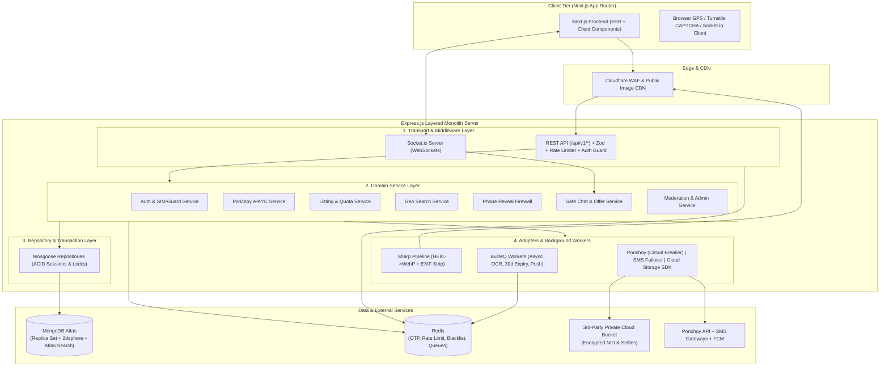

# System Architecture Document: Becha-Kena

* **Document Version:** 3.0.0 (Finalized — All Architectural Decisions Confirmed)
* **Based On:** [PRD.md](file:///c:/Users/musfi/Documents/becha-kena/PRD.md) (v4.0.0) & [requirement-validation.md](file:///c:/Users/musfi/Documents/becha-kena/requirement-validation.md)
* **Architecture Style:** **Layered Modular Monolith**
* **Tech Stack:**
  * **Frontend:** Next.js (App Router, TypeScript, Tailwind CSS)
  * **Backend:** Express.js (TypeScript, Layered Architecture, Socket.io)
  * **Database:** MongoDB Atlas (Mongoose ODM, GeoJSON `2dsphere`, Atlas Search, ACID Replica Set Transactions)
  * **Cache / Queues / Real-Time:** Redis (Rate Limits, OTPs, Blacklist, BullMQ, Socket.io Adapter)
  * **Storage & e-KYC:** 3rd-Party Cloud Storage (Private Bucket + Public CDN) & Porichoy API

---

## 1. Architecture Overview & Layering Principles

To ensure rapid MVP velocity, strict code maintainability, and clean separation of concerns without microservice overhead, the backend is built as a **Strict 4-Layer Modular Monolith**:

1. **Presentation / Transport Layer (`routes/`, `middlewares/`, `controllers/`, `sockets/`):**
   * Handles HTTP/WebSocket parsing, Zod request validation, JWT cookie extraction, RBAC checks, and rate-limiting. Zero business logic lives here.
2. **Business Logic / Service Layer (`services/`):**
   * Contains all core domain rules (e.g., 5-listing quota enforcement, Click-to-Reveal 7-day exemption, Bait-and-Switch edit check, Chat URL/Profanity filtering, Porichoy KYC orchestration).
3. **Data Access / Repository Layer (`repositories/`, `models/`):**
   * Encapsulates MongoDB Atlas / Mongoose queries, `2dsphere` geospatial aggregations, and ACID transaction sessions.
4. **Infrastructure & External Adapters Layer (`adapters/`, `jobs/`):**
   * Isolated wrappers for external third-party APIs (Porichoy API with Circuit Breaker, SMS Failover Gateway, S3/Cloudinary Private Storage, Sharp Image Pipeline, FCM Push, BullMQ Workers).

### Dependency Rule
```
[Transport/Controllers] ---> [Services] ---> [Repositories/Models] ---> [MongoDB Atlas]
                                 |
                                 +--------> [Infrastructure Adapters] ---> [Porichoy / S3 / Redis / SMS]
```
*(Strict top-down dependency: Repositories never call Services; Services never accept Express `req`/`res` objects).*

---

## 2. High-Level System Architecture Diagram



---

## 3. Recommended Codebase Structure (Monorepo Blueprint)

Using a TypeScript **pnpm workspace** allows sharing Zod validation schemas (`VAL-01` to `VAL-04`), TypeScript interfaces, and API error codes cleanly between Next.js and Express.js.

```text
becha-kena/
├── packages/
│   └── shared/                     # Shared between Next.js & Express.js
│       ├── validators/             # Zod schemas (phone, NID, listing, offer, BD GPS bounds)
│       ├── constants/              # Error codes, RBAC roles, category floors, ban reasons
│       └── types/                  # DTO interfaces & API response envelopes
├── apps/
│   ├── web/                        # Next.js (App Router) Frontend
│   │   ├── app/
│   │   │   ├── (public)/           # Home, Search Results, Product Details Page (SSR for SEO)
│   │   │   ├── (auth)/             # OTP Login, Phone Recovery flow
│   │   │   ├── (seller)/           # Seller Dashboard, Add/Edit Listing, KYC Wizard
│   │   │   ├── chat/               # Real-time In-App Chat UI
│   │   │   └── admin/              # Moderation, KYC Manual Review Queue, Kill Switch
│   │   ├── components/             # ClickToReveal, GpsPicker, ImageUploader, TurnstileWidget
│   │   └── lib/                    # Fetch wrapper (auto-refresh), Socket client
│   │
│   └── api/                        # Express.js Layered Monolith Backend
│       └── src/
│           ├── config/             # Env, MongoDB Atlas, Redis, S3/Cloudinary configs
│           ├── api/                # Layer 1: Routes, Controllers, Middlewares (Auth, RBAC, Zod)
│           │   ├── middlewares/
│           │   ├── routes/v1/
│           │   └── sockets/        # Socket.io namespaces, auth handshake, chat handlers
│           ├── services/           # Layer 2: Business Logic Services
│           ├── repositories/       # Layer 3: Mongoose Models & Data Access
│           ├── adapters/           # Layer 4: Porichoy, SMS Failover, Private Storage, Sharp, FCM
│           ├── jobs/               # BullMQ Workers & Cron (30d Expiry, OCR Check, Push)
│           ├── utils/              # HMAC-SHA256 NID hasher, Profanity/URL regex filter
│           ├── app.ts              # Express app setup
│           └── server.ts           # HTTP + Socket.io + Graceful Shutdown
```

### 3.1 Next.js Rendering Boundary Decisions

Clear SSR vs. CSR boundaries are critical for SEO performance, auth security, and Core Web Vitals:

| Page / Component | Rendering Strategy | Reason |
| :--- | :--- | :--- |
| **Home / Category Feed** | **SSR (Server Component)** | SEO-critical; listing cards pre-rendered for crawlers. Auth cookie read server-side to personalize sort. |
| **Search Results** | **SSR + Client Pagination** | First page SSR for SEO; subsequent cursor pages fetched client-side via `useIntersectionObserver` infinite scroll. |
| **Product Details Page (PDP)** | **SSR (Server Component)** | Full listing content SSR for Open Graph / WhatsApp share previews. |
| **"Click to Reveal" Button** | **Client Component (`'use client'`)** | Requires browser-side OTP login modal, rate-limit feedback, and `tel:` link activation. |
| **Seller Dashboard** | **Client Component (CSR)** | Private, no SEO needed; real-time quota meter and listing CRUD are interactive. Auth verified via middleware `matcher` before page renders. |
| **KYC Wizard (Camera/NID Upload)** | **Client Component (`'use client'`)** | Requires browser camera API (`getUserMedia`), live selfie, and file upload — cannot be SSR. |
| **In-App Chat** | **Client Component (`'use client'`)** | Socket.io connection requires browser environment; real-time message rendering. Thread list SSR, messages CSR. |
| **Admin Panel Pages** | **SSR (Server Component + Role Middleware)** | Role checked in `middleware.ts` (Edge Runtime) before rendering. Sensitive data never sent to browser until auth confirmed. |

---

## 4. Database Architecture (MongoDB Atlas Adaptation)

Since the PRD (`PRD.md` v3.0.0) specified relational SQL features (PostGIS, `SELECT ... FOR UPDATE`, `JSONB`), migrating to **MongoDB Atlas** requires specific NoSQL architectural adaptations to guarantee the exact same data integrity and geospatial performance:

### 4.1 Key MongoDB Atlas Architectural Adaptations

| PRD Feature | SQL Concept (Old) | MongoDB Atlas Recommended Implementation |
| :--- | :--- | :--- |
| **Geospatial Radius Search** | PostGIS `ST_DWithin` | **GeoJSON Point (`[lng, lat]`)** + **`2dsphere` Index** + `$geoNear` aggregation pipeline. *(Note: MongoDB strictly enforces `[longitude, latitude]` order).* |
| **5-Listing Quota Race Lock** | `SELECT ... FOR UPDATE` | **MongoDB Multi-Document ACID Transaction** (`session.withTransaction`) + atomic counter `activeListingCount` on `users` collection checked with `$lt: 5`. |
| **Concurrent Offer Lock** | SQL Row Lock + `version` | Mongoose `optimisticConcurrency: true` (`__v` check) OR atomic `findOneAndUpdate({ _id, status: 'ACTIVE', __v }, { $set: { status: 'RESERVED' }, $inc: { __v: 1 } })`. |
| **Full-Text + Typo Search** | Postgres Full-Text | **MongoDB Atlas Search** (`$search` with `fuzzy` autocomplete + `geoWithin` compound operator). |
| **90-Day Deleted Evidence** | Manual Purge | **MongoDB TTL Index** (`expireAfterSeconds`) on archived `reports` / deleted snapshots, or `expiresAt` field on temporary tokens. |

### 4.2 MongoDB Collection & Index Design

#### 1. `users`
* **Document Fields:** `_id` (ObjectId/UUID), `phoneNumber` (unique E.164), `displayName`, `accountPinHash` (optional SIM-guard PIN), `role` (`USER | MODERATOR | COMPLIANCE_OFFICER | ADMIN_LEAD`), `isSellerVerified` (bool), `activeListingCount` (int, default 0 — prevents quota race conditions), `trustScore` (decimal), `completedDealsCount` (int), `status` (`ACTIVE | SUSPENDED | BANNED | DELETED`), `lastActiveAt` (Date), `deviceIds` ([string]), `createdAt`, `deletedAt`.
* **Indexes:** `{ phoneNumber: 1 }` (unique), `{ status: 1, lastActiveAt: 1 }`.

#### 1b. `categories` *(Admin-Seeded, Rarely Mutated)*
* **Document Fields:** `_id`, `name`, `slug` (URL-safe unique), `parentId` (Nullable ObjectId ref `categories` — `null` for Level 1 roots), `level` (1, 2, or 3), `minPriceBDT` (Number), `maxPriceBDT` (Number, Nullable), `attributeSchema` (Mixed JSON — defines optional structured fields for listings in this category, e.g., `{ brand: 'string', storageGB: 'number' }`), `isActive` (Boolean), `sortOrder` (Number), `createdAt`.
* **Indexes:** `{ slug: 1 }` (unique), `{ parentId: 1, sortOrder: 1 }` (tree traversal).
* **Caching Strategy:** Since categories rarely change, the full category tree is **cached in Redis** (`categories:tree` key, `EX 3600`) on first request and invalidated on Admin update. Next.js fetches the tree at build time for static rendering of category navigation.

#### 2. `identity_verifications`
* **Document Fields:** `_id`, `userId` (ref `users`), `verificationType` (`ADULT_SELF | MINOR_GUARDIAN`), `guardianRelationship`, `canonicalNidHash` (HMAC-SHA-256 of Porichoy-resolved 10-digit ID), `compositeDobHash`, `minorCountUnderGuardian` (or tracked via aggregation), `livenessScore`, `storageKeys` (`{ frontKey, backKey, selfieKey }` — private bucket paths only), `porichoyRefId`, `status` (`PENDING | APPROVED | REJECTED | MANUAL_REVIEW`), `rejectionReason`, `reviewedByAdminId`, `verifiedAt`.
* **Indexes:** `{ canonicalNidHash: 1 }` (unique partial index for `ADULT_SELF`, non-unique or max-2 enforced in transaction for `MINOR_GUARDIAN`), `{ status: 1, createdAt: 1 }` (Admin queue).

#### 3. `listings`
* **Document Fields:** `_id`, `sellerId` (ref `users`), `sellerSnapshot` (embedded `{ displayName, isSellerVerified, trustScore, avatarUrl }` — **WARNING: stale cache risk; see invalidation strategy below**), `categoryId` (ref `categories`), `title`, `description`, `condition`, `price` (Number), `isNegotiable` (bool), `contactPhone` (E.164 — listing-specific contact, defaults to seller's `phoneNumber`, revealed by Click-to-Reveal), `location` (`{ type: 'Point', coordinates: [lng, lat] }`), `address` (`{ division, district, thana }`), `attributes` (Mixed JSON — category-specific structured fields: `{ brand, model, storageGB, ramGB }` for mobiles etc.), `images` (embedded array `[{ cdnUrl, r2Key, sortOrder, ocrFlagged }]`), `coverImageUrl`, `status` (`ACTIVE | UNDER_REVIEW | RESERVED | SOLD | EXPIRED | DELETED`), `reservedBuyerId`, `soldToBuyerId`, `dealConfirmedByBuyer` (bool), `viewsCount` (Number — updated via Redis increment, see strategy below), `expiresAt` (Date: `+30 days`), `deletedAt`, `__v` (optimistic lock).
* **Indexes:**
  * `{ location: '2dsphere' }` (Proximity search)
  * `{ status: 1, categoryId: 1, createdAt: -1 }` (Category feed)
  * `{ sellerId: 1, status: 1 }` (Seller Dashboard)
  * `{ status: 1, expiresAt: 1 }` (Expiry cron worker)
  * **Atlas Search Index:** On `title`, `description`, `address.thana`, `location`, `attributes.brand`, `attributes.model`.

> [!WARNING] **`sellerSnapshot` Invalidation Strategy:**
> Because seller trust score, verification status, and display name are **embedded** in potentially thousands of `listings` documents for read performance, stale data is a real risk when a seller's profile changes (ban, KYC revoke, new reviews). The following strategy ensures consistency without expensive per-request joins:
> * **Trigger:** Whenever `users.isSellerVerified`, `users.trustScore`, `users.status`, or `users.displayName` changes (ban, KYC approval, review submission), a **BullMQ job** is enqueued to `snapshot_sync_queue` with the `sellerId`.
> * **Worker Action:** The worker runs `db.listings.updateMany({ sellerId, status: { $in: ['ACTIVE','RESERVED','UNDER_REVIEW'] } }, { $set: { 'sellerSnapshot.isSellerVerified': newVal, 'sellerSnapshot.trustScore': newVal } })`.
> * **Ban Fast-Path:** When an Admin executes a ban (`users.status = 'BANNED'`), the sync runs **synchronously inline** (not via queue) to immediately remove the "NID Verified" badge from all the banned seller's active listings before they can be browsed again.
> * **Acceptable Staleness:** For non-ban updates (e.g., trust score changes), queue lag of up to 30 seconds is acceptable since it only affects score display, not safety.

> [!TIP] **`viewsCount` Update Strategy (Avoiding Write Contention):**
> Incrementing `viewsCount` via MongoDB `$inc` on every PDP page load on a popular listing would create a write-heavy hotspot. Use a **Redis-buffered counter** pattern instead:
> * On every `GET /listings/:id` hit by a non-owner user, the API does `INCR views:{listingId}` in Redis (< 1ms, no DB write).
> * A **BullMQ cron job** runs every **5 minutes**, batches all `views:{listingId}` keys, flushes them to MongoDB using `bulkWrite([{ updateOne: { filter: { _id }, update: { $inc: { viewsCount: redisCount } } } }])`, and deletes the Redis keys.
> * **Bot/Guest Filtering:** Only authenticated users' views (valid JWT session) increment the Redis counter. Guest/unauthenticated views are tracked separately for analytics but excluded from the public `viewsCount` displayed on the listing.

#### 4. `phone_reveal_logs`
* **Document Fields:** `_id`, `listingId`, `sellerId`, `buyerId`, `ipAddress`, `deviceId`, `revealedAt` (Date).
* **Indexes:** `{ buyerId: 1, listingId: 1, revealedAt: -1 }` (for instant 7-day re-view exemption check).

#### 5. `chat_threads` & `messages` (Separate Collections for Scalability)
* **`chat_threads`:** `_id`, `listingId`, `buyerId`, `sellerId`, `listingSnapshot` (`{ title, price, thumbnail, status }`), `lastMessage` (`{ body, senderId, createdAt }`), `isLocked` (bool), `lockReason`, `updatedAt`.
  * *Index:* `{ listingId: 1, buyerId: 1 }` (unique), `{ buyerId: 1, updatedAt: -1 }`, `{ sellerId: 1, updatedAt: -1 }`.
* **`messages`:** `_id`, `threadId`, `clientMessageId` (UUID), `senderId`, `type` (`TEXT | IMAGE | OFFER | SYSTEM`), `body`, `mediaUrl`, `offer` (`{ amount, status }`), `moderationFlag`, `createdAt`.
  * *Index:* `{ threadId: 1, createdAt: -1 }` (cursor pagination), `{ threadId: 1, clientMessageId: 1 }` (unique idempotency index).

#### 6. `reviews`, `reports`, `ban_appeals`, `admin_audit_logs`
* **`reviews`:** `_id`, `listingId`, `reviewerId`, `revieweeId`, `rating`, `comment`, `editableUntil` (`+48h`), `createdAt`. (Unique compound index `{ listingId: 1, reviewerId: 1 }`).
* **`reports`:** `_id`, `reporterId`, `targetUserId`, `listingId`, `reason`, `evidenceSnapshot` (Mixed JSON), `status`, `createdAt`.
* **`admin_audit_logs`:** Append-only collection `{ _id, adminId, action, targetId, ipAddress, createdAt }`.

---

## 5. Better Approaches & Service Recommendations

Based on `PRD.md` (v3.0.0) and our chosen stack (**Next.js + Express.js + MongoDB Atlas**), here are the optimal architectural approaches for each core service:

### 5.1 Authentication & Session Approach (`AuthService`)
* **Recommended Pattern:** **OTP via Redis + HttpOnly Cookie Dual-Token JWT**
  1. **Why HttpOnly Cookies instead of `localStorage`?** Storing JWTs in `localStorage` makes your marketplace vulnerable to XSS stealing verified seller sessions. Using **HttpOnly, Secure, SameSite=Lax Cookies** allows Next.js Server Components (`app/(seller)/dashboard`) to verify auth securely during SSR before rendering HTML!
  2. **Same-Origin Proxy Trick:** Configure Next.js (`next.config.ts` rewrites or shared root domain `api.bechakena.com` & `bechakena.com`) so Express cookies are treated as first-party cookies without third-party cookie blocking on Safari/iOS.
  3. **Token Lifecycle:**
     * **Access Token (JWT):** Short-lived **15 minutes** (contains `userId`, `role`, `isSellerVerified`).
     * **Refresh Token:** **30 days** opaque UUID stored hashed in Redis/MongoDB, rotated on every use (automatic theft detection).
  4. **OTP Storage in Redis:** Store `otp:{phone}` as an HMAC hash in Redis with `EX 180` and `otp_attempts:{phone}` counter (`max 3`). Faster and cleaner than writing temporary OTP docs to MongoDB.
  5. **Instant Ban Revocation:** Maintain a Redis Set `banned_users`. Middleware checks `SISMEMBER banned_users userId` in `< 1ms` on sensitive API calls and every Socket.io event.

### 5.2 API Architecture & Validation Approach
* **Recommended Pattern:** **RESTful `/api/v1` + Shared Zod Contracts + Cursor Pagination**
  1. **Unified Error & Response Envelope:** Standardize every Express response (`{ success, data, error: { code, message, details }, meta: { nextCursor } }`).
  2. **Zod Middleware Validation:** Put all `VAL-01` to `VAL-04` rules inside `packages/shared/validators`. Both Next.js forms (React Hook Form + Zod) and Express API routes validate against the exact same schema.
  3. **Cursor-Based Pagination:** Use cursor pagination (`?cursor=<last_id_or_distance>&limit=20`) instead of `page=5` (`skip()`), because `skip(1000)` degrades MongoDB Atlas performance severely.
  4. **Idempotency Keys:** Require `Idempotency-Key` header on `POST /listings` and `POST /kyc/submit` so flaky 3G/4G retries in Bangladesh never create duplicate ads or double-charge Porichoy API!

### 5.3 e-KYC, Cloud Storage & Image Pipeline Approach
* **Recommended Pattern:** **Direct Signed Uploads for NID + Backend Sharp Stream for Public Photos**
  1. **NID & Liveness Selfies (Zero Server Touch on Upload):**
     * Express generates a **5-minute S3/R2 Pre-Signed PUT URL** (`POST /api/v1/kyc/upload-urls`).
     * Next.js uploads the raw NID front/back & selfie directly to the Private Cloud Bucket.
     * Next.js calls `POST /api/v1/kyc/submit` with only the object keys.
     * `KycService` downloads the images in memory via private IAM credentials, extracts OCR + calls **Porichoy API** (wrapped in an `opossum` Circuit Breaker), computes the Canonical NID Hash (`HMAC-SHA-256`), and discards memory buffers.
     * *Why better?* Keeps sensitive NID images out of Express temp disk/logs and reduces Express bandwidth load by 80%.
  2. **Public Listing Photos (Per-Image Async Pipeline):**
     * Next.js uploads listing images one-by-one (`POST /api/v1/media/upload-listing-photo`) using **Multer memory storage** (max 10MB).
     * Express checks **Magic Bytes** (`file-type` package) $\rightarrow$ passes through **Sharp** (`sharp(buffer).rotate().resize(1200).webp({ quality: 80 })`). Calling `.rotate()` without `.withMetadata()` **automatically strips 100% of EXIF GPS coordinates and camera metadata**!
     * Uploads clean `< 300KB` WebP to Public CDN bucket (Cloudflare R2 / S3+CloudFront / Cloudinary) and returns the `cdnUrl`.
     * Enqueues a **BullMQ async job** to scan the `cdnUrl` with lightweight OCR (flagging photos that have phone numbers handwritten on paper).

### 5.4 Geospatial Search & Click-to-Reveal Firewall Approach
* **Recommended Pattern:** **MongoDB Atlas Search + Redis Sliding-Window Rate Limit**
  1. **Search Query:** Use **MongoDB Atlas Search** (`$search` aggregation) combining text relevance (`title`, `description`) + `geoWithin` (`circle` around buyer's GPS lat/lng) + `range` (`price`) + `equals` (`status: 'ACTIVE'`).
  2. **Fallback:** If GPS is denied, Next.js opens a Division > District > Thana selector and passes the pre-seeded Thana centroid `[lng, lat]` to the same endpoint.
  3. **Click-to-Reveal (`RevealService`):**
     * Standard `GET /api/v1/listings/:id` strictly projects out the phone number and returns masked `017XX-XXXXXX`.
     * `POST /api/v1/listings/:id/reveal-phone`:
       1. Verifies `listing.status === 'ACTIVE'` and `listing.sellerId !== req.user.id`.
       2. Checks `PhoneRevealLogs.findOne({ buyerId, listingId, revealedAt: { $gte: 7DaysAgo } })`. If found $\rightarrow$ return unmasked number immediately (**7-Day Free Re-View Exception**).
       3. Otherwise, increments Redis Sliding-Window counters (`reveal:user:{id}`, `reveal:device:{id}`, `reveal:subnet:{ip24}`). If within `5/hr & 20/day`, inserts `PhoneRevealLog` and returns full number.

### 5.5 Real-Time Chat & Background Worker Approach
* **Recommended Pattern:** **Socket.io + Redis Pub/Sub + BullMQ**
  1. **Socket.io Inside Monolith:** Attach Socket.io to the Express HTTP server. Authenticate handshake using the same HttpOnly JWT cookie.
  2. **Chat Safety Filter (`ChatSafetyUtil`):** Run synchronously in memory (`< 5ms`) on every `send_message` event:
     * **Hard Block:** URL regex + obfuscated domain detection (`[dot]`, `wa.me`, `t.me`) and word-boundary (`\b`) Bengali/Banglish/English profanity dictionary. Reject with socket ACK error `{ blocked: true, reason }`.
     * **Soft Warning:** Detect `bKash`, `Nagad`, `advance`, `courier`; persist message with `moderationFlag: 'SCAM_WARNING'` so Next.js renders the inline warning banner.
  3. **Idempotency & Offline Push:** Insert message into MongoDB with unique `(threadId, clientMessageId)`. Check Redis presence (`online_users`); if recipient is offline, push job to BullMQ `notification_queue` to trigger **FCM Push Notification**.

### 5.6 BullMQ Queue Architecture (Priority, Retry & Dead Letter Strategy)

All background work runs through **named BullMQ queues** backed by the same Redis instance. Each queue has explicit priority, retry, and failure handling:

| Queue Name | Priority | Max Retries | Backoff | Dead Letter Action |
| :--- | :---: | :---: | :--- | :--- |
| `kyc_notification_queue` | **Critical (1)** | 5 | Exponential (2s base) | Log to `admin_audit_logs` + Alert Slack/PagerDuty |
| `snapshot_sync_queue` | **High (2)** | 3 | Fixed 5s | Re-enqueue + notify Admin if seller ban sync fails |
| `notification_push_queue` | **High (2)** | 3 | Exponential (1s base) | Log failed push; skip (non-blocking) |
| `trust_score_recalc_queue` | **Normal (3)** | 3 | Fixed 10s | Discard; will recalc on next review trigger |
| `image_ocr_scan_queue` | **Normal (3)** | 2 | Fixed 30s | Flag listing for manual image review |
| `views_flush_cron` | **Low (5)** | 1 | None | Discard stale Redis view keys; acceptable data loss |
| `listing_expiry_cron` | **Low (5)** | 2 | Fixed 60s | Retry; alert Admin if expiry cron fails repeatedly |

* **Concurrency:** `kyc_notification` and `snapshot_sync` workers run with `concurrency: 1` per queue to avoid race conditions. All other workers use `concurrency: 5`.
* **DLQ Pattern:** Failed jobs exceeding max retries are moved to a `dead_letter` queue in Redis. A daily BullMQ Board admin dashboard (or custom Admin panel endpoint `GET /admin/queue-health`) surfaces DLQ count and oldest job age for manual inspection.

### 5.7 Admin Panel Architecture

The Admin panel requires distinct authentication (2FA) and operates on sensitive data. Two architectural options exist; the recommended approach is below:

**Recommended: Integrated Admin Routes within the Same Next.js App (`/admin/*`)**
* The `app/admin/` Next.js route group is protected server-side via **Role-Based Middleware** checking the `role` field in the verified JWT cookie (`MODERATOR | COMPLIANCE_OFFICER | ADMIN_LEAD`).
* **Admin 2FA:** Admin users authenticate via Phone OTP first (same as users), then are presented with a **TOTP (Time-based One-Time Password)** second factor (Google Authenticator / Authy) on first login from any new device. Subsequent logins from recognized devices require only Phone OTP + PIN. TOTP secrets are stored encrypted in MongoDB `admin_2fa_secrets` collection.
* **Sensitive Actions (Kill Switch, Warrant Export):** Endpoints `POST /admin/users/:id/ban` and `POST /admin/export-warrant` require a fresh TOTP code on every invocation (even from recognized devices), logged in `admin_audit_logs`.
* **Admin Routing:**
  * `/admin/kyc-queue` — Manual KYC review panel (COMPLIANCE_OFFICER+)
  * `/admin/listings` — Flagged listing moderation (MODERATOR+)
  * `/admin/users` — User search, warning, suspend, ban, appeal resolution (ADMIN_LEAD)
  * `/admin/queue-health` — BullMQ dead letter queue inspector (ADMIN_LEAD)
  * `/admin/reports` — Report inbox with evidence snapshots (MODERATOR+)

---

## 6. Core API Endpoint Blueprint (`/api/v1`)

| Domain | Method & Endpoint | Auth / Permission | Purpose |
| :--- | :--- | :--- | :--- |
| **Auth** | `POST /auth/otp/request` | Public + Turnstile | Send OTP (Redis + Failover SMS) |
| **Auth** | `POST /auth/otp/verify` | Public | Verify OTP, set HttpOnly JWT + Refresh Cookies |
| **Auth** | `POST /auth/refresh` | Refresh Cookie | Rotate tokens cleanly |
| **Auth** | `POST /auth/phone-migration` | Authenticated | Recover account via NID+Selfie match (`MF-01`) |
| **KYC** | `POST /kyc/upload-urls` | `USER` | Generate 5-min Private S3/Cloud Put URLs |
| **KYC** | `POST /kyc/submit` | `USER` + Idempotency | Trigger Porichoy OCR/Face verification (Adult/U18) |
| **KYC** | `POST /kyc/upgrade-adult` | `MINOR_GUARDIAN` | Minor turning 18 submits own Smart NID (`MF-04`) |
| **Search** | `GET /listings` | Public | Atlas Search + GeoJSON radius + Cursor pagination |
| **PDP** | `GET /listings/:id` | Public | Listing specs, Seller Trust Card, Masked phone |
| **PDP** | `POST /listings/:id/reveal-phone` | Logged-In User | Rate-limited reveal + 7-day re-view exemption |
| **Media** | `POST /media/upload-photo` | `VERIFIED_SELLER` | Single photo upload $\rightarrow$ Magic Bytes $\rightarrow$ Sharp WebP (No EXIF) |
| **Seller** | `GET /seller/dashboard` | `VERIFIED_SELLER` | KPIs, active/sold/expired tabs, 5-ad quota meter |
| **Seller** | `POST /listings` | `VERIFIED_SELLER` | Atomic transaction incrementing `activeListingCount < 5` |
| **Seller** | `PATCH /listings/:id` | Owner (`VERIFIED_SELLER`) | Edit listing (triggers `UNDER_REVIEW` if major change) |
| **Seller** | `DELETE /listings/:id` | Owner (`VERIFIED_SELLER`) | Soft delete, decr quota, lock active chats |
| **Seller** | `POST /listings/:id/renew` | Owner (`VERIFIED_SELLER`) | 1-click 30-day renewal if quota < 5 |
| **Deal** | `POST /listings/:id/mark-sold` | Owner (`VERIFIED_SELLER`) | Select buyer from Chats or `PhoneRevealLogs` |
| **Deal** | `POST /listings/:id/confirm-purchase` | Selected Buyer | Confirm purchase $\rightarrow$ unlock 48h mutual review |
| **Chat** | `GET /chats/threads` | Logged-In User | Cursor-paginated inbox |
| **Chat** | `GET /chats/threads/:id/messages` | Thread Participant | Cursor-paginated history + Offers |
| **Admin** | `GET /admin/kyc-queue` | `COMPLIANCE_OFFICER+` | Manual review queue + Audited signed URLs |
| **Admin** | `POST /admin/users/:id/ban` | `ADMIN_LEAD` + 2FA | Global Kill Switch (Redis + MongoDB NID blacklist) |

---

## 7. Deployment & Infrastructure Recommendations (MVP Cost-Effective)

| Component | Recommended Service (MVP) | Why This Fits Bangladesh Market & Budget |
| :--- | :--- | :--- |
| **Next.js Frontend** | **Vercel** (Singapore `sin1` region) or CloudFront/Docker | Lowest latency to Dhaka (~35–45ms RTT) + zero-config SSR & Edge caching. |
| **Express.js Backend** | **DigitalOcean / AWS EC2 / Railway** (Singapore `sgp1`) | Co-located in Singapore (`sin1`/`sgp1`) right next to MongoDB Atlas & Vercel so API calls stay < 5ms! |
| **MongoDB Atlas** | **Atlas M10 Dedicated Cluster** (AWS Singapore `ap-southeast-1`) | M10+ is required for dedicated **Replica Set Transactions**, consistent **Atlas Search**, and VPC peering. *(Free M0 lacks production SLA & heavy geo throughput).* |
| **Redis** | **Upstash Redis** or DigitalOcean Managed Redis (Singapore) | Serverless/managed low-latency Redis for OTPs, rate limits, and BullMQ. |
| **Cloud Storage** | **Cloudflare R2** (or AWS S3 Singapore) | Private bucket for NIDs + Public R2 bucket with Cloudflare CDN (zero egress fees on public product photos!). |

---

## 8. Confirmed Architectural Decisions ✅

All decisions below have been explicitly confirmed by the product owner on 2026-11-14.

| # | Decision | Choice | Rationale |
|:--|:---------|:-------|:----------|
| 1 | **Repository Structure** | **pnpm Monorepo** (`apps/web` + `apps/api` + `packages/shared`) | Single source of truth for Zod schemas and DTO types across frontend and backend. Zero schema drift. |
| 2 | **Cloud Storage Provider** | **Cloudflare R2** | S3-compatible API, private bucket for NID/selfie documents, public bucket with Cloudflare CDN for listing photos. **$0 CDN egress fees** saves significant cost at scale. |
| 3 | **Auth Session Strategy** | **HttpOnly Secure `SameSite=Lax` Cookies** | Immune to XSS token theft. Compatible with Next.js SSR (server can read cookie on every request). Access Token: 15 min, Refresh Token: 30-day rotating. |
| 4 | **Search Engine** | **MongoDB Atlas Search** (`$search` aggregation pipeline) | Built into Atlas M10+ dedicated cluster — no extra infrastructure, no DevOps overhead. Supports full-text, fuzzy, autocomplete, and geo-filter in a single aggregation stage. |


