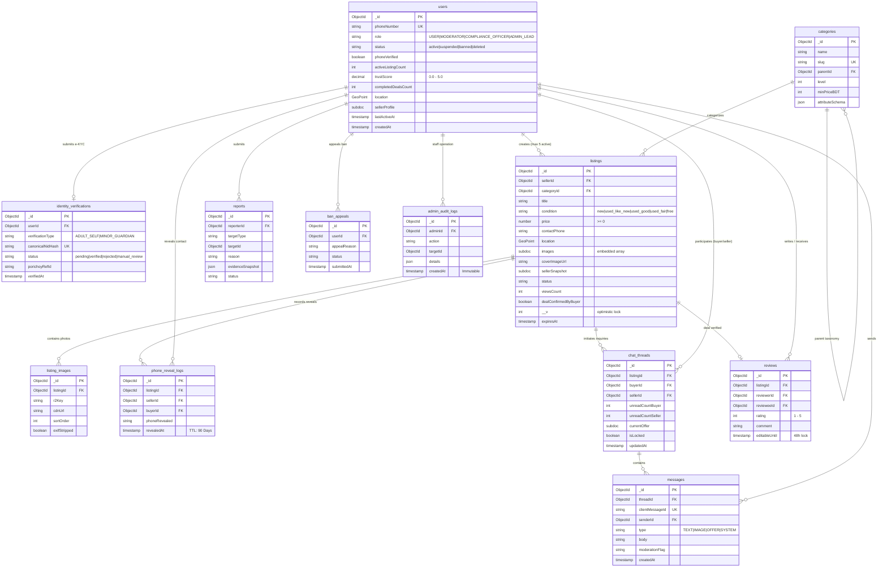

# Database Architecture & Specification: Becha-Kena

* **Document Version:** 1.0.0 (Comprehensive Technical Reference)
* **Based On:** [PRD.md](file:///c:/Users/musfi/Documents/becha-kena/PRD.md) (v4.0.0), [architecture.md](file:///c:/Users/musfi/Documents/becha-kena/architecture.md) (v3.0.0), and [dfd.md](file:///c:/Users/musfi/Documents/becha-kena/dfd.md) (v1.0.0)
* **Database Engine:** **MongoDB Atlas Dedicated Cluster (M10+)**
* **ODM / Driver:** Mongoose v8+ with TypeScript
* **Geospatial Model:** WGS 84 GeoJSON (`Point`, `2dsphere` index, `[lng, lat]` coordinate order)
* **Status:** Final & Complete

---

## Table of Contents
1. [Collection List](#1-collection-list)
2. [Data Schema Specifications](#2-data-schema-specifications)
3. [Relationships & Embedding Strategy](#3-relationships--embedding-strategy)
4. [Index Strategy & Query Optimization](#4-index-strategy--query-optimization)
5. [Validation Rules & Schema Guards](#5-validation-rules--schema-guards)
6. [Key Aggregation Pipelines](#6-key-aggregation-pipelines)
7. [Multi-Document ACID Transactions](#7-multi-document-acid-transactions)
8. [Sample Production Data](#8-sample-production-data)
9. [Mongoose Schema & Model Implementation](#9-mongoose-schema--model-implementation)
10. [Entity-Relationship Diagram (ERD)](#10-entity-relationship-diagram-erd)

---

## 1. Collection List

The Becha-Kena platform uses **12 core collections** inside MongoDB Atlas, designed with strict separation between transactional entities, append-only logs, and ephemeral buffers.

| Collection Name | Storage Model | Purpose & Description | PRD / DFD Reference |
|:---|:---|:---|:---|
| **`users`** | Core Entity | Unified user account model (buyer, seller, admin), phone auth, KYC status, trust score, and active listing quota counter. | D1, FR-AUTH, FR-KYC |
| **`identity_verifications`** | Sensitive Entity | e-KYC submissions, Porichoy reference IDs, canonical NID hash (`HMAC-SHA-256`), and compliance review trail. | D2, FR-KYC-01 to 04 |
| **`categories`** | Taxonomy Store | 3-level hierarchical category tree, dynamic attribute schemas, and minimum price floors (`minPriceBDT`). Cached in Redis. | D3, FR-CAT-01 to 03 |
| **`listings`** | Core Entity | Product advertisements, asking prices, GeoJSON location point, embedded seller snapshot, views counter, and lifecycle state. | D4, FR-LST, FR-PDP |
| **`listing_images`** | Media Store | Processed WebP images ($<300\text{KB}$) stored in Cloudflare R2 public bucket with stripped EXIF GPS metadata. | D4, FR-LST-02 |
| **`phone_reveal_logs`** | Ephemeral Audit Log | Time-stamped records of Click-to-Reveal actions for rate-limiting, 7-day free re-views, and 90-day fraud audit trail. Auto-purged via TTL index. | D5, FR-PDP-02 |
| **`chat_threads`** | Negotiation Channel | 1-to-1 conversation channels per buyer per listing (`{ listingId, buyerId }`), latest message previews, and active price offers. | D6, FR-CHT-04 |
| **`messages`** | Messaging Entity | Real-time messages, image attachments, price proposals, client-side UUID idempotency, and safety moderation flags (`SCAM_WARNING`). | D6, FR-CHT-01 to 03 |
| **`reviews`** | Social Proof | Deal-attributed 1-to-5 star ratings and reviews, unlocked post-deal confirmation with a permanent 48-hour edit lock. | D7, FR-MOD-01, 03 |
| **`reports`** | Trust & Safety | User/listing abuse tickets, scam complaints, and 90-day immutable listing/chat JSON snapshots. | D7, FR-MOD-02 |
| **`ban_appeals`** | Compliance Ticket | Dispute records submitted by suspended/banned users, routed to the Admin Compliance Officer queue. | D7, FR-MOD-02 |
| **`admin_audit_logs`** | Security Audit Trail | Strictly append-only, immutable record of all privileged staff operations (Kill Switch, manual KYC override, warrant exports). | D7, SEC-07, PERM-05 |
| **`admin_2fa_secrets`** | Security Secret | AES-256-GCM encrypted TOTP secrets and recognized devices for staff 2FA (`architecture.md §5.7`, Decision D-04). | Arch §5.7, PERM-05 |
| **`notifications`** | In-App Alert Store | Persistent in-app notifications backing PRD §6 Event & Notification Matrix with 90-day TTL (Decision D-05). | PRD §6 |

---

## 2. Data Schema Specifications

> **Dedicated Schema Reference:** For the complete, standalone schema documentation and detailed field specification tables, see [database-schema.md](file:///c:/Users/musfi/Documents/becha-kena/database-schema.md).

### 2.1 `users`
* `_id`: `ObjectId` (Primary Key).
* `phoneNumber`: `String` (Unique, E.164 format `+8801XXXXXXXXX`).
* `role`: `String` (`'USER' | 'MODERATOR' | 'COMPLIANCE_OFFICER' | 'ADMIN_LEAD'`). Default: `'USER'`.
* `status`: `String` (`'active' | 'suspended' | 'banned' | 'deleted'`). Default: `'active'`.
* `phoneVerified`: `Boolean`. Default: `true` (registered via OTP).
* `accountPinHash`: `String` (Nullable, bcrypt hash for SIM-guard PIN `FR-AUTH-03`).
* `activeListingCount`: `Number` (Integer, default `0`, range `0-5`). Used for ACID quota race-locks (`FR-LST-01`).
* `trustScore`: `Number` (Decimal `0.0 - 5.0`, default `0.0` for new sellers without completed deals).
* `completedDealsCount`: `Number` (Integer, default `0`).
* `location`: `GeoJSON Point` (`{ type: 'Point', coordinates: [lng, lat] }`).
* `manualLocation`: `Subdocument` (`{ division: String, district: String, thana: String }`).
* `sellerProfile`: `Subdocument`:
  * `displayName`: `String` (3-50 chars).
  * `bio`: `String` (max 500 chars).
  * `businessName`: `String` (Nullable, optional commercial title).
  * `avatarUrl`: `String` (Nullable CDN URL).
  * `kycStatus`: `String` (`'pending' | 'verified' | 'rejected' | 'manual_review'`).
  * `isSellerVerified`: `Boolean`. Default: `false`.
  * `verifiedAt`: `Date` (Nullable).
* `deviceIds`: `[String]` (Tracked device IDs for multi-dimensional fraud checks).
* `fcmToken`: `String` (Nullable, for mobile background push notifications).
* `notificationPrefs`: `Subdocument` (`{ newMessage: Boolean, offerUpdates: Boolean, listingExpiry: Boolean, dealConfirmation: Boolean }`).
* `bannedAt`: `Date` (Nullable).
* `banReason`: `String` (Nullable).
* `lastActiveAt`: `Date` (Indexed for active user tracking).
* `deletedAt`: `Date` (Nullable, soft-delete timestamp).
* `createdAt`, `updatedAt`: `Date` (Mongoose timestamps).

### 2.2 `identity_verifications`
* `_id`: `ObjectId`.
* `userId`: `ObjectId` (Ref: `users`).
* `verificationType`: `String` (`'ADULT_SELF' | 'MINOR_GUARDIAN'`).
* `status`: `String` (`'pending' | 'verified' | 'rejected' | 'manual_review'`). Default: `'pending'`.
* `canonicalNidHash`: `String` (HMAC-SHA-256 of Porichoy-resolved 10-digit Smart NID; `select: false`).
* `compositeDobHash`: `String` (HMAC-SHA-256 of `DOB + Name`; `select: false`).
* `guardianCanonicalNidHash`: `String` (Nullable, HMAC-SHA-256 of guardian's canonical Smart NID; `select: false`, sparse index for 2-minor quota & contamination rule).
* `guardianName`: `String` (Nullable, for minor accounts).
* `guardianRelationship`: `String` (`'FATHER' | 'MOTHER' | 'ADULT_SIBLING' | 'LEGAL_GUARDIAN'`, Nullable; Decision D-03).
* `storageKeys`: `Subdocument` (`{ frontKey: String, backKey: String, selfieKey: String }` in Cloudflare R2 private bucket; `select: false`).
* `porichoyRefId`: `String` (Transaction ID from Porichoy e-KYC API; `select: false`).
* `porichoyResponse`: `Mixed` (Raw payload stored encrypted for compliance audit; `select: false`).
* `livenessScore`: `Number` (Facial match confidence score `0-100`).
* `rejectionReason`: `String` (Nullable).
* `reviewedByAdminId`: `ObjectId` (Ref: `users`, Nullable).
* `reviewNote`: `String` (Nullable).
* `submittedAt`: `Date`.
* `verifiedAt`: `Date` (Nullable).
* `createdAt`, `updatedAt`: `Date`.

### 2.3 `categories`
* `_id`: `ObjectId`.
* `name`: `String` (e.g., `'Mobiles & Tablets'`).
* `slug`: `String` (Unique, URL-safe e.g., `'mobiles-tablets'`).
* `parentId`: `ObjectId` (Ref: `categories`, Nullable for Level 1 root categories).
* `level`: `Number` (`1 | 2 | 3`).
* `minPriceBDT`: `Number` (Minimum allowed listing price e.g., `500` for Mobiles; anti-spam guard `VAL-02`).
* `maxPriceBDT`: `Number` (Nullable maximum guard rail).
* `attributeSchema`: `[Subdocument]`:
  * `key`: `String` (e.g., `'storageGB'`).
  * `label`: `String` (e.g., `'Internal Storage'`).
  * `type`: `String` (`'text' | 'number' | 'select' | 'boolean'`).
  * `options`: `[String]` (e.g., `['64GB', '128GB', '256GB']`).
  * `required`: `Boolean`.
* `iconUrl`: `String` (Nullable).
* `sortOrder`: `Number` (Default `0`).
* `isActive`: `Boolean` (Default `true`).
* `createdAt`, `updatedAt`: `Date`.

### 2.4 `listings`
* `_id`: `ObjectId`.
* `sellerId`: `ObjectId` (Ref: `users`).
* `categoryId`: `ObjectId` (Ref: `categories`).
* `title`: `String` (5-100 chars; reject embedded phone/URL `VAL-03`).
* `description`: `String` (20-2,000 chars; reject embedded phone/URL `VAL-03`).
* `condition`: `String` (`'new' | 'used_like_new' | 'used_good' | 'used_fair' | 'free'`).
* `price`: `Number` (Asking price in BDT; $\ge \text{category.minPriceBDT}$ or strictly `0` if `condition === 'free'`).
* `isNegotiable`: `Boolean` (Default `true`).
* `contactPhone`: `String` (E.164 required; listing-specific contact number revealed via Click-to-Reveal).
* `location`: `GeoJSON Point` (`{ type: 'Point', coordinates: [longitude, latitude] }`).
* `address`: `Subdocument` (`{ division: String, district: String, thana: String }`).
* `attributes`: `Map of Mixed` (Dynamic key-value pairs validating against category `attributeSchema`).
* `images`: `[Subdocument]` (Embedded array `[{ cdnUrl: String, r2Key: String, sortOrder: Number, ocrFlagged: Boolean }]` for instantaneous zero-join feed rendering).
* `coverImageUrl`: `String` (Primary thumbnail CDN URL for search cards).
* `sellerSnapshot`: `Subdocument` (Denormalized cache for high-throughput listing feeds):
  * `displayName`: `String`.
  * `isSellerVerified`: `Boolean`.
  * `trustScore`: `Number`.
  * `avatarUrl`: `String` (Nullable).
* `status`: `String` (`'draft' | 'active' | 'under_review' | 'reserved' | 'sold' | 'expired' | 'deleted'`). Default: `'active'`.
* `viewsCount`: `Number` (Integer, default `0`, buffered in Redis).
* `reservedBuyerId`: `ObjectId` (Ref: `users`, Nullable).
* `soldToBuyerId`: `ObjectId` (Ref: `users`, Nullable).
* `soldAt`: `Date` (Nullable).
* `dealConfirmedByBuyer`: `Boolean` (Default `false`).
* `expiresAt`: `Date` (Auto-computed as `createdAt + 30 days`).
* `deletedAt`: `Date` (Nullable, soft-delete timestamp).
* `__v`: `Number` (Mongoose version key; used for optimistic concurrency control during offer acceptance).
* `createdAt`, `updatedAt`: `Date`.

### 2.5 `listing_images`
* `_id`: `ObjectId`.
* `listingId`: `ObjectId` (Ref: `listings`).
* `r2Key`: `String` (Cloudflare R2 public bucket path e.g., `listings/6735e0a0/image_01.webp`).
* `cdnUrl`: `String` (Public Cloudflare CDN URL).
* `sortOrder`: `Number` (`0-9`).
* `mimeType`: `String` (Strictly `image/webp`).
* `sizeBytes`: `Number` (Max `307,200` bytes = 300KB).
* `exifStripped`: `Boolean` (Must be `true`; enforced by Sharp pipeline `SEC-02`).
* `ocrChecked`: `Boolean` (Default `false`).
* `ocrFlagged`: `Boolean` (Flagged if written phone number detected in photo).
* `createdAt`: `Date`.

### 2.6 `phone_reveal_logs`
* `_id`: `ObjectId`.
* `listingId`: `ObjectId` (Ref: `listings`).
* `sellerId`: `ObjectId` (Ref: `users`).
* `buyerId`: `ObjectId` (Ref: `users`).
* `phoneRevealed`: `String` (The unmasked E.164 phone string; `select: false`).
* `ipAddress`: `String` (Hashed or masked IP; `select: false`).
* `deviceId`: `String` (Client device identifier).
* `revealedAt`: `Date` (Indexed with MongoDB TTL: 90 days = 7,776,000s).

### 2.7 `chat_threads`
* `_id`: `ObjectId`.
* `listingId`: `ObjectId` (Ref: `listings`).
* `buyerId`: `ObjectId` (Ref: `users`).
* `sellerId`: `ObjectId` (Ref: `users`).
* `listingSnapshot`: `Subdocument` (`{ title: String, price: Number, thumbnail: String, status: String }`).
* `lastMessage`: `Subdocument`:
  * `body`: `String`.
  * `senderId`: `ObjectId`.
  * `createdAt`: `Date`.
* `unreadCountBuyer`: `Number` (Default `0`).
* `unreadCountSeller`: `Number` (Default `0`).
* `currentOffer`: `Subdocument` (Nullable):
  * `offerId`: `ObjectId`.
  * `amount`: `Number`.
  * `proposedBy`: `ObjectId` (Ref: `users`).
  * `status`: `String` (`'pending' | 'accepted' | 'rejected' | 'expired' | 'superseded'`).
  * `expiresAt`: `Date` (72 hours from proposal).
* `isLocked`: `Boolean` (Default `false`; locked when listing is sold/deleted).
* `lockReason`: `String` (Nullable).
* `createdAt`, `updatedAt`: `Date`.

### 2.8 `messages`
* `_id`: `ObjectId`.
* `threadId`: `ObjectId` (Ref: `chat_threads`).
* `clientMessageId`: `String` (Client UUIDv4 for network retry idempotency `FR-CHT-01`).
* `senderId`: `ObjectId` (Ref: `users`).
* `type`: `String` (`'TEXT' | 'IMAGE' | 'OFFER' | 'SYSTEM'`).
* `body`: `String` (1-1,000 chars; pre-sanitized).
* `mediaUrl`: `String` (Nullable CDN URL for single permitted image).
* `offerAmount`: `Number` (Nullable, asking/counter price if `type === 'OFFER'`).
* `moderationFlag`: `String` (`'CLEAN' | 'SCAM_WARNING' | 'OFF_PLATFORM_WARNING'`).
* `readAt`: `Date` (Nullable).
* `deletedAt`: `Date` (Nullable).
* `createdAt`: `Date`.

### 2.9 `reviews`
* `_id`: `ObjectId`.
* `listingId`: `ObjectId` (Ref: `listings`).
* `reviewerId`: `ObjectId` (Ref: `users`, the buyer).
* `revieweeId`: `ObjectId` (Ref: `users`, the seller).
* `rating`: `Number` (Integer `1 - 5`).
* `comment`: `String` (10-500 chars).
* `dealConfirmedByBuyer`: `Boolean` (True; reviews strictly gated on deal confirmation `FR-MOD-01`).
* `editableUntil`: `Date` (`createdAt + 48 hours`; permanently locked thereafter).
* `createdAt`, `updatedAt`: `Date`.

### 2.10 `reports`
* `_id`: `ObjectId`.
* `reporterId`: `ObjectId` (Ref: `users`).
* `targetType`: `String` (`'LISTING' | 'USER' | 'MESSAGE'`).
* `targetId`: `ObjectId` (ID of reported listing, user, or message).
* `reason`: `String` (`'SCAM_ADVANCE_PAYMENT' | 'PROFANITY' | 'FAKE_PRODUCT' | 'HARASSMENT' | 'OTHER'`).
* `description`: `String` (Detailed user complaint).
* `evidenceSnapshot`: `Mixed` (Immutable JSON snapshot of listing metadata or chat snippet; 90-day retention).
* `status`: `String` (`'open' | 'investigating' | 'resolved' | 'dismissed'`). Default: `'open'`.
* `assignedAdminId`: `ObjectId` (Ref: `users`, Nullable).
* `resolutionNote`: `String` (Nullable).
* `createdAt`, `updatedAt`: `Date`.

### 2.11 `ban_appeals`
* `_id`: `ObjectId`.
* `userId`: `ObjectId` (Ref: `users`).
* `appealReason`: `String` (20-1,000 chars).
* `contactEmailOrPhone`: `String`.
* `evidenceKeys`: `[String]` (R2 storage keys for uploaded supporting documents).
* `status`: `String` (`'pending' | 'under_review' | 'approved' | 'rejected'`). Default: `'pending'`.
* `reviewedByAdminId`: `ObjectId` (Ref: `users`, Nullable).
* `reviewNote`: `String` (Nullable).
* `submittedAt`: `Date`.
* `resolvedAt`: `Date` (Nullable).

### 2.12 `admin_audit_logs`
* `_id`: `ObjectId`.
* `adminId`: `ObjectId` (Ref: `users`).
* `action`: `String` (e.g., `'USER_BAN'`, `'KYC_MANUAL_APPROVE'`, `'LISTING_TAKEDOWN'`, `'WARRANT_EXPORT'`).
* `targetType`: `String` (`'USER' | 'LISTING' | 'KYC'`).
* `targetId`: `ObjectId`.
* `details`: `Mixed` (JSON diff of state before and after).
* `ipAddress`: `String`.
* `userAgent`: `String`.
* `createdAt`: `Date` (Strictly append-only; update/delete operations disabled at MongoDB role level).

---

## 3. Relationships & Embedding Strategy

### 3.1 Design Principles: Embedding vs. Referencing

In MongoDB Atlas, choosing between embedding (denormalization) and referencing (normalization) determines system scalability:

| Relationship | Implementation | Architectural Rationale | Stale Cache Mitigation |
|:---|:---:|:---|:---|
| **User $\rightarrow$ Seller Profile** | **Embedded** | 1:1 relationship. Seller info is accessed whenever user data is loaded. Zero join overhead. | N/A |
| **Listing $\rightarrow$ Seller Info (`sellerSnapshot`)** | **Embedded** | Product cards render thousands of times per second. Embedding `{ displayName, isSellerVerified, trustScore }` avoids expensive `$lookup` on listing feed queries. | **BullMQ Sync Worker**: Changes to seller status enqueue `snapshot_sync_queue`. Admin bans run a **synchronous inline** `updateMany` to immediately strip verified badges. |
| **Listing $\rightarrow$ Images** | **Hybrid (Embedded `images` + Referenced `listing_images`)** | Listings embed lightweight image descriptors (`images: [{ cdnUrl, r2Key, sortOrder }]`) for instantaneous zero-join feed and PDP rendering. | The dedicated `listing_images` collection maintains deep pipeline metadata (upload byte size, EXIF GPS stripping verification `SEC-02`, and async OCR phone-detection flags). |
| **Chat Thread $\rightarrow$ Messages** | **Referenced (`messages`)** | Embedding messages inside chat threads risks hitting MongoDB's 16MB document limit in long negotiations and inflates index size. | Paginated using cursor pagination (`threadId + createdAt`). |
| **Category $\rightarrow$ Sub-categories** | **Parent-Referenced** | Recursive 3-level tree where each category points to its `parentId`. | Tree is cached in Redis (`categories:tree`) with a 1-hour TTL, eliminating database reads during browsing. |
| **Listing $\rightarrow$ Phone Reveal Logs** | **Referenced (`phone_reveal_logs`)** | Append-only event log with high write volume and automated 90-day time-to-live. | Dedicated collection with TTL index. |

### 3.2 Relationship Cardinality Matrix

```
[users] (1) <──── (1) [identity_verifications]
   │
   ├────── (1) ────< (N) [listings] ──── (1) ────< (N) [listing_images]
   │                       │
   │                       ├────── (1) ────< (N) [phone_reveal_logs]
   │                       │
   │                       └────── (1) ────< (N) [chat_threads] (N) >──── (1) [users]
   │                                                    │
   │                                                    └────── (1) ────< (N) [messages]
   │
   ├────── (1) ────< (N) [reviews] (N) >──── (1) [listings]
   │
   └────── (1) ────< (N) [reports] / [ban_appeals] / [admin_audit_logs]
```

---

## 4. Index Strategy & Query Optimization

Indexes are tuned to satisfy PRD service-level agreements: $<50\text{ms}$ search responses, sub-millisecond ban checks, and zero-downtime TTL purges.

### 4.1 Index Definitions by Collection

| Collection | Index Key Specification | Index Type | Business Justification |
|:---|:---|:---:|:---|
| **`users`** | `{ phoneNumber: 1 }` | **Unique** | Ensures one account per mobile number across Bangladesh. |
| | `{ status: 1, lastActiveAt: -1 }` | Compound | Fast filtering of active vs. banned/suspended accounts. |
| | `{ 'sellerProfile.kycStatus': 1, createdAt: 1 }` | Compound | Admin compliance queue for pending KYC reviews. |
| **`identity_verifications`** | `{ canonicalNidHash: 1 }` | **Unique Partial** | Prevents duplicate NID registrations and anti-ban evasion (`verificationType: 'ADULT_SELF'`). |
| | `{ status: 1, createdAt: 1 }` | Compound | Compliance review queue ordering. |
| **`categories`** | `{ slug: 1 }` | **Unique** | Fast URL slug routing (`/category/mobiles-tablets`). |
| | `{ parentId: 1, sortOrder: 1 }` | Compound | Hierarchical tree traversal. |
| **`listings`** | `{ location: '2dsphere' }` | **2dsphere** | Core proximity radius searches (`$geoNear` / `geoWithin`). |
| | `{ status: 1, categoryId: 1, createdAt: -1 }` | **Compound** | High-traffic category feed browsing with pagination. |
| | `{ sellerId: 1, status: 1 }` | **Compound** | Seller Dashboard quota meter & listing manager (`FR-LST-01`). |
| | `{ status: 1, expiresAt: 1 }` | **Compound** | Daily BullMQ cron job auto-expiring 30-day ads. |
| **`listing_images`** | `{ listingId: 1, sortOrder: 1 }` | Compound | Ordered photo retrieval for listing gallery. |
| **`phone_reveal_logs`** | `{ buyerId: 1, listingId: 1, revealedAt: -1 }` | **Compound** | 7-day free re-view exemption verification (`FR-PDP-02`). |
| | `{ revealedAt: 1 }` | **TTL Index** | **`expireAfterSeconds: 7776000`** (90-day auto-purge for privacy compliance). |
| **`chat_threads`** | `{ listingId: 1, buyerId: 1 }` | **Unique** | Strict enforcement of **1 chat thread per buyer per listing** (`FR-CHT-04`). |
| | `{ buyerId: 1, updatedAt: -1 }` | Compound | Buyer conversation inbox list sorted by recent activity. |
| | `{ sellerId: 1, updatedAt: -1 }` | Compound | Seller inquiry inbox list sorted by recent activity. |
| **`messages`** | `{ threadId: 1, createdAt: -1 }` | Compound | Cursor pagination for message history inside chat window. |
| | `{ threadId: 1, clientMessageId: 1 }` | **Unique** | Message deduplication & network retry idempotency (`FR-CHT-01`). |
| **`reviews`** | `{ listingId: 1, reviewerId: 1 }` | **Unique** | Restricts buyer to **exactly 1 review per completed purchase**. |
| | `{ revieweeId: 1, createdAt: -1 }` | Compound | Fast public seller profile review feed. |
| **`reports`** | `{ status: 1, createdAt: 1 }` | Compound | Moderator abuse ticket inbox. |
| | `{ reporterId: 1, targetId: 1 }` | **Unique** | Prevents duplicate abuse reports on the same target by the same user (`FR-MOD-02`). |
| **`admin_audit_logs`** | `{ adminId: 1, createdAt: -1 }` | Compound | Audit trail search by staff operator. |

### 4.2 MongoDB Atlas Search Index Specification

For full-text search with typo tolerance and autocomplete, a dedicated **Atlas Search Index** (`listing_search_v1`) is configured on the `listings` collection:

```json
{
  "mappings": {
    "dynamic": false,
    "fields": {
      "title": {
        "type": "string",
        "analyzer": "lucene.standard",
        "multi": {
          "autocomplete": {
            "type": "autocomplete",
            "tokenization": "edgeGram",
            "minGrams": 2,
            "maxGrams": 15
          }
        }
      },
      "description": {
        "type": "string",
        "analyzer": "lucene.standard"
      },
      "address": {
        "fields": {
          "thana": { "type": "string", "facet": true },
          "district": { "type": "string", "facet": true },
          "division": { "type": "string", "facet": true }
        }
      },
      "price": { "type": "number", "facet": true },
      "status": { "type": "string" },
      "location": { "type": "geo" }
    }
  }
}
```

---

## 5. Validation Rules & Schema Guards

MongoDB enforces validation via JSON Schema Validator (`$jsonSchema`) at the database engine level, acting as a defense-in-depth shield behind Mongoose and Zod.

### 5.1 Critical Validation Rules

```javascript
db.createCollection("listings", {
  validator: {
    $jsonSchema: {
      bsonType: "object",
      required: ["sellerId", "categoryId", "title", "description", "condition", "price", "contactPhone", "location", "images", "status", "expiresAt"],
      properties: {
        title: {
          bsonType: "string",
          minLength: 5,
          maxLength: 100,
          description: "Must be 5-100 characters; phone numbers and URLs forbidden."
        },
        description: {
          bsonType: "string",
          minLength: 20,
          maxLength: 2000,
          description: "Must be 20-2000 characters."
        },
        condition: {
          enum: ["new", "used_like_new", "used_good", "used_fair", "free"],
          description: "Must match defined condition enumerations (free allows 0 BDT price)."
        },
        price: {
          bsonType: "number",
          minimum: 0,
          maximum: 100000000,
          description: "Listing price in BDT. Must be 0 if condition='free', otherwise >= category minPriceBDT."
        },
        contactPhone: {
          bsonType: "string",
          pattern: "^\\+8801[3-9]\\d{8}$",
          description: "Valid E.164 Bangladeshi phone number required for Click-to-Reveal."
        },
        images: {
          bsonType: "array",
          minItems: 1,
          maxItems: 10,
          description: "Array of processed WebP images with EXIF stripped."
        },
        location: {
          bsonType: "object",
          required: ["type", "coordinates"],
          properties: {
            type: { enum: ["Point"] },
            coordinates: {
              bsonType: "array",
              minItems: 2,
              maxItems: 2,
              items: { bsonType: "double" },
              description: "[longitude, latitude] in WGS84 format within Bangladesh bounds."
            }
          }
        },
        status: {
          enum: ["draft", "active", "under_review", "reserved", "sold", "expired", "deleted"]
        }
      }
    }
  }
});
```

---

## 6. Key Aggregation Pipelines

### 6.1 Proximity Radius Search with Dynamic Expansion

Executes a `$geoNear` query around the buyer's GPS coordinate, filters by category, price, and active status, and projects masked contact information:

```javascript
const searchListingsPipeline = (buyerLng, buyerLat, maxDistanceMeters, categoryId, minPrice, maxPrice, limit, lastDistance) => [
  {
    $geoNear: {
      near: { type: "Point", coordinates: [buyerLng, buyerLat] },
      distanceField: "distanceMeters",
      maxDistance: maxDistanceMeters, // e.g., 5000 (5km) auto-expanded to 15000 (15km)
      spherical: true,
      query: {
        status: "active",
        ...(categoryId && { categoryId: new ObjectId(categoryId) }),
        price: { $gte: minPrice || 0, $lte: maxPrice || 100000000 },
        ...(lastDistance && { distanceMeters: { $gt: lastDistance } }) // Cursor pagination
      }
    }
  },
  { $sort: { distanceMeters: 1, createdAt: -1 } },
  { $limit: limit || 20 },
  {
    $project: {
      title: 1,
      price: 1,
      isNegotiable: 1,
      condition: 1,
      address: 1,
      distanceMeters: { $round: ["$distanceMeters", 0] },
      sellerSnapshot: 1,
      images: { $slice: ["$images", 1] }, // First image as card thumbnail for zero-join rendering
      createdAt: 1,
      // Contact phone strictly masked in search feeds (+88017XX-XXXXXX retaining telco operator)
      contactPhone: { $concat: [{ $substrCP: ["$contactPhone", 0, 6] }, "XX-XXXXXX"] }
    }
  }
];
```

### 6.2 Trust Score Recalculation Algorithm (`FR-MOD-03`)

Asynchronously calculates a seller's rating based on a recency-weighted average multiplied by a deal-count bonus:

$$\text{trustScore} = \left(\frac{\sum \text{rating} \times \text{weight}}{\sum \text{weight}}\right) \times \min\left(1.0, \frac{\text{completedDealsCount}}{10}\right)$$

```javascript
const recalcTrustScorePipeline = (sellerId) => [
  { $match: { revieweeId: new ObjectId(sellerId) } },
  {
    $project: {
      rating: 1,
      // Reviews > 90 days old receive a 0.70 weight factor
      weight: {
        $cond: [
          { $gte: ["$createdAt", new Date(Date.now() - 90 * 24 * 60 * 60 * 1000)] },
          1.0,
          0.70
        ]
      }
    }
  },
  {
    $group: {
      _id: null,
      weightedSum: { $sum: { $multiply: ["$rating", "$weight"] } },
      totalWeight: { $sum: "$weight" },
      reviewCount: { $sum: 1 }
    }
  },
  {
    $project: {
      baseRating: { $divide: ["$weightedSum", "$totalWeight"] },
      reviewCount: 1
    }
  }
];
```

### 6.3 Deal Attribution Matcher Pipeline (`FR-MOD-01`)

When a seller marks an item as sold, this aggregation compiles candidate buyers from **active chat participants** and **authenticated phone reveals**:

```javascript
const getDealCandidatesPipeline = (listingId, sellerId) => [
  { $match: { _id: new ObjectId(listingId), sellerId: new ObjectId(sellerId) } },
  {
    $lookup: {
      from: "chat_threads",
      let: { lId: "$_id" },
      pipeline: [
        { $match: { $expr: { $eq: ["$listingId", "$$lId"] } } },
        { $project: { buyerId: 1, lastMessageAt: 1, currentOffer: 1 } }
      ],
      as: "chatBuyers"
    }
  },
  {
    $lookup: {
      from: "phone_reveal_logs",
      let: { lId: "$_id" },
      pipeline: [
        { $match: { $expr: { $eq: ["$listingId", "$$lId"] } } },
        { $project: { buyerId: 1, revealedAt: 1 } }
      ],
      as: "revealBuyers"
    }
  },
  {
    $project: {
      candidates: {
        $setUnion: ["$chatBuyers.buyerId", "$revealBuyers.buyerId"]
      }
    }
  }
];
```

---

## 7. Multi-Document ACID Transactions

Because MongoDB Atlas operates as a Replica Set, critical business operations use `session.withTransaction()` to ensure zero race conditions.

### 7.1 5-Listing Free Quota Lock (`FR-LST-01`)

Prevents concurrent submissions on slow mobile connections from exceeding the 5 active listings quota:

```typescript
import mongoose from 'mongoose';
import { User, Listing } from '../models';

export async function createListingWithQuotaLock(sellerId: string, listingData: any) {
  const session = await mongoose.startSession();
  session.startTransaction();

  try {
    // 1. Atomically check quota and increment activeListingCount if < 5
    const updatedUser = await User.findOneAndUpdate(
      {
        _id: sellerId,
        activeListingCount: { $lt: 5 },
        status: 'active',
        'sellerProfile.isSellerVerified': true
      },
      { $inc: { activeListingCount: 1 } },
      { session, new: true }
    );

    if (!updatedUser) {
      throw new Error('QUOTA_EXCEEDED: Verified sellers are limited to 5 active listings.');
    }

    // 2. Insert listing document inside the same transaction
    const listing = new Listing({
      ...listingData,
      sellerId,
      sellerSnapshot: {
        displayName: updatedUser.sellerProfile.displayName,
        isSellerVerified: updatedUser.sellerProfile.isSellerVerified,
        trustScore: updatedUser.trustScore
      },
      status: 'active',
      expiresAt: new Date(Date.now() + 30 * 24 * 60 * 60 * 1000)
    });

    await listing.save({ session });

    await session.commitTransaction();
    return listing;
  } catch (error) {
    await session.abortTransaction();
    throw error;
  } finally {
    session.endSession();
  }
}
```

### 7.2 Atomic Offer Acceptance with Optimistic Concurrency (`FR-CHT-03`)

Guarantees an item cannot be accepted by two different buyers simultaneously:

```typescript
export async function acceptOfferAtomic(
  threadId: string,
  listingId: string,
  offerId: string,
  sellerId: string,
  buyerId: string,
  expectedVersion: number
) {
  const session = await mongoose.startSession();
  session.startTransaction();

  try {
    // 1. Atomically reserve listing verifying version key __v matches expectedVersion
    const listing = await Listing.findOneAndUpdate(
      {
        _id: listingId,
        sellerId,
        status: 'active',
        __v: expectedVersion // Strict optimistic concurrency lock (FR-CHT-03)
      },
      {
        $set: {
          status: 'reserved',
          reservedBuyerId: buyerId
        },
        $inc: { __v: 1 }
      },
      { session, new: true }
    );

    if (!listing) {
      throw new Error('CONFLICT_409: Listing is no longer active or was modified concurrently.');
    }

    // 2. Mark accepted offer in the current chat thread
    await ChatThread.findOneAndUpdate(
      { _id: threadId, 'currentOffer._id': offerId },
      { $set: { 'currentOffer.status': 'accepted' } },
      { session }
    );

    // 3. Mark all other pending offers on this listing across other buyer threads as superseded (FR-CHT-03)
    await ChatThread.updateMany(
      {
        listingId,
        _id: { $ne: threadId },
        'currentOffer.status': 'pending'
      },
      { $set: { 'currentOffer.status': 'superseded' } },
      { session }
    );

    await session.commitTransaction();
    return listing;
  } catch (error) {
    await session.abortTransaction();
    throw error;
  } finally {
    session.endSession();
  }
}
```

---

## 8. Sample Production Data

### 8.1 Sample `users` Document (Verified Seller)

```json
{
  "_id": { "$oid": "6735e0a01234567890user01" },
  "phoneNumber": "+8801711223344",
  "role": "USER",
  "status": "active",
  "phoneVerified": true,
  "activeListingCount": 3,
  "trustScore": 4.8,
  "completedDealsCount": 14,
  "location": {
    "type": "Point",
    "coordinates": [90.4125, 23.8103]
  },
  "manualLocation": {
    "division": "Dhaka",
    "district": "Dhaka",
    "thana": "Gulshan"
  },
  "sellerProfile": {
    "displayName": "Tanvir Rahman",
    "bio": "Authentic Apple gadgets and accessories seller in Gulshan 2.",
    "isSellerVerified": true,
    "kycStatus": "verified",
    "verifiedAt": { "$date": "2026-01-15T10:30:00.000Z" }
  },
  "notificationPrefs": {
    "newMessage": true,
    "offerUpdates": true,
    "listingExpiry": true,
    "dealConfirmation": true
  },
  "lastActiveAt": { "$date": "2026-11-14T12:00:00.000Z" },
  "createdAt": { "$date": "2025-11-01T08:00:00.000Z" },
  "updatedAt": { "$date": "2026-11-14T12:00:00.000Z" }
}
```

### 8.2 Sample `listings` Document

```json
{
  "_id": { "$oid": "6735e0a01234567890list01" },
  "sellerId": { "$oid": "6735e0a01234567890user01" },
  "categoryId": { "$oid": "6735e0a01234567890cat001" },
  "title": "iPhone 13 Pro 128GB Sierra Blue",
  "description": "Mint condition with original box, cable, and money receipt. Battery health 86%. Never repaired. Face ID fully functional.",
  "condition": "used_like_new",
  "price": 68000,
  "isNegotiable": true,
  "contactPhone": "+8801711223344",
  "location": {
    "type": "Point",
    "coordinates": [90.4125, 23.8103]
  },
  "address": {
    "division": "Dhaka",
    "district": "Dhaka",
    "thana": "Gulshan"
  },
  "attributes": {
    "brand": "Apple",
    "model": "iPhone 13 Pro",
    "storageGB": 128,
    "batteryHealth": 86
  },
  "images": [
    {
      "cdnUrl": "https://cdn.bechakena.com/listings/list01/img01.webp",
      "r2Key": "listings/list01/img01.webp",
      "sortOrder": 0,
      "ocrFlagged": false
    }
  ],
  "coverImageUrl": "https://cdn.bechakena.com/listings/list01/img01.webp",
  "sellerSnapshot": {
    "displayName": "Tanvir Rahman",
    "isSellerVerified": true,
    "trustScore": 4.8,
    "avatarUrl": "https://cdn.bechakena.com/avatars/user01.webp"
  },
  "status": "active",
  "viewsCount": 142,
  "dealConfirmedByBuyer": false,
  "expiresAt": { "$date": "2026-12-14T12:00:00.000Z" },
  "__v": 0,
  "createdAt": { "$date": "2026-11-14T12:00:00.000Z" },
  "updatedAt": { "$date": "2026-11-14T12:00:00.000Z" }
}
```

### 8.3 Sample `phone_reveal_logs` Document (with TTL)

```json
{
  "_id": { "$oid": "6735e0a01234567890rev001" },
  "listingId": { "$oid": "6735e0a01234567890list01" },
  "sellerId": { "$oid": "6735e0a01234567890user01" },
  "buyerId": { "$oid": "6735e0a01234567890buyer09" },
  "phoneRevealed": "+8801711223344",
  "ipAddress": "103.205.71.18",
  "deviceId": "d41d8cd98f00b204e9800998ecf8427e",
  "revealedAt": { "$date": "2026-11-14T14:22:10.000Z" }
}
```

---

## 9. Mongoose Schema & Model Implementation

Below are the complete TypeScript interfaces and Mongoose model implementations for the core domain.

### 9.1 `User` Model (`User.ts`)

```typescript
import { Schema, model, Document, Types } from 'mongoose';

export interface IUser extends Document {
  phoneNumber: string;
  role: 'USER' | 'MODERATOR' | 'COMPLIANCE_OFFICER' | 'ADMIN_LEAD';
  status: 'active' | 'suspended' | 'banned' | 'deleted';
  phoneVerified: boolean;
  accountPinHash?: string;
  activeListingCount: number;
  trustScore: number;
  completedDealsCount: number;
  location?: {
    type: 'Point';
    coordinates: [number, number];
  };
  manualLocation?: {
    division: string;
    district: string;
    thana: string;
  };
  sellerProfile: {
    displayName: string;
    bio?: string;
    businessName?: string;
    avatarUrl?: string;
    kycStatus: 'pending' | 'verified' | 'rejected' | 'manual_review';
    isSellerVerified: boolean;
    verifiedAt?: Date;
  };
  deviceIds: string[];
  fcmToken?: string;
  notificationPrefs: {
    newMessage: boolean;
    offerUpdates: boolean;
    listingExpiry: boolean;
    dealConfirmation: boolean;
  };
  bannedAt?: Date;
  banReason?: string;
  lastActiveAt: Date;
  deletedAt?: Date;
  createdAt: Date;
  updatedAt: Date;
}

const UserSchema = new Schema<IUser>(
  {
    phoneNumber: {
      type: String,
      required: true,
      unique: true,
      match: [/^\+8801[3-9]\d{8}$/, 'Must be a valid Bangladeshi E.164 phone number.']
    },
    role: {
      type: String,
      enum: ['USER', 'MODERATOR', 'COMPLIANCE_OFFICER', 'ADMIN_LEAD'],
      default: 'USER'
    },
    status: {
      type: String,
      enum: ['active', 'suspended', 'banned', 'deleted'],
      default: 'active'
    },
    phoneVerified: { type: Boolean, default: true },
    accountPinHash: { type: String, select: false },
    activeListingCount: { type: Number, default: 0, min: 0, max: 5 },
    trustScore: { type: Number, default: 0.0, min: 0.0, max: 5.0 },
    completedDealsCount: { type: Number, default: 0 },
    location: {
      type: { type: String, enum: ['Point'], default: 'Point' },
      coordinates: { type: [Number], index: '2dsphere' }
    },
    manualLocation: {
      division: String,
      district: String,
      thana: String
    },
    sellerProfile: {
      displayName: { type: String, trim: true, minlength: 3, maxlength: 50 },
      bio: { type: String, maxlength: 500 },
      businessName: String,
      avatarUrl: String,
      kycStatus: {
        type: String,
        enum: ['pending', 'verified', 'rejected', 'manual_review'],
        default: 'pending'
      },
      isSellerVerified: { type: Boolean, default: false },
      verifiedAt: Date
    },
    deviceIds: { type: [String], default: [] },
    fcmToken: { type: String, default: null },
    notificationPrefs: {
      newMessage: { type: Boolean, default: true },
      offerUpdates: { type: Boolean, default: true },
      listingExpiry: { type: Boolean, default: true },
      dealConfirmation: { type: Boolean, default: true }
    },
    bannedAt: { type: Date, default: null },
    banReason: { type: String, default: null },
    lastActiveAt: { type: Date, default: Date.now },
    deletedAt: { type: Date, default: null }
  },
  { timestamps: true }
);

UserSchema.index({ status: 1, lastActiveAt: -1 });
UserSchema.index({ status: 1, 'sellerProfile.kycStatus': 1 });
UserSchema.index({ role: 1 });

export const User = model<IUser>('User', UserSchema);
```

### 9.2 `Listing` Model (`Listing.ts`)

```typescript
import { Schema, model, Document, Types } from 'mongoose';

export interface IListingImageEmbedded {
  cdnUrl: string;
  r2Key: string;
  sortOrder: number;
  ocrFlagged?: boolean;
}

export interface IListing extends Document {
  sellerId: Types.ObjectId;
  categoryId: Types.ObjectId;
  title: string;
  description: string;
  condition: 'new' | 'used_like_new' | 'used_good' | 'used_fair' | 'free';
  price: number;
  isNegotiable: boolean;
  contactPhone: string;
  location: {
    type: 'Point';
    coordinates: [number, number];
  };
  address: {
    division: string;
    district: string;
    thana: string;
  };
  attributes: Map<string, any>;
  images: IListingImageEmbedded[];
  coverImageUrl: string;
  sellerSnapshot: {
    displayName: string;
    isSellerVerified: boolean;
    trustScore: number;
    avatarUrl?: string;
  };
  status: 'draft' | 'active' | 'under_review' | 'reserved' | 'sold' | 'expired' | 'deleted';
  viewsCount: number;
  reservedBuyerId?: Types.ObjectId;
  soldToBuyerId?: Types.ObjectId;
  soldAt?: Date;
  dealConfirmedByBuyer: boolean;
  expiresAt: Date;
  deletedAt?: Date;
  __v: number;
  createdAt: Date;
  updatedAt: Date;
}

const ListingImageEmbeddedSchema = new Schema<IListingImageEmbedded>(
  {
    cdnUrl: { type: String, required: true },
    r2Key: { type: String, required: true },
    sortOrder: { type: Number, required: true, default: 0 },
    ocrFlagged: { type: Boolean, default: false }
  },
  { _id: false }
);

const ListingSchema = new Schema<IListing>(
  {
    sellerId: { type: Schema.Types.ObjectId, ref: 'User', required: true, index: true },
    categoryId: { type: Schema.Types.ObjectId, ref: 'Category', required: true, index: true },
    title: {
      type: String,
      required: true,
      minlength: 5,
      maxlength: 100,
      trim: true
    },
    description: {
      type: String,
      required: true,
      minlength: 20,
      maxlength: 2000,
      trim: true
    },
    condition: {
      type: String,
      enum: ['new', 'used_like_new', 'used_good', 'used_fair', 'free'],
      required: true
    },
    price: {
      type: Number,
      required: true,
      validate: {
        validator: function (val: number) {
          // @ts-ignore
          if (this.condition === 'free') return val === 0;
          return val >= 10;
        },
        message: 'Price must be 0 for free items, or at least 10 BDT for priced listings.'
      }
    },
    isNegotiable: { type: Boolean, default: true },
    contactPhone: {
      type: String,
      required: true,
      match: [/^\+8801[3-9]\d{8}$/, 'Must be a valid E.164 Bangladeshi phone number.']
    },
    location: {
      type: { type: String, enum: ['Point'], default: 'Point' },
      coordinates: { type: [Number], required: true }
    },
    address: {
      division: { type: String, required: true },
      district: { type: String, required: true },
      thana: { type: String, required: true }
    },
    attributes: { type: Map, of: Schema.Types.Mixed },
    images: {
      type: [ListingImageEmbeddedSchema],
      required: true,
      validate: [(arr: IListingImageEmbedded[]) => arr.length >= 1 && arr.length <= 10, 'Listings require 1 to 10 images.']
    },
    coverImageUrl: { type: String, required: true },
    sellerSnapshot: {
      displayName: { type: String, required: true },
      isSellerVerified: { type: Boolean, required: true },
      trustScore: { type: Number, required: true },
      avatarUrl: String
    },
    status: {
      type: String,
      enum: ['draft', 'active', 'under_review', 'reserved', 'sold', 'expired', 'deleted'],
      default: 'active'
    },
    viewsCount: { type: Number, default: 0 },
    reservedBuyerId: { type: Schema.Types.ObjectId, ref: 'User', default: null },
    soldToBuyerId: { type: Schema.Types.ObjectId, ref: 'User', default: null },
    soldAt: { type: Date, default: null },
    dealConfirmedByBuyer: { type: Boolean, default: false },
    expiresAt: { type: Date, required: true, index: true },
    deletedAt: { type: Date, default: null }
  },
  {
    timestamps: true,
    optimisticConcurrency: true // Enforces __v check on concurrent updates
  }
);

ListingSchema.index({ location: '2dsphere' });
ListingSchema.index({ status: 1, categoryId: 1, createdAt: -1 });
ListingSchema.index({ sellerId: 1, status: 1 });
ListingSchema.index({ status: 1, expiresAt: 1 });

export const Listing = model<IListing>('Listing', ListingSchema);
```

### 9.3 `IdentityVerification` Model (`IdentityVerification.ts`)

```typescript
import { Schema, model, Document, Types } from 'mongoose';

export interface IIdentityVerification extends Document {
  userId: Types.ObjectId;
  verificationType: 'ADULT_SELF' | 'MINOR_GUARDIAN';
  status: 'pending' | 'verified' | 'rejected' | 'manual_review';
  canonicalNidHash: string;
  compositeDobHash: string;
  guardianName?: string;
  guardianRelationship?: 'FATHER' | 'MOTHER' | 'LEGAL_GUARDIAN';
  storageKeys: {
    frontKey: string;
    backKey: string;
    selfieKey: string;
  };
  porichoyRefId?: string;
  porichoyResponse?: any;
  livenessScore?: number;
  rejectionReason?: string;
  reviewedByAdminId?: Types.ObjectId;
  reviewNote?: string;
  submittedAt: Date;
  verifiedAt?: Date;
  createdAt: Date;
  updatedAt: Date;
}

const IdentityVerificationSchema = new Schema<IIdentityVerification>(
  {
    userId: { type: Schema.Types.ObjectId, ref: 'User', required: true, index: true },
    verificationType: { type: String, enum: ['ADULT_SELF', 'MINOR_GUARDIAN'], required: true },
    status: {
      type: String,
      enum: ['pending', 'verified', 'rejected', 'manual_review'],
      default: 'pending'
    },
    canonicalNidHash: { type: String, required: true, select: false },
    compositeDobHash: { type: String, required: true, select: false },
    guardianName: { type: String, default: null },
    guardianRelationship: { type: String, enum: ['FATHER', 'MOTHER', 'LEGAL_GUARDIAN'], default: null },
    storageKeys: {
      frontKey: { type: String, required: true, select: false },
      backKey: { type: String, required: true, select: false },
      selfieKey: { type: String, required: true, select: false }
    },
    porichoyRefId: { type: String, select: false },
    porichoyResponse: { type: Schema.Types.Mixed, select: false },
    livenessScore: { type: Number, min: 0, max: 100 },
    rejectionReason: { type: String, default: null },
    reviewedByAdminId: { type: Schema.Types.ObjectId, ref: 'User', default: null },
    reviewNote: { type: String, default: null },
    submittedAt: { type: Date, default: Date.now },
    verifiedAt: { type: Date, default: null }
  },
  { timestamps: true }
);

IdentityVerificationSchema.index(
  { canonicalNidHash: 1 },
  { unique: true, partialFilterExpression: { verificationType: 'ADULT_SELF', status: 'verified' } }
);
IdentityVerificationSchema.index({ status: 1, createdAt: 1 });

export const IdentityVerification = model<IIdentityVerification>('IdentityVerification', IdentityVerificationSchema);
```

### 9.4 `Category` Model (`Category.ts`)

```typescript
import { Schema, model, Document, Types } from 'mongoose';

export interface ICategoryAttribute {
  key: string;
  label: string;
  type: 'text' | 'number' | 'select' | 'boolean';
  options?: string[];
  required: boolean;
}

export interface ICategory extends Document {
  name: string;
  slug: string;
  parentId?: Types.ObjectId;
  level: 1 | 2 | 3;
  minPriceBDT: number;
  maxPriceBDT?: number;
  attributeSchema: ICategoryAttribute[];
  iconUrl?: string;
  sortOrder: number;
  isActive: boolean;
  createdAt: Date;
  updatedAt: Date;
}

const CategoryAttributeSchema = new Schema<ICategoryAttribute>(
  {
    key: { type: String, required: true },
    label: { type: String, required: true },
    type: { type: String, enum: ['text', 'number', 'select', 'boolean'], required: true },
    options: { type: [String], default: [] },
    required: { type: Boolean, default: false }
  },
  { _id: false }
);

const CategorySchema = new Schema<ICategory>(
  {
    name: { type: String, required: true, trim: true },
    slug: { type: String, required: true, unique: true, lowercase: true, trim: true },
    parentId: { type: Schema.Types.ObjectId, ref: 'Category', default: null },
    level: { type: Number, enum: [1, 2, 3], required: true },
    minPriceBDT: { type: Number, default: 0, min: 0 },
    maxPriceBDT: { type: Number, default: null },
    attributeSchema: { type: [CategoryAttributeSchema], default: [] },
    iconUrl: { type: String, default: null },
    sortOrder: { type: Number, default: 0 },
    isActive: { type: Boolean, default: true }
  },
  { timestamps: true }
);

CategorySchema.index({ parentId: 1, sortOrder: 1 });

export const Category = model<ICategory>('Category', CategorySchema);
```

### 9.5 `ListingImage` Model (`ListingImage.ts`)

```typescript
import { Schema, model, Document, Types } from 'mongoose';

export interface IListingImage extends Document {
  listingId: Types.ObjectId;
  r2Key: string;
  cdnUrl: string;
  sortOrder: number;
  mimeType: 'image/webp';
  sizeBytes: number;
  exifStripped: boolean;
  ocrChecked: boolean;
  ocrFlagged: boolean;
  createdAt: Date;
}

const ListingImageSchema = new Schema<IListingImage>(
  {
    listingId: { type: Schema.Types.ObjectId, ref: 'Listing', required: true, index: true },
    r2Key: { type: String, required: true },
    cdnUrl: { type: String, required: true },
    sortOrder: { type: Number, required: true, min: 0, max: 9 },
    mimeType: { type: String, enum: ['image/webp'], required: true },
    sizeBytes: { type: Number, required: true, max: 307200 },
    exifStripped: { type: Boolean, required: true, default: true },
    ocrChecked: { type: Boolean, default: false },
    ocrFlagged: { type: Boolean, default: false }
  },
  { timestamps: { createdAt: true, updatedAt: false } }
);

ListingImageSchema.index({ listingId: 1, sortOrder: 1 });

export const ListingImage = model<IListingImage>('ListingImage', ListingImageSchema);
```

### 9.6 `PhoneRevealLog` Model (`PhoneRevealLog.ts`)

```typescript
import { Schema, model, Document, Types } from 'mongoose';

export interface IPhoneRevealLog extends Document {
  listingId: Types.ObjectId;
  sellerId: Types.ObjectId;
  buyerId: Types.ObjectId;
  phoneRevealed: string;
  ipAddress: string;
  deviceId?: string;
  revealedAt: Date;
}

const PhoneRevealLogSchema = new Schema<IPhoneRevealLog>(
  {
    listingId: { type: Schema.Types.ObjectId, ref: 'Listing', required: true, index: true },
    sellerId: { type: Schema.Types.ObjectId, ref: 'User', required: true },
    buyerId: { type: Schema.Types.ObjectId, ref: 'User', required: true },
    phoneRevealed: { type: String, required: true, select: false },
    ipAddress: { type: String, required: true, select: false },
    deviceId: { type: String, default: null },
    revealedAt: { type: Date, default: Date.now, required: true }
  },
  { timestamps: false }
);

// 7-day free re-view exemption verification index (FR-PDP-02)
PhoneRevealLogSchema.index({ buyerId: 1, listingId: 1, revealedAt: -1 });

// 90-day auto-purge TTL index (7,776,000 seconds)
PhoneRevealLogSchema.index({ revealedAt: 1 }, { expireAfterSeconds: 7776000 });

export const PhoneRevealLog = model<IPhoneRevealLog>('PhoneRevealLog', PhoneRevealLogSchema);
```

### 9.7 `ChatThread` Model (`ChatThread.ts`)

```typescript
import { Schema, model, Document, Types } from 'mongoose';

export interface ICurrentOffer {
  offerId: Types.ObjectId;
  amount: number;
  proposedBy: Types.ObjectId;
  status: 'pending' | 'accepted' | 'rejected' | 'expired' | 'superseded';
  expiresAt: Date;
}

export interface IChatThread extends Document {
  listingId: Types.ObjectId;
  buyerId: Types.ObjectId;
  sellerId: Types.ObjectId;
  listingSnapshot: {
    title: string;
    price: number;
    thumbnail: string;
    status: string;
  };
  lastMessage?: {
    body: string;
    senderId: Types.ObjectId;
    createdAt: Date;
  };
  unreadCountBuyer: number;
  unreadCountSeller: number;
  currentOffer?: ICurrentOffer;
  isLocked: boolean;
  lockReason?: string;
  createdAt: Date;
  updatedAt: Date;
}

const ChatThreadSchema = new Schema<IChatThread>(
  {
    listingId: { type: Schema.Types.ObjectId, ref: 'Listing', required: true },
    buyerId: { type: Schema.Types.ObjectId, ref: 'User', required: true },
    sellerId: { type: Schema.Types.ObjectId, ref: 'User', required: true },
    listingSnapshot: {
      title: { type: String, required: true },
      price: { type: Number, required: true },
      thumbnail: { type: String, required: true },
      status: { type: String, required: true }
    },
    lastMessage: {
      body: String,
      senderId: { type: Schema.Types.ObjectId, ref: 'User' },
      createdAt: Date
    },
    unreadCountBuyer: { type: Number, default: 0 },
    unreadCountSeller: { type: Number, default: 0 },
    currentOffer: {
      offerId: { type: Schema.Types.ObjectId, default: () => new Types.ObjectId() },
      amount: { type: Number },
      proposedBy: { type: Schema.Types.ObjectId, ref: 'User' },
      status: {
        type: String,
        enum: ['pending', 'accepted', 'rejected', 'expired', 'superseded'],
        default: 'pending'
      },
      expiresAt: { type: Date }
    },
    isLocked: { type: Boolean, default: false },
    lockReason: { type: String, default: null }
  },
  { timestamps: true }
);

// Strict 1 thread per buyer per listing enforcement (FR-CHT-04)
ChatThreadSchema.index({ listingId: 1, buyerId: 1 }, { unique: true });
ChatThreadSchema.index({ buyerId: 1, updatedAt: -1 });
ChatThreadSchema.index({ sellerId: 1, updatedAt: -1 });

export const ChatThread = model<IChatThread>('ChatThread', ChatThreadSchema);
```

### 9.8 `ChatMessage` Model (`ChatMessage.ts`)

```typescript
import { Schema, model, Document, Types } from 'mongoose';

export interface IChatMessage extends Document {
  threadId: Types.ObjectId;
  clientMessageId: string;
  senderId: Types.ObjectId;
  type: 'TEXT' | 'IMAGE' | 'OFFER' | 'SYSTEM';
  body: string;
  mediaUrl?: string;
  offerAmount?: number;
  moderationFlag: 'CLEAN' | 'SCAM_WARNING' | 'OFF_PLATFORM_WARNING';
  readAt?: Date;
  deletedAt?: Date;
  createdAt: Date;
}

const ChatMessageSchema = new Schema<IChatMessage>(
  {
    threadId: { type: Schema.Types.ObjectId, ref: 'ChatThread', required: true },
    clientMessageId: { type: String, required: true },
    senderId: { type: Schema.Types.ObjectId, ref: 'User', required: true },
    type: { type: String, enum: ['TEXT', 'IMAGE', 'OFFER', 'SYSTEM'], default: 'TEXT' },
    body: { type: String, required: true, maxlength: 1000 },
    mediaUrl: { type: String, default: null },
    offerAmount: { type: Number, default: null },
    moderationFlag: {
      type: String,
      enum: ['CLEAN', 'SCAM_WARNING', 'OFF_PLATFORM_WARNING'],
      default: 'CLEAN'
    },
    readAt: { type: Date, default: null },
    deletedAt: { type: Date, default: null }
  },
  { timestamps: { createdAt: true, updatedAt: false } }
);

// Idempotent delivery deduplication index (FR-CHT-01)
ChatMessageSchema.index({ threadId: 1, clientMessageId: 1 }, { unique: true });
ChatMessageSchema.index({ threadId: 1, createdAt: -1 });

export const ChatMessage = model<IChatMessage>('ChatMessage', ChatMessageSchema);
```

### 9.9 `Review` Model (`Review.ts`)

```typescript
import { Schema, model, Document, Types } from 'mongoose';

export interface IReview extends Document {
  listingId: Types.ObjectId;
  reviewerId: Types.ObjectId;
  revieweeId: Types.ObjectId;
  rating: number;
  comment: string;
  dealConfirmedByBuyer: boolean;
  editableUntil: Date;
  createdAt: Date;
  updatedAt: Date;
}

const ReviewSchema = new Schema<IReview>(
  {
    listingId: { type: Schema.Types.ObjectId, ref: 'Listing', required: true },
    reviewerId: { type: Schema.Types.ObjectId, ref: 'User', required: true },
    revieweeId: { type: Schema.Types.ObjectId, ref: 'User', required: true },
    rating: { type: Number, required: true, min: 1, max: 5 },
    comment: { type: String, required: true, minlength: 10, maxlength: 500, trim: true },
    dealConfirmedByBuyer: { type: Boolean, required: true, default: true },
    editableUntil: {
      type: Date,
      default: () => new Date(Date.now() + 48 * 60 * 60 * 1000)
    }
  },
  { timestamps: true }
);

// Exactly 1 review per buyer per listing
ReviewSchema.index({ listingId: 1, reviewerId: 1 }, { unique: true });
ReviewSchema.index({ revieweeId: 1, createdAt: -1 });

export const Review = model<IReview>('Review', ReviewSchema);
```

### 9.10 `Report` Model (`Report.ts`)

```typescript
import { Schema, model, Document, Types } from 'mongoose';

export interface IReport extends Document {
  reporterId: Types.ObjectId;
  targetType: 'LISTING' | 'USER' | 'MESSAGE';
  targetId: Types.ObjectId;
  reason: 'SCAM_ADVANCE_PAYMENT' | 'PROFANITY' | 'FAKE_PRODUCT' | 'HARASSMENT' | 'OTHER';
  description: string;
  evidenceSnapshot: any;
  status: 'open' | 'investigating' | 'resolved' | 'dismissed';
  assignedAdminId?: Types.ObjectId;
  resolutionNote?: string;
  createdAt: Date;
  updatedAt: Date;
}

const ReportSchema = new Schema<IReport>(
  {
    reporterId: { type: Schema.Types.ObjectId, ref: 'User', required: true },
    targetType: { type: String, enum: ['LISTING', 'USER', 'MESSAGE'], required: true },
    targetId: { type: Schema.Types.ObjectId, required: true },
    reason: {
      type: String,
      enum: ['SCAM_ADVANCE_PAYMENT', 'PROFANITY', 'FAKE_PRODUCT', 'HARASSMENT', 'OTHER'],
      required: true
    },
    description: { type: String, required: true, maxlength: 1000 },
    evidenceSnapshot: { type: Schema.Types.Mixed, required: true },
    status: {
      type: String,
      enum: ['open', 'investigating', 'resolved', 'dismissed'],
      default: 'open',
      index: true
    },
    assignedAdminId: { type: Schema.Types.ObjectId, ref: 'User', default: null },
    resolutionNote: { type: String, default: null }
  },
  { timestamps: true }
);

// Prevents duplicate spam reporting by same reporter on same target (FR-MOD-02)
ReportSchema.index({ reporterId: 1, targetId: 1 }, { unique: true });
ReportSchema.index({ status: 1, createdAt: 1 });

export const Report = model<IReport>('Report', ReportSchema);
```

### 9.11 `BanAppeal` Model (`BanAppeal.ts`)

```typescript
import { Schema, model, Document, Types } from 'mongoose';

export interface IBanAppeal extends Document {
  userId: Types.ObjectId;
  appealReason: string;
  contactEmailOrPhone: string;
  evidenceKeys: string[];
  status: 'pending' | 'under_review' | 'approved' | 'rejected';
  reviewedByAdminId?: Types.ObjectId;
  reviewNote?: string;
  submittedAt: Date;
  resolvedAt?: Date;
}

const BanAppealSchema = new Schema<IBanAppeal>(
  {
    userId: { type: Schema.Types.ObjectId, ref: 'User', required: true, index: true },
    appealReason: { type: String, required: true, minlength: 20, maxlength: 1000 },
    contactEmailOrPhone: { type: String, required: true },
    evidenceKeys: { type: [String], default: [] },
    status: {
      type: String,
      enum: ['pending', 'under_review', 'approved', 'rejected'],
      default: 'pending'
    },
    reviewedByAdminId: { type: Schema.Types.ObjectId, ref: 'User', default: null },
    reviewNote: { type: String, default: null },
    submittedAt: { type: Date, default: Date.now },
    resolvedAt: { type: Date, default: null }
  },
  { timestamps: false }
);

BanAppealSchema.index({ status: 1, submittedAt: 1 });

export const BanAppeal = model<IBanAppeal>('BanAppeal', BanAppealSchema);
```

### 9.12 `AdminAuditLog` Model (`AdminAuditLog.ts`)

```typescript
import { Schema, model, Document, Types } from 'mongoose';

export interface IAdminAuditLog extends Document {
  adminId: Types.ObjectId;
  action: string;
  targetType: 'USER' | 'LISTING' | 'KYC';
  targetId: Types.ObjectId;
  details: any;
  ipAddress: string;
  userAgent?: string;
  createdAt: Date;
}

const AdminAuditLogSchema = new Schema<IAdminAuditLog>(
  {
    adminId: { type: Schema.Types.ObjectId, ref: 'User', required: true },
    action: { type: String, required: true },
    targetType: { type: String, enum: ['USER', 'LISTING', 'KYC'], required: true },
    targetId: { type: Schema.Types.ObjectId, required: true },
    details: { type: Schema.Types.Mixed, required: true },
    ipAddress: { type: String, required: true },
    userAgent: { type: String, default: null }
  },
  {
    timestamps: { createdAt: true, updatedAt: false } // Immutable: no updatedAt
  }
);

AdminAuditLogSchema.index({ adminId: 1, createdAt: -1 });
AdminAuditLogSchema.index({ targetId: 1, targetType: 1 });

// Immutability defense-in-depth: Reject any attempt to update or delete audit logs
AdminAuditLogSchema.pre('updateOne', function () {
  throw new Error('IMMUTABLE_AUDIT_LOG: Audit log records cannot be updated.');
});
AdminAuditLogSchema.pre('updateMany', function () {
  throw new Error('IMMUTABLE_AUDIT_LOG: Audit log records cannot be updated.');
});
AdminAuditLogSchema.pre('deleteOne', function () {
  throw new Error('IMMUTABLE_AUDIT_LOG: Audit log records cannot be deleted.');
});
AdminAuditLogSchema.pre('deleteMany', function () {
  throw new Error('IMMUTABLE_AUDIT_LOG: Audit log records cannot be deleted.');
});

AdminAuditLogSchema.index({ adminId: 1, createdAt: -1 });

export const AdminAuditLog = model<IAdminAuditLog>('AdminAuditLog', AdminAuditLogSchema);
```

---

## 10. Entity-Relationship Diagram (ERD)

The diagram below visualizes all 12 collections, key primary/foreign keys, and data relationships across the system:


