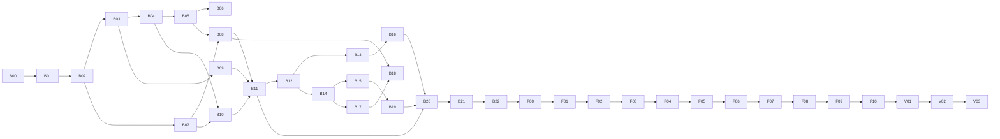

# Becha-Kena: Step-by-Step Build Prompts (Backend-First)

* **Document Version:** 1.0.0
* **Purpose:** An ordered set of copy-paste prompts for an AI coding agent. Run them one at a time to build the whole Becha-Kena platform, backend first, then the frontend.
* **Source-of-Truth Documents (in priority order when they conflict):**
  1. [PRD.md](file:///c:/Users/musfi/Documents/becha-kena/PRD.md) (v4.0.0): business rules and validation
  2. [api-spec.md](file:///c:/Users/musfi/Documents/becha-kena/api-spec.md) (v1.0.0): endpoint contracts, error codes, versioning
  3. [database-schema.md](file:///c:/Users/musfi/Documents/becha-kena/database-schema.md) (v1.0.0): collections, fields, enums, indexes
  4. [database.md](file:///c:/Users/musfi/Documents/becha-kena/database.md) (v1.0.0): pipelines, ACID transactions, Mongoose models, sample data
  5. [architecture.md](file:///c:/Users/musfi/Documents/becha-kena/architecture.md) (v3.0.0): layering, folder structure, queues, infra
  6. [dfd.md](file:///c:/Users/musfi/Documents/becha-kena/dfd.md) (v1.0.0): data flows and process boundaries

---

## Table of Contents

* [Part 0: How to Use This File](#part-0-how-to-use-this-file)
* [Part 1: Master Context Prompt (send once at the start of every session)](#part-1-master-context-prompt)
* [Part 2: Resolved Doc Conflicts & Build Decisions](#part-2-resolved-doc-conflicts--build-decisions)
* [Part 3: Backend Build Phases (B00 to B22)](#part-3-backend-build-phases)
* [Part 4: Frontend Build Phases (F00 to F10)](#part-4-frontend-build-phases)
* [Part 5: Final Verification & Release Prompts](#part-5-final-verification--release-prompts)
* [Appendix A: Phase Dependency Map](#appendix-a-phase-dependency-map)
* [Appendix B: Endpoint to Phase Traceability](#appendix-b-endpoint-to-phase-traceability)

---

## Part 0: How to Use This File

1. **Start every new agent session** by sending the **Master Context Prompt** (Part 1). Then send **one** phase prompt.
2. **Run phases in order.** Each phase lists its `Depends on`. Don't start a phase until the previous one's **Definition of Done** passes.
3. **Each phase prompt has the same structure:**
   * **Goal:** what the phase delivers.
   * **Read first:** the exact doc sections the agent must read before writing code.
   * **Build:** files and features to implement.
   * **Business rules:** non-negotiable rules from the PRD.
   * **Tests:** required automated tests.
   * **Definition of Done (DoD):** a checklist the agent must confirm before it stops.
4. **After each phase**, ask the agent to run `pnpm lint && pnpm typecheck && pnpm test` and paste the summary. Commit with a message like `feat(api): B05 auth domain`.
5. **If the agent finds a conflict between docs**, it must stop, follow the priority order above, and report the conflict. It must not invent new behaviour.

---

## Part 1: Master Context Prompt

> Copy everything in the block below and send it as the first message of every build session. You can also save it as `agent.md` / `AGENTS.md` at the repo root so the agent loads it automatically.

```text
You are a senior TypeScript backend engineer building "Becha-Kena", a trust-first C2C
marketplace for Bangladesh. You are working inside the repository at the current working
directory. The full specification is in these files at the repo root — READ them before coding
and treat them as the contract:

  PRD.md (v4.0.0)            -> business rules (highest priority)
  api-spec.md (v1.0.0)       -> REST + Socket.io contracts, auth tiers, error codes, versioning
  database-schema.md (v1.0.0)-> collections, fields, enums, indexes
  database.md (v1.0.0)       -> aggregation pipelines, ACID transactions, Mongoose models
  architecture.md (v3.0.0)   -> layering, folder structure, BullMQ queues, infra
  dfd.md (v1.0.0)            -> data flows between processes and stores

If two documents conflict, follow the priority order above and REPORT the conflict in your
final message. Never silently invent fields, endpoints, enums, or business rules.

TECH STACK (fixed — do not substitute):
- pnpm workspace monorepo: apps/api (Express), apps/web (Next.js App Router, later),
  packages/shared (Zod validators, constants, types).
- Node.js 20 LTS, TypeScript strict mode ("strict": true, "noUncheckedIndexedAccess": true).
- Express 4 + Socket.io 4 (with @socket.io/redis-adapter).
- MongoDB Atlas via Mongoose 8 (replica set required for transactions; 2dsphere; Atlas Search).
- Redis via ioredis (OTP, sessions, rate limits, ban set, idempotency, view buffers) + BullMQ.
- Cloudflare R2 via @aws-sdk/client-s3 + @aws-sdk/s3-request-presigner (private + public buckets).
- Sharp for images, file-type for magic bytes, opossum for circuit breakers,
  jsonwebtoken for JWT, bcrypt for PIN hashing, otplib for admin TOTP, pino for logs,
  helmet, cors, cookie-parser, zod.
- Tests: Vitest + Supertest + mongodb-memory-server (MongoMemoryReplSet) + a real Redis from
  docker-compose (or ioredis-mock only for pure unit tests).

ARCHITECTURE RULES (architecture.md §1):
- Strict 4-layer modular monolith:
  1) api/ (routes, controllers, middlewares, sockets): parse, validate, authorize. NO business logic.
  2) services/: all domain rules. Services NEVER receive Express req/res.
  3) repositories/ + models/: all Mongoose access, aggregations, transactions.
  4) adapters/ + jobs/: Porichoy, SMS, R2, Sharp, FCM, Turnstile, BullMQ workers.
- Dependency direction is top-down only. Repositories never call services.
- Every external adapter has an interface + a real implementation + a mock implementation,
  chosen by env var (e.g. PORICHOY_MODE=mock|live), so the system runs fully offline in dev/test.

API RULES (api-spec.md §1, §14, §15):
- Base path /api/v1. Success envelope { success: true, data, meta? }.
  Error envelope { success: false, error: { code, message, requestId, timestamp,
  retryAfterSeconds?, details? } }.
- Auth via HttpOnly Secure SameSite=Lax cookies: bk_access_token (15 min JWT),
  bk_refresh_token (30-day opaque rotating token, hashed in Redis).
- Use ONLY the error codes in api-spec.md §1.4 and §15.2 (add new ones to the shared
  constants file and report them).
- Cursor pagination only (never skip()).
- Never return stack traces, Mongo errors, or raw phone numbers/NID data in production.

CODING STANDARDS:
- Zod schemas live in packages/shared/validators and are reused by API and web.
- Use AppError(statusCode, code, message, details?, retryAfterSeconds?) for operational errors.
- All money is integer BDT (Number). All coordinates are GeoJSON [lng, lat].
- Sensitive fields use select:false (see database-schema.md §5).
- Every privileged admin action writes an immutable admin_audit_logs entry.
- Write tests alongside code. A phase is done only when lint, typecheck, and tests pass.

WORKING STYLE:
- Before coding, list the doc sections you read and a short plan.
- Implement ONLY the current phase scope. Don't scaffold future phases beyond stubs.
- At the end, output: files created/changed, test summary, conflicts/assumptions found,
  and the DoD checklist with each item ticked or explained.
```

---

## Part 2: Resolved Doc Conflicts & Build Decisions

The docs disagree in a few places. These decisions are **already applied** in the phase prompts below. If you want a different choice, edit this table **before** running the related phase.

| # | Topic | Conflict Found | Decision Used in Prompts | Affects Phase |
|:--:|:---|:---|:---|:--:|
| D-01 | **Listing photo count** | PRD §4 & api-spec say `2–10`. database.md `$jsonSchema` / `Listing.ts` say `1–10`. | **`2–10`** (PRD wins). Zod + Mongoose validator use min 2. Keep `$jsonSchema` at `minItems: 1` as a looser DB-level guard. | B03, B11 |
| D-02 | **Click-to-Reveal limits** | dfd.md §2.1 mentions `10 reveals/day`. PRD says `5/hr & 20/day per user, 10/hr per device, 30/hr per /24 subnet`. | **PRD limits.** | B12 |
| D-03 | **Guardian relationship enum** | PRD includes `ADULT_SIBLING` (guardian ≥ 21 if not a parent). database-schema enum is `FATHER | MOTHER | LEGAL_GUARDIAN`. | **Include `ADULT_SIBLING`** (PRD wins). The agent must update `database-schema.md` & `database.md` enums to match. | B03, B08 |
| D-04 | **Admin TOTP secrets storage** | architecture.md §5.7 mentions an `admin_2fa_secrets` collection that the DB docs don't define. | **Add a 13th collection `admin_2fa_secrets`** `{ userId (unique), secretEncrypted (select:false), enabledAt, lastUsedAt, recognizedDeviceIds[] }`. | B03, B18 |
| D-05 | **In-app notifications** | PRD §6 needs "In-App" notifications, but there's no collection or endpoint for them. | **Add a 14th collection `notifications`** + `GET /api/v1/notifications`, `PATCH /api/v1/notifications/:id/read`, `POST /api/v1/notifications/read-all`. Also emit them live over Socket.io `notification` event. | B03, B19 |
| D-06 | **Atlas Search locally** | Atlas Search (`$search`) is not available in local MongoDB or mongodb-memory-server. | **`SearchProvider` interface** with `AtlasSearchProvider` (prod) and `LocalGeoSearchProvider` (`$geoNear` + regex/`$text`) chosen by `SEARCH_PROVIDER=atlas|local`. | B12 |
| D-07 | **Offer price bounds** | PRD: `10%–150%` of asking price. | Validate against the **live `listings.price`**, not the stale `listingSnapshot.price`. | B14 |
| D-08 | **Free listings** | PRD §4 says "Free items use Giveaway category". database.md uses `condition: 'free'` + `price: 0`. | **Both:** `condition === 'free'` requires `price === 0` and bypasses the category floor. A seeded "Giveaway / Free Stuff" category also exists. | B03, B11 |
| D-09 | **Quota-counting statuses** | PRD: `active`, `reserved`, `under_review` count toward the 5-ad quota. | `activeListingCount` is incremented on create/renew and decremented **only** on the transition to `sold`, `expired`, or `deleted`. | B11, B13, B20 |
| D-10 | **SMS / Porichoy / FCM vendors** | No vendor contracts yet. | Build **mock adapters first** (log OTP to console in dev). Real adapters sit behind the same interface, configured via env. | B05, B08, B19 |

---

## Part 3: Backend Build Phases

---

### B00: Monorepo Scaffolding & Tooling

* **Depends on:** nothing
* **Goal:** A working pnpm workspace with strict TypeScript, linting, testing, and local infrastructure.

```text
PHASE B00 — Monorepo Scaffolding & Tooling

Read first: architecture.md §3 (Codebase Structure), §8 (Confirmed Decisions).

Build:
1. Root: package.json (private, packageManager pnpm@9), pnpm-workspace.yaml
   (apps/*, packages/*), .nvmrc (20), .editorconfig, .gitignore, .prettierrc,
   eslint.config.js (typescript-eslint strict + import order), tsconfig.base.json
   (strict, noUncheckedIndexedAccess, exactOptionalPropertyTypes false, ES2022, NodeNext).
2. packages/shared: package.json (name @becha-kena/shared), tsconfig, src/index.ts with
   empty barrels: validators/, constants/, types/.
3. apps/api: package.json (name @becha-kena/api), tsconfig extending base, folder skeleton
   exactly as architecture.md §3:
     src/config, src/api/{middlewares,routes/v1,controllers,sockets}, src/services,
     src/repositories, src/models, src/adapters, src/jobs, src/utils, src/app.ts, src/server.ts
   plus tests/{unit,integration,helpers}.
4. Scripts (root): dev, build, lint, typecheck, test, test:watch, format.
   apps/api scripts: dev (tsx watch src/server.ts), build (tsc), start, test (vitest run),
   seed, db:indexes, db:validators.
5. docker-compose.yml for local dev: mongo:7 started as a single-node replica set (rs0,
   with an init healthcheck that runs rs.initiate), redis:7-alpine, and minio (S3-compatible
   R2 stand-in) with two buckets: bk-private, bk-public.
6. apps/api/.env.example with EVERY env var the project will need (group and comment them):
   NODE_ENV, PORT, API_BASE_URL, WEB_ORIGIN, MONGODB_URI, REDIS_URL,
   JWT_ACCESS_SECRET, JWT_ACCESS_TTL=900, REFRESH_TTL_SECONDS=2592000, COOKIE_DOMAIN,
   NID_HMAC_SECRET, PHONE_HMAC_SECRET, OTP_HMAC_SECRET, KYC_RESPONSE_ENC_KEY (32-byte base64),
   TOTP_ENC_KEY, R2_ENDPOINT, R2_ACCESS_KEY_ID, R2_SECRET_ACCESS_KEY, R2_PRIVATE_BUCKET,
   R2_PUBLIC_BUCKET, CDN_BASE_URL, PORICHOY_MODE, PORICHOY_BASE_URL, PORICHOY_API_KEY,
   SMS_MODE, SMS_PRIMARY_*, SMS_SECONDARY_*, TURNSTILE_MODE, TURNSTILE_SECRET,
   FCM_MODE, FCM_PROJECT_ID, FCM_CLIENT_EMAIL, FCM_PRIVATE_KEY, SEARCH_PROVIDER,
   MIN_BUILD_ANDROID, MIN_BUILD_IOS, LOG_LEVEL.
7. Vitest config for apps/api with a global setup that starts MongoMemoryReplSet and
   exports helpers (tests/helpers/db.ts: connect, clearDatabase, disconnect).
8. A minimal GitHub Actions workflow .github/workflows/ci.yml: install, lint, typecheck, test
   (with a redis service container).
9. README.md: prerequisites, `docker compose up -d`, `pnpm i`, `pnpm --filter api dev`.

Tests: one smoke test proving Vitest + MongoMemoryReplSet start and a transaction can commit.

DoD:
[ ] pnpm install, pnpm lint, pnpm typecheck, pnpm test all pass from the repo root.
[ ] docker compose up -d brings up mongo (replica set healthy), redis, minio.
[ ] The folder structure matches architecture.md §3 exactly.
```

---

### B01: Shared Package (Constants, Types, Zod Validators)

* **Depends on:** B00
* **Goal:** One source of truth for enums, error codes, DTOs, and validation rules, shared by the API and web apps.

```text
PHASE B01 — packages/shared: constants, types, validators

Read first: PRD.md §4 (VAL table), §3.8 (FR-CAT); api-spec.md §1.3, §1.4, §15.1, §15.2;
database-schema.md §3 (all enums).

Build in packages/shared/src:
1. constants/
   - roles.ts: USER_ROLES = ['USER','MODERATOR','COMPLIANCE_OFFICER','ADMIN_LEAD'],
     STAFF_ROLES, role hierarchy helper hasRoleAtLeast().
   - enums.ts: every enum from database-schema.md (user status, kycStatus,
     verificationType, guardianRelationship incl. ADULT_SIBLING (decision D-03),
     listing condition incl. 'free', listing status, offer status, message type,
     moderationFlag, report targetType/reason/status, appeal status, audit targetType).
   - errorCodes.ts: ERROR_CODES object with EVERY code from api-spec.md §1.4 and §15.2
     (VALIDATION_ERROR, PRICE_BELOW_CATEGORY_FLOOR, PROHIBITED_CONTENT_DETECTED,
     INVALID_IMAGE_FORMAT, OTP_INVALID_OR_EXPIRED, UNAUTHORIZED, REFRESH_TOKEN_EXPIRED,
     PIN_VERIFICATION_REQUIRED, FORBIDDEN_KYC_REQUIRED, ACCOUNT_SUSPENDED_OR_BANNED,
     SELF_INTERACTION_BLOCKED, REVIEW_WINDOW_LOCKED, ADMIN_2FA_INVALID, RESOURCE_NOT_FOUND,
     CONFLICT_409, NID_ALREADY_REGISTERED, DUPLICATE_SUBMISSION, LISTING_UNAVAILABLE,
     QUOTA_EXCEEDED, GUARDIAN_MINOR_LIMIT_REACHED, UPGRADE_REQUIRED, RATE_LIMIT_EXCEEDED,
     INTERNAL_SERVER_ERROR, EXTERNAL_PROVIDER_DEGRADED) plus FORBIDDEN (generic RBAC) and
     IDEMPOTENCY_KEY_REUSED. Map each code -> default HTTP status.
   - limits.ts: LISTING_QUOTA=5, LISTING_TTL_DAYS=30, EXPIRY_WARNING_DAY=27,
     OFFER_TTL_HOURS=72, REVIEW_EDIT_HOURS=48, OTP_TTL=180, OTP_MAX_ATTEMPTS=3,
     OTP_RESEND_COOLDOWN=60, OTP_MAX_PER_HOUR=5 (per IP/device), 3 (per phone),
     REVEAL limits (5/hr, 20/day user; 10/hr device; 30/hr subnet), REVEAL_FREE_REVIEW_DAYS=7,
     MAX_MINORS_PER_GUARDIAN=2, DORMANT_DAYS=180, RADIUS_TIERS=[2,5,10,25,0],
     PRICE_MIN=10, PRICE_MAX=100_000_000, IMAGES_MIN=2, IMAGES_MAX=10 (decision D-01),
     IMAGE_RAW_MAX_BYTES=10MB, CHAT_IMAGE_MAX_BYTES=5MB, WEBP_MAX_BYTES=307200,
     OFFER_MIN_PCT=0.10, OFFER_MAX_PCT=1.50, BD_BOUNDS {lat:[20.34,26.64], lng:[88.01,92.67]},
     KYC_AUTO_APPROVE=80, KYC_HARD_REJECT=50.
2. types/
   - api.ts: ApiSuccess<T>, ApiErrorDetail, ApiErrorResponse (exactly api-spec.md §15.1),
     PaginationMeta { nextCursor, hasMore, expandedRadiusKm? }.
   - dto/*.ts: request/response DTO types for every endpoint in api-spec.md §2
     (infer them from the Zod schemas where possible with z.infer).
3. validators/
   - primitives.ts: bdPhone (E.164 ^\+8801[3-9]\d{8}$ with a normalizer that accepts
     01XXXXXXXXX / 8801XXXXXXXXX and returns +8801XXXXXXXXX), otpCode, nidNumber
     (^(\d{10}|\d{13}|\d{17})$), objectId, bdLatitude, bdLongitude, geoPointInput,
     cursor, uuidV4.
   - contentGuards.ts: containsPhoneNumber() (incl. spaced/disguised digits and Bengali
     digits ০-৯), containsUrl() (http, https, www, .com/.net/.org/.bd/.xyz, bit.ly, wa.me,
     t.me, "[dot]", " dot "), exported as pure functions + Zod refinements.
   - One file per domain with Zod schemas matching api-spec.md request bodies/queries:
     auth.ts, users.ts, kyc.ts, listings.ts (title 5-100, description 20-2000, price rules,
     condition/free rule, images 2-10, contactPhone, attributes record), search.ts
     (query params incl. radiusKm enum, sort enum, limit<=40), chat.ts (message 1-1000,
     offer, offer respond with discriminated union on action), reviews.ts, reports.ts,
     appeals.ts, admin.ts, notifications.ts.
4. index.ts barrel exports. Build with tsup to ESM + CJS + d.ts.

Tests (Vitest in packages/shared):
- Phone normalizer and regex (valid/invalid prefixes 011, 012 must fail).
- containsPhoneNumber catches "০১৭১১ ২২৩৩৪৪", "0 1 7 1 1-223344", "plus88017...".
- containsUrl catches "wa.me/880", "bit[dot]ly", "example . com"; it must NOT flag
  normal words like "dotted" or "company".
- Listing schema: free condition requires price 0; non-free requires >= 10; 1 image fails.
- Offer respond schema: ACCEPT requires expectedListingVersion; COUNTER requires counterAmount.

DoD:
[ ] Every enum/limit/error code from the docs is present and exported.
[ ] The api app can import @becha-kena/shared and typecheck.
[ ] Unit tests cover all content guards and validators.
```

---

### B02: API Core Infrastructure (Config, Logging, Errors, Versioning, Health)

* **Depends on:** B01
* **Goal:** A production-grade Express skeleton with config validation, Mongo/Redis connections, the global error handler, version headers, and graceful shutdown.

```text
PHASE B02 — API core infrastructure

Read first: architecture.md §1, §5.2; api-spec.md §1.3, §14.1–§14.4, §15.1, §15.3, §15.7.

Build in apps/api/src:
1. config/env.ts: parse process.env with Zod (fail fast with a readable error listing missing
   vars). Export a typed `config` object. Secrets are never logged.
2. config/mongo.ts: connect with Mongoose (retryWrites, w:'majority'), connection event logs,
   and a helper withTransaction(fn) that uses session.withTransaction and retries
   TransientTransactionError up to 2 times (api-spec §15.5 point 3).
3. config/redis.ts: ioredis clients — `redis` (commands), `redisSub`/`redisPub` (Socket.io
   adapter), plus a BullMQ connection factory (maxRetriesPerRequest: null).
4. utils/logger.ts: pino with redaction paths for cookies, authorization, phoneNumber,
   contactPhone, nidNumber, otpCode, pin, *.storageKeys, and any URL query param named
   X-Amz-Signature / X-Amz-Credential (PRD FR-KYC-04: scrub pre-signed tokens from logs).
5. utils/AppError.ts: class AppError(statusCode, code, message, details?, retryAfterSeconds?)
   + factory helpers (notFound, forbidden, conflict, rateLimited, ...).
6. utils/response.ts: ok(res, data, meta?, status=200), created(res, data).
7. api/middlewares:
   - requestId.ts: read X-Request-Id or generate UUID; set on req and response header.
   - apiVersion.ts: set X-API-Version: 1.0.0, X-Min-Supported-Build-Android/iOS headers;
     if X-Client-Platform is android/ios and X-App-Build < min -> 426 UPGRADE_REQUIRED.
   - deprecation.ts: a factory deprecated({ sunset, successor }) that sets the RFC 8594
     Deprecation/Sunset/Link headers (unused for now, but exported and tested).
   - validate.ts: validate({ body?, query?, params? }) using Zod; throws ZodError.
   - notFound.ts: 404 RESOURCE_NOT_FOUND for unknown routes.
   - errorHandler.ts: exactly as api-spec.md §15.7 (ZodError -> 400 with details,
     AppError, Mongo E11000 -> 409 DUPLICATE_SUBMISSION, Mongoose CastError -> 400,
     fallback 500 with masked message). Include requestId + timestamp in every error.
8. app.ts: helmet, cors (credentials:true, origin WEB_ORIGIN), cookie-parser,
   express.json({ limit: '1mb' }), requestId, pino-http, apiVersion, ETag (weak) enabled,
   router mounted at /api/v1, notFound, errorHandler. Trust proxy = 1 (Cloudflare).
9. routes/v1/index.ts: mount domain routers (empty stubs) + GET /api/v1/health returning
   { status, mongo, redis, uptime, version } (no auth).
10. server.ts: create HTTP server, connect Mongo + Redis, listen, and handle graceful shutdown on
   SIGTERM/SIGINT (stop accepting, close Socket.io later, drain BullMQ later, close
   Mongo/Redis, 10s hard timeout).

Tests (integration via Supertest):
- GET /api/v1/health -> 200 envelope.
- Unknown route -> 404 envelope with requestId.
- Zod failure on a test-only route -> 400 VALIDATION_ERROR with dot-path details.
- Duplicate-key insert on a test model -> 409 DUPLICATE_SUBMISSION.
- Thrown plain Error -> 500 with the generic message (no stack in body).
- X-Client-Platform: android + X-App-Build below min -> 426 UPGRADE_REQUIRED.
- Logger redaction unit test: phone numbers and X-Amz-Signature are censored.

DoD:
[ ] Every error response matches ApiErrorResponse exactly.
[ ] Starting without required env vars fails with a clear message.
[ ] Graceful shutdown closes all connections (verified by test or manual log).
```

---

### B03: Mongoose Models, Indexes, DB Validators & Seed Data

* **Depends on:** B02
* **Goal:** All 14 collections implemented exactly per the schema docs, with indexes, DB-level `$jsonSchema` guards, and seed data.

```text
PHASE B03 — Data layer: models, indexes, validators, seeds

Read first: database-schema.md (entire file); database.md §1–§5, §8, §9 (all 12 models),
§10 ERD; Part 2 decisions D-01, D-03, D-04, D-05, D-08 in prompt.md.

Build in apps/api/src/models (one file per model, exported from models/index.ts):
1. Implement the 12 models from database.md §9 EXACTLY (field names, types, defaults,
   select:false flags, enums, timestamps), with these corrections:
   - Listing.images validator: 2..10 (D-01). Price validator: condition 'free' => 0,
     otherwise >= 10 and <= 100,000,000 (the category floor is checked in the service).
   - IdentityVerification.guardianRelationship enum adds 'ADULT_SIBLING' (D-03).
   - IdentityVerification: add `guardianCanonicalNidHash` (String, select:false, indexed)
     so the "max 2 minors per guardian NID" and "contamination rule" can be queried.
     Report this addition.
   - Indexes exactly per database.md §4.1 / database-schema.md §2 — do NOT add redundant
     single-field indexes that are prefixes of compound indexes.
   - AdminAuditLog: block update/delete with pre-hooks for updateOne, updateMany,
     findOneAndUpdate, findOneAndDelete, deleteOne, deleteMany, replaceOne.
2. New model AdminTwoFactorSecret (collection admin_2fa_secrets) per decision D-04.
3. New model Notification (collection notifications) per decision D-05:
   { userId (ref User), type (enum: KYC_APPROVED, KYC_MANUAL_REVIEW, KYC_REJECTED,
     NEW_MESSAGE, OFFER_RECEIVED, OFFER_UPDATED, OFFER_EXPIRED, LISTING_UNDER_REVIEW,
     LISTING_REVIEW_ESCALATED, LISTING_APPROVED, LISTING_UNAVAILABLE, LISTING_EXPIRING,
     LISTING_EXPIRED, CONFIRM_PURCHASE, SECURITY_ALERT, ACCOUNT_STATUS),
     title, body, data (Mixed deep-link payload), readAt (Date|null), createdAt }
   Indexes: { userId: 1, createdAt: -1 }, { userId: 1, readAt: 1 },
   TTL { createdAt: 1 } expireAfterSeconds 90 days.
4. repositories/: one repository per model with typed methods used by later phases
   (start with findById, create, and the obvious queries; later phases add more).
5. scripts/ (run via pnpm --filter api <script>):
   - db-indexes.ts: syncIndexes() for all models and print a diff.
   - db-validators.ts: apply the listings $jsonSchema from database.md §5.1 using collMod
     (create the collection if missing). Make it idempotent.
   - atlas-search-index.json + create-search-index.ts: the Atlas Search index from
     database.md §4.2 (name listing_search_v1), extended with attributes.brand,
     attributes.model, condition, categoryId (FR-CAT-03). The script only runs when
     SEARCH_PROVIDER=atlas.
   - seed.ts (idempotent upserts):
     a) Categories: the full 3-level tree from PRD FR-CAT-01 (7 roots, all listed L2s, plus a
        "Giveaway / Free Stuff" category per D-08) with minPriceBDT from FR-CAT-02
        (Mobiles 500, Furniture 200, Books 10, default 10) and attributeSchema from FR-CAT-03
        (Electronics: brand, model, storageGB, ramGB, imeiLast4Digits; Vehicles: brand, year,
        engineCC, registrationType).
     b) Geo: a data/bd-geo.json file with all 8 divisions, 64 districts, and their thanas with
        centroid [lng, lat]. If the full thana dataset isn't available offline, include at
        least every Dhaka-division thana plus district centroids for all 64 districts, and
        leave a clearly marked TODO with the expected schema for the full dataset.
     c) Staff users: one each of MODERATOR, COMPLIANCE_OFFICER, ADMIN_LEAD from env-provided
        phone numbers (SEED_*_PHONE), with no TOTP enrolled yet.
     d) Optional dev-only sample data (database.md §8) behind --with-samples.

Tests:
- Model validation tests: free/price rule, images 2..10, phone regex, trustScore 0..5,
  activeListingCount 0..5, review rating 1..5.
- Unique index tests: users.phoneNumber, chat_threads {listingId,buyerId},
  messages {threadId,clientMessageId}, reviews {listingId,reviewerId},
  reports {reporterId,targetId}, identity_verifications partial unique canonicalNidHash
  (only for ADULT_SELF + verified).
- AdminAuditLog: update and delete attempts throw.
- select:false fields are absent from default queries.
- Seed script runs twice without duplicates.

DoD:
[ ] 14 models exist; field names match database-schema.md byte-for-byte (except the reported additions).
[ ] database-schema.md and database.md are updated for D-03, D-04, D-05 and guardianCanonicalNidHash.
[ ] pnpm --filter api seed works against docker-compose Mongo.
```

---

### B04: Security Middleware (Auth, RBAC, Ban Check, Rate Limit, Idempotency, Turnstile, Device)

* **Depends on:** B03
* **Goal:** Reusable guards that implement every auth tier and header rule in api-spec §1.1 and §1.2.

```text
PHASE B04 — Security & cross-cutting middleware

Read first: api-spec.md §1.1, §1.2, §15.4; architecture.md §5.1, §5.4; PRD FR-AUTH-01,
FR-AUTH-04, FR-PDP-02.

Build:
1. services/token.service.ts:
   - signAccessToken({ userId, role, isSellerVerified, deviceId, jti }) — HS256, 15 min.
   - Refresh tokens: opaque 256-bit random. Store sha256(token) in Redis
     `refresh:{sha}` -> { userId, deviceId, familyId } EX 30d, and add it to set
     `user_sessions:{userId}`. Rotation: delete the old token and issue a new one in the same
     family. If a revoked/unknown token from a known family is reused, revoke the whole family
     (theft detection).
   - Cookie helpers: setAuthCookies(res), clearAuthCookies(res) with exact attributes from
     api-spec §3.2 (refresh cookie Path=/api/v1/auth).
2. middlewares/auth.ts:
   - authenticate (required) and optionalAuth: verify the bk_access_token cookie; on missing
     or invalid token -> 401 UNAUTHORIZED.
   - Ban check: SISMEMBER banned_users userId -> 403 ACCOUNT_SUSPENDED_OR_BANNED.
   - Attach req.user = { id, role, isSellerVerified, deviceId }.
   - requireVerifiedSeller: re-check isSellerVerified from DB (cache 60s in Redis
     `seller_verified:{id}`) -> 403 FORBIDDEN_KYC_REQUIRED.
   - requireRole(...roles) / requireStaff('MODERATOR'|'COMPLIANCE_OFFICER'|'ADMIN_LEAD')
     using the hierarchy -> 403 FORBIDDEN.
   - requirePinIfDormant: if Redis flag `pin_required:{userId}:{deviceId}` exists -> 401
     PIN_VERIFICATION_REQUIRED (used on seller routes; set by B05).
3. middlewares/rateLimit.ts: a Redis sliding-window limiter (sorted set + Lua script for
   atomicity) with a factory rateLimit({ keys: (req)=>string[], limit, windowSec, code }).
   It sets X-RateLimit-Limit/Remaining/Reset and, on block, Retry-After plus 429
   RATE_LIMIT_EXCEEDED with retryAfterSeconds. It supports multiple dimensions in one call
   (user, device, /24 subnet). Add a helper ipSubnet24(ip) for IPv4, and use /64 for IPv6.
4. middlewares/idempotency.ts: requires the Idempotency-Key (UUIDv4) header on configured
   routes. Redis key `idem:{userId}:{route}:{key}`:
   - first request: SET NX "processing" EX 86400, run the handler, then store
     { status, body } on success;
   - repeat with the stored result: replay the same status and body;
   - repeat while processing: 409 CONFLICT_409;
   - same key with a different body hash: 422 IDEMPOTENCY_KEY_REUSED.
5. middlewares/deviceId.ts: requireDeviceId -> 400 VALIDATION_ERROR when X-Device-Id is
   missing on the routes listed in api-spec §1.2.
6. adapters/turnstile/: interface verify(token, ip) + CloudflareTurnstileAdapter +
   MockTurnstileAdapter (accepts "test-pass"). middlewares/turnstile.ts -> 400
   VALIDATION_ERROR (field X-Turnstile-Token) on failure.
7. utils/crypto.ts: hmacSha256(secret, value), sha256, randomToken, AES-256-GCM
   encrypt/decrypt (used for porichoyResponse and TOTP secrets), constant-time compare.

Tests:
- authenticate: valid, expired, tampered, missing, banned user.
- requireRole hierarchy (ADMIN_LEAD passes a MODERATOR+ guard; USER fails).
- Sliding window: the 6th request in an hour returns 429 with Retry-After; multiple dimensions
  are counted independently; concurrency test (20 parallel) never exceeds the limit.
- Idempotency: replay returns an identical body; a different body with the same key gives 422.
- Refresh rotation and reuse detection revokes the family.

DoD:
[ ] Every auth tier in api-spec §1.1 maps to a ready-to-use middleware chain
    (export them as `guards.public`, `guards.user`, `guards.verifiedSeller`,
    `guards.moderator`, `guards.compliance`, `guards.adminLead`, `guards.adminLead2fa` (2FA added in B18)).
```

---

### B05: Auth Domain (OTP, Sessions, PIN, Phone Migration)

* **Depends on:** B04
* **Endpoints:** #1–#6 in api-spec §2

```text
PHASE B05 — Authentication & session management

Read first: api-spec.md §3.1–§3.6; PRD FR-AUTH-01..04, Flow 1/2 sequence diagrams, §6
notification matrix (OTP, new device/dormant login); dfd.md Level 2 Process 1.0.

Build:
1. adapters/sms/: interface SmsProvider.send(phone, message). Implementations:
   PrimarySmsAdapter, SecondarySmsAdapter (HTTP stubs configurable via env), MockSmsAdapter
   (logs "OTP for +880…: 123456" in dev only). A FailoverSmsService tries primary with a 3s
   timeout and falls back to secondary; if both fail -> 503 EXTERNAL_PROVIDER_DEGRADED
   with retryAfterSeconds 60.
2. services/otp.service.ts:
   - requestOtp(phone, intent, ip, deviceId): enforce a 60s resend cooldown
     (`otp_cooldown:{phone}`), max 3/hr per phone, max 5/hr per IP and per device (use the B04
     limiter); generate a 6-digit crypto-random OTP; store HMAC(OTP_HMAC_SECRET, otp) at
     `otp:{phone}` EX 180 and reset `otp_attempts:{phone}`; send SMS.
   - verifyOtp(phone, code): on a mismatch, increment attempts; on the 3rd failure, delete the
     OTP and lock `otp_lock:{phone}` for 1h -> 400 OTP_INVALID_OR_EXPIRED with
     details.remainingAttempts. On success, delete the OTP keys.
3. services/auth.service.ts:
   - loginOrRegister(phone, deviceId, ip): find or create the user (role USER, trustScore 0,
     activeListingCount 0, phoneVerified true) atomically (upsert on phoneNumber);
     reject banned/suspended/deleted -> 403 ACCOUNT_SUSPENDED_OR_BANNED.
   - Dormant/recycled SIM check (FR-AUTH-02): if lastActiveAt is older than 180 days AND the
     deviceId isn't in user.deviceIds:
       * if accountPinHash is set -> set Redis `pin_required:{userId}:{deviceId}` and return
         requiresPinVerification: true;
       * always send a SECURITY_ALERT (SMS + push stub) to the account owner.
   - Add deviceId to user.deviceIds ($addToSet, keep the last 10), update lastActiveAt.
   - nextRoute: "/seller/dashboard" if isSellerVerified, otherwise "/" for buyers
     (and "/seller/kyc" if the request came from the "sell" intent; accept an optional
     `returnTo` hint).
   - refresh, logout(allDevices), verifyPin (bcrypt compare, 5 wrong attempts -> lock 1h),
     setPin happens in B06.
4. Phone migration (FR-AUTH-03, api-spec §3.6): the caller is logged in with the NEW number
   (which must not already be a verified seller account). Steps: load the old account by
   oldPhoneNumber (must be a verified seller); call the KYC adapter (from B08 — create the
   interface now and use the mock) to resolve the canonical NID from nidNumber+dob and match
   the selfie; compare HMAC with the stored canonicalNidHash. On a match, in ONE transaction:
   move phoneNumber to the old account, mark the temporary new-number account deleted, revoke
   all sessions of both accounts (delete user_sessions sets), and write an
   admin_audit_logs-style system audit entry (adminId = null is not allowed, so instead log
   to a `security_events` pino stream). Return the shape in api-spec §3.6. Rate limit:
   3 attempts / 24h per user.
5. Routes + controllers in api/routes/v1/auth.routes.ts with the exact guards:
   POST /auth/otp/request (turnstile + deviceId), POST /auth/otp/verify (deviceId),
   POST /auth/refresh, POST /auth/logout (user), POST /auth/pin/verify (user),
   POST /auth/phone-migration (user).
6. Request/response shapes must match api-spec §3 exactly (including the user object
   in §3.2).

Tests (integration):
- Full happy path: request OTP (mock SMS captures the code) -> verify -> cookies set ->
  GET /health with the cookie works -> refresh rotates -> logout clears.
- Wrong OTP 3 times -> lock; resend cooldown -> 429.
- Banned user cannot log in or refresh.
- Dormant 181 days + new device + PIN set -> requiresPinVerification true; seller route
  returns 401 PIN_VERIFICATION_REQUIRED until /auth/pin/verify succeeds.
- Phone migration success and mismatch paths; old sessions revoked.
- SMS primary down -> secondary used; both down -> 503.

DoD:
[ ] Endpoints #1–#6 conform to api-spec §3 request/response/error contracts.
[ ] No OTP, PIN, or token value ever appears in logs (assert with a log spy).
```

---

### B06: Users Domain (Profile, Preferences, Public Profile, Account Deletion)

* **Depends on:** B05
* **Endpoints:** #7–#10

```text
PHASE B06 — User profile & account lifecycle

Read first: api-spec.md §4.1–§4.4; PRD FR-AUTH-04, FR-MOD-03 (badge display), §4 VAL
(notification prefs, GPS bounds); database-schema.md §3.1; architecture.md §4.2
(sellerSnapshot invalidation).

Build:
1. GET /users/me: return exactly the api-spec §4.1 shape (hasAccountPin boolean, never the hash;
   maxListingQuota 5).
2. PATCH /users/me: partial update; displayName/bio pass the content guards (no phones or URLs);
   location must be inside the BD bounds and is stored as GeoJSON [lng,lat]; accountPin
   (4–6 digits) is bcrypt-hashed (cost 12); fcmToken is stored. If displayName or avatarUrl
   changed AND the user is a verified seller -> enqueue snapshot_sync_queue (define a
   queue producer stub now in jobs/queues.ts; the worker comes in B20) and return
   snapshotSyncQueued: true.
3. GET /users/:id/public-profile (public): only public fields; verificationBadge
   'NID_VERIFIED' | 'GUARDIAN_VERIFIED' | null (derived from the latest verified
   identity_verifications.verificationType); badgeLabel "New Seller" when trustScore 0 and
   completedDealsCount 0, otherwise `${trustScore.toFixed(1)} ★`; deleted/banned users -> 404.
4. DELETE /users/me (confirmDelete must be true): one transaction that sets the user to
   status 'deleted' + deletedAt, soft-deletes all listings in active/reserved/under_review/
   expired (status 'deleted', deletedAt), sets activeListingCount 0, locks all chat_threads
   where the user is buyer or seller (lockReason 'USER_ACCOUNT_CLOSED') and inserts a
   SYSTEM message in each, then revokes all sessions. Keep identity_verifications and
   phone_reveal_logs untouched (compliance retention).
5. A shared utility services/presenters/userPresenter.ts so no controller hand-builds
   user JSON.

Tests: shape snapshots for all 4 endpoints; content guard rejection; GPS out of bounds;
PIN hashed (not stored raw); delete cascade verified across 3 collections; a public profile
never contains phoneNumber/deviceIds/accountPinHash.

DoD:
[ ] Endpoints #7–#10 pass contract tests.
[ ] The deletion cascade is atomic (a test forces a failure mid-transaction and checks for rollback).
```

---

### B07: Storage Adapter (Cloudflare R2 Private + Public)

* **Depends on:** B02
* **Goal:** One storage abstraction used by KYC, media, appeals, and warrant export.

```text
PHASE B07 — Object storage adapter

Read first: architecture.md §5.3, §7 (Cloudflare R2); PRD FR-KYC-04; api-spec §5.1, §7.1, §13.1, §13.7.

Build adapters/storage/:
1. interface ObjectStorage {
     presignPut(bucket, key, contentType, expiresSec): Promise<string>;
     presignGet(bucket, key, expiresSec, opts?: { noStore: boolean }): Promise<string>;
     putObject(bucket, key, body: Buffer, contentType, cacheControl?): Promise<void>;
     getObject(bucket, key): Promise<Buffer>;
     headObject(bucket, key): Promise<{ size: number; contentType: string } | null>;
     deleteObject(bucket, key): Promise<void>;
   }
2. R2StorageAdapter using @aws-sdk/client-s3 (region 'auto', forcePathStyle for MinIO).
   Private-bucket presigned GETs set ResponseCacheControl 'no-store, private'.
   Private uploads use ServerSideEncryption 'AES256' where supported.
3. InMemoryStorageAdapter for unit tests.
4. Key builders in utils/storageKeys.ts:
   kyc/{userId}/{front|back|selfie}_{random}.enc, listings/{userId}/{uuid}.webp,
   chat/{threadId}/{uuid}.webp, avatars/{userId}/{uuid}.webp,
   appeals/{appealTempId}/{uuid}.webp, warrants/{reference}.zip.
   publicUrl(key) = `${CDN_BASE_URL}/${key}`.

Tests: InMemory adapter contract tests; an R2 adapter integration test against docker MinIO
(skipped when MinIO isn't reachable); keys never contain user-supplied filenames.

DoD:
[ ] Every storage call in later phases goes through this interface only.
```

---

### B08: e-KYC Domain (Porichoy, NID Hashing, Guardian Rules, Upgrade)

* **Depends on:** B05, B07
* **Endpoints:** #11–#14

```text
PHASE B08 — e-KYC verification pipeline

Read first: PRD FR-KYC-01..04, §4 VAL (NID, age constraints), Flow (KYC sequence diagram),
§6 (KYC notifications); api-spec.md §5.1–§5.4, §15.5 point 1; database-schema.md §3.2;
dfd.md Level 2 Process 2.0; Part 2 decision D-03.

Build:
1. adapters/porichoy/:
   interface KycProvider {
     verifyNid(input: { nidNumber, dob, fullName }): Promise<{ matched: boolean;
        canonicalSmartNid: string; nameOnRecord: string; dobOnRecord: string;
        isDeceased: boolean; refId: string; raw: unknown }>;
     matchFace(input: { selfie: Buffer; nidPhotoRef: string }): Promise<{ score: number }>;
   }
   - PorichoyAdapter (HTTP, 8s timeout) wrapped in an opossum circuit breaker
     (2 retries, exponential backoff, errorThresholdPercentage 50, resetTimeout 30s).
   - MockKycProvider with deterministic test fixtures: NIDs ending "000" = not matched,
     "999" = deceased, "777" = provider timeout, selfie score controlled by a fixture map
     (default 91.5).
2. services/kyc.service.ts:
   - createUploadUrls(userId, mimeTypes): only image/jpeg|png|webp|heic; 300s presigned PUTs
     to the private bucket; store the issued keys in Redis `kyc_keys:{userId}` EX 1h so submit
     can only reference keys issued to this user.
   - submit(userId, dto) (Idempotency-Key required):
     a) Pre-checks: the user isn't already a verified seller (unless upgrade); the storage keys
        belong to the user and exist (headObject).
     b) Age rules (VAL): ADULT_SELF age >= 18 from dob. MINOR_GUARDIAN: seller < 18;
        guardian >= 18, or >= 21 if relationship is ADULT_SIBLING or LEGAL_GUARDIAN.
     c) Call verifyNid via the breaker. If the breaker is open, times out, or returns 5xx ->
        persist the record with status 'manual_review' and return 202 Accepted with the
        api-spec §15.5 body (NEVER 500).
     d) Compute canonicalNidHash = HMAC(NID_HMAC_SECRET, canonicalSmartNid) and
        compositeDobHash = HMAC(NID_HMAC_SECRET, dob + normalizedName) (normalize: lowercase,
        trim, collapse spaces, strip punctuation).
     e) Ban-evasion check: if the hash (or compositeDobHash) is in Redis set
        `blacklisted_nid_hashes` -> reject with 403 ACCOUNT_SUSPENDED_OR_BANNED.
     f) ADULT_SELF uniqueness: an existing verified ADULT_SELF record with the same hash for
        another user -> 409 NID_ALREADY_REGISTERED.
        MINOR_GUARDIAN: the hash is the GUARDIAN's; store it in guardianCanonicalNidHash;
        count verified MINOR_GUARDIAN records with the same guardian hash; >= 2 -> 422
        GUARDIAN_MINOR_LIMIT_REACHED.
     g) Face match decision: score >= 80 auto-approve; 50–79 'manual_review';
        < 50 'rejected' (rejectionReason 'FACE_LIVENESS_FAIL'); deceased/not matched ->
        'rejected' ('NID_DOB_MISMATCH' / 'NID_DECEASED').
     h) Store porichoyRefId and the AES-GCM-encrypted porichoyResponse (select:false).
     i) On approve, in one transaction: identity_verifications.status 'verified', verifiedAt;
        users.sellerProfile.isSellerVerified true, kycStatus 'verified', verifiedAt; and set
        sellerProfile.displayName from nameOnRecord if empty. Invalidate the Redis
        seller_verified cache. Enqueue kyc_notification_queue (push + SMS + in-app
        "Verified! You can now post up to 5 free listings.").
     j) On manual_review / rejected: update users.sellerProfile.kycStatus and enqueue the
        matching notification (with a retry guide for rejections).
     k) Memory hygiene: downloaded image buffers are not written to disk or logged.
   - getStatus(userId): the latest record (api-spec §5.3).
   - upgradeAdult(userId, dto) (FR-KYC-01, api-spec §5.4): the current verification must
     be MINOR_GUARDIAN and verified; age now >= 18; run the ADULT_SELF flow; on approve,
     mark the old MINOR_GUARDIAN record superseded (keep it — set a reviewNote) so it no
     longer counts toward the guardian's 2-minor limit (count only records where
     status 'verified' AND not superseded — add a `supersededAt` Date field and report it).
     trustScore/completedDealsCount are untouched.
3. Routes: POST /kyc/upload-urls (user), POST /kyc/submit (user + idempotency),
   GET /kyc/status (user), POST /kyc/upgrade-adult (verifiedSeller).

Tests:
- Adult auto-approve -> user becomes a verified seller; the hash is stored, never the raw NID.
- 13-digit old NID and 10-digit smart NID resolving to the same canonical NID -> the second
  user gets 409.
- Borderline 65% -> manual_review; 40% -> rejected.
- Porichoy timeout -> 202 manual_review with keys persisted.
- Minor flow: the 3rd minor under the same guardian -> 422; ADULT_SIBLING aged 20 -> 400.
- Blacklisted hash -> 403.
- Upgrade-adult detaches from the guardian slot (the guardian can then add another minor).
- Keys not issued to the user -> 400.

DoD:
[ ] Endpoints #11–#14 pass contract tests.
[ ] Raw NID numbers never persist anywhere (grep the DB in a test).
```

---

### B09: Categories & Geo Domain

* **Depends on:** B03
* **Endpoints:** #15–#17

```text
PHASE B09 — Category taxonomy & geolocation

Read first: PRD FR-CAT-01..03, FR-GEO-01; api-spec.md §6.1–§6.3; database.md §3 (Redis
category cache); architecture.md §4.2 1b.

Build:
1. services/category.service.ts:
   - getTree(): read Redis `categories:tree`; on a miss, build the nested tree
     (isActive only, sorted by sortOrder) and SET EX 3600.
   - getBySlug(slug) -> 404 if missing or inactive.
   - getLeafForListing(categoryId): must be active and have no active children (a level-3
     leaf, or a level-2 node without children); used by B11.
   - invalidateTree(): DEL categories:tree (called by admin edits later).
2. services/geo.service.ts: load data/bd-geo.json once into memory; getLocations({division,
   district}); thanaCentroid(division, district, thana) -> [lng, lat] | throws 400;
   reverseGeocode(lng, lat): nearest thana centroid within 15km (haversine over the in-memory
   list; FR-GEO-01 edge fallback), else null.
3. Routes: GET /categories, GET /categories/:slug, GET /geo/locations — all public with
   Cache-Control: public, max-age=300 and a weak ETag (304 support).

Tests: tree shape matches api-spec §6.1; a cache hit avoids the DB (spy); slug 404; geo
filtering; reverseGeocode on a border coordinate; a 304 on matching If-None-Match.

DoD:
[ ] Endpoints #15–#17 pass contract tests.
```

---

### B10: Media Pipeline (Magic Bytes, Sharp, EXIF Strip, OCR Queue)

* **Depends on:** B04, B07
* **Endpoint:** #18

```text
PHASE B10 — Media upload & image sanitization

Read first: PRD FR-LST-02, §4 VAL (photos, chat image); architecture.md §5.3 point 2;
api-spec.md §7.1; database-schema.md §3.5 (listing_images).

Build:
1. adapters/image/sharpPipeline.ts: process(buffer) ->
   sharp(buffer, { failOn: 'error' }).rotate().resize(1200,1200,{fit:'inside',
   withoutEnlargement:true}).webp({ quality: 80 }); if the output is > 300KB, step quality
   down (70, 60, 50) until it's < 307,200 bytes, else throw INVALID_IMAGE_FORMAT. Never call
   withMetadata(). Return { buffer, width, height, sizeBytes }.
   HEIC: make sure sharp is built with libheif; if HEIC decode is unsupported in the runtime,
   fall back to heic-convert -> JPEG -> pipeline.
2. Magic-byte validation with file-type: allow only image/jpeg, image/png, image/webp,
   image/heic, image/heif. Ignore the client Content-Type and file extension.
3. POST /media/upload-photo (multer memoryStorage, single 'file'):
   - purpose LISTING_PHOTO -> requires verifiedSeller, max 10MB raw;
     CHAT_ATTACHMENT -> user, max 5MB; AVATAR -> user, max 5MB.
   - Process -> putObject to the public bucket (Cache-Control: public, max-age=31536000,
     immutable) -> for LISTING_PHOTO create a listing_images record with listingId null
     ("orphan", add `uploadedBy` and make listingId nullable — report this) exifStripped
     true, ocrChecked false -> enqueue image_ocr_scan_queue { imageId }.
   - Response exactly api-spec §7.1 (201).
   - Rate limit: 60 uploads/hour per user.
4. An orphan cleanup job definition (worker in B20): listing_images with listingId null older
   than 24h -> delete the object + record.

Tests: a JPEG with GPS EXIF -> output has NO EXIF (assert via sharp(output).metadata()
.exif undefined); a PNG renamed to .jpg passes; a .exe renamed to .jpg -> 400
INVALID_IMAGE_FORMAT; 11MB -> 400; output < 300KB; a buyer uploading LISTING_PHOTO -> 403
FORBIDDEN_KYC_REQUIRED.

DoD:
[ ] Endpoint #18 passes contract tests; the EXIF-strip test is mandatory.
```

---

### B11: Listings Write Side (Create, Edit + Re-Moderation, Delete, Renew)

* **Depends on:** B08, B09, B10
* **Endpoints:** #22–#25

```text
PHASE B11 — Listing lifecycle & quota

Read first: PRD FR-LST-01..06, FR-CAT-02, §4 VAL (title, description, price, photos, GPS);
api-spec.md §8.4–§8.7; database.md §7.1 (quota transaction), §5.1; database-schema.md §3.4;
dfd.md Level 2 Process 4.0; Part 2 decisions D-01, D-08, D-09.

Build services/listing.service.ts + repositories:
1. create(sellerId, dto) [verifiedSeller + idempotency + deviceId + requirePinIfDormant]:
   a) Content guards on title/description -> 400 PROHIBITED_CONTENT_DETECTED (field-level
      details).
   b) Category = getLeafForListing; price rule: condition 'free' => price 0, else
      price >= category.minPriceBDT (and <= maxPriceBDT if set), otherwise 400
      PRICE_BELOW_CATEGORY_FLOOR with minPriceBDT in details.
   c) Attributes validated against category.attributeSchema (required keys, select options,
      number types); unknown keys are stripped.
   d) Location: GPS inside BD bounds, OR (if absent) the thana centroid from the address.
      If GPS is given, set the address from reverseGeocode when the client didn't send one.
   e) contactPhone defaults to users.phoneNumber; validated with bdPhone (FR-LST-06).
   f) Images: 2..10 imageIds that exist in listing_images, were uploadedBy this seller, and
      are orphans; build the embedded images[] sorted by sortOrder; coverImageUrl =
      images[0].cdnUrl.
   g) Transaction (database.md §7.1, via withTransaction): conditional $inc
      activeListingCount where < 5 AND isSellerVerified AND status active -> on a miss, 422
      QUOTA_EXCEEDED; insert the listing (status 'active', expiresAt now+30d, sellerSnapshot
      { displayName, isSellerVerified, trustScore, avatarUrl }); set listingId on the
      listing_images rows.
   h) If any image has ocrFlagged already true -> create the listing as 'under_review'
      instead (still counts toward quota).
   Response: api-spec §8.4.
2. update(sellerId, listingId, dto) [owner only; not sold/deleted/reserved -> 409 CONFLICT_409]:
   - Re-moderation trigger (FR-LST-03): title, categoryId, images changed, or
     |newPrice - oldPrice| / oldPrice > 0.30 -> status 'under_review', store the pending
     changes in `pendingRevision` (add a Mixed field and report it) while the public
     fields keep the last approved values (PRD: "remains visible at its last approved
     state"), enqueue listing_moderation_queue { listingId }, and notify the seller
     (LISTING_UNDER_REVIEW: "Your listing update is under brief safety review (usually < 5
     minutes).").
   - Minor changes (description, isNegotiable, small price change, attributes,
     contactPhone) apply immediately and still pass validation/content guards.
   - Use optimisticConcurrency (__v) so concurrent edits fail with 409.
   - Response: api-spec §8.5 with triggeredReModeration.
3. remove(sellerId, listingId) [owner]: transaction -> status 'deleted', deletedAt; decrement
   activeListingCount only if the previous status was active/reserved/under_review (D-09);
   lock all chat_threads for the listing (lockReason 'LISTING_DELETED_BY_SELLER'), insert
   the SYSTEM message "This listing has been removed by the seller.", supersede pending
   offers; after commit, emit socket thread_locked + a push to chat buyers
   (LISTING_UNAVAILABLE). Response §8.6.
4. renew(sellerId, listingId) [owner]: allowed if status 'expired', or 'active' with
   expiresAt within 3 days. For expired listings: a conditional $inc of activeListingCount
   (< 5) inside the transaction -> 422 QUOTA_EXCEEDED. Set expiresAt now+30d, status
   active, and clear the `expiryWarnedAt` flag (add it — used by B20). Response §8.7.
5. listing_moderation_queue worker (here, not B20): re-run the content guards, category floor,
   and attribute validation on pendingRevision and check that all images are ocrChecked && !ocrFlagged.
   Pass -> apply pendingRevision, status 'active', notify LISTING_APPROVED. Fail -> keep
   under_review, set `moderationEscalatedAt`, notify LISTING_REVIEW_ESCALATED ("An agent
   is reviewing your listing — you will hear back within 2 hours.") so it shows in the admin
   queue (B18).

Tests:
- Quota race: fire 8 parallel create requests for a seller with 0 listings -> exactly 5
  succeed and 3 get 422 (this test is mandatory).
- Free listing price 0 OK; price 0 non-free -> 400; below the floor -> 400 with minPriceBDT.
- Title containing "০১৭১১২২৩৩৪৪" -> 400.
- An edit with a price change > 30% -> under_review and public fields unchanged; the worker approves.
- Delete frees quota and locks threads with a SYSTEM message.
- Renew an expired listing when quota is full -> 422.
- Buyer (unverified) -> 403 FORBIDDEN_KYC_REQUIRED.

DoD:
[ ] Endpoints #22–#25 pass contract tests.
[ ] The concurrency test passes 10/10 runs.
```

---

### B12: Search, PDP, Views Buffer & Click-to-Reveal Firewall

* **Depends on:** B11
* **Endpoints:** #19–#21

```text
PHASE B12 — Discovery & anti-scraping firewall

Read first: PRD FR-GEO-01..02, FR-PDP-01..02, FR-CAT-03; api-spec.md §8.1–§8.3;
database.md §4.2, §6.1; architecture.md §4.2 (viewsCount strategy), §5.4; Part 2
decisions D-02, D-06.

Build:
1. services/search/SearchProvider interface: search(params) -> { items, nextCursor, hasMore }.
   - AtlasSearchProvider: a $search compound (text fuzzy on title/description + autocomplete,
     equals status 'active', range price, geoWithin circle when radiusKm > 0, equals
     categoryId incl. descendants, attribute filters), sort per `sort`.
   - LocalGeoSearchProvider: database.md §6.1 $geoNear (spherical, query.status 'active',
     categoryIds $in descendants, price range, condition, attributes.* equality,
     case-insensitive regex for q on title/description) — the dev/test default.
   - Cursor: base64url JSON of the sort key(s) + _id (distance+_id for nearest,
     createdAt+_id for newest, price+_id for price sorts). Tamper-safe: validate with Zod.
   - Location resolution: lat/lng if given; else the thana/district centroid from the manual
     filters; else, if radiusKm is 0, no geo filter (All Bangladesh, sorted newest).
   - Auto-radius expansion (FR-GEO-02): if radiusKm in {2,5} and the FIRST page is empty ->
     retry with the next tier (2->10, 5->10; 10->25 is also allowed) and return
     meta.expandedRadiusKm.
   - Projection: never return location.coordinates or the raw contactPhone. Return
     maskedPhone (first 6 chars + "XX-XXXXXX" per database.md §6.1 OPT-01), distanceKm
     rounded to 1 decimal, and the first image + coverImageUrl.
2. GET /listings (public, rate limit 120/min per IP): Zod-validated query (api-spec §8.1).
3. GET /listings/:id (optionalAuth):
   - status sold/deleted -> 410 LISTING_UNAVAILABLE; draft -> 404 (unless owner).
     active/under_review/reserved/expired -> 200 (expired visible to the owner only, 404
     for others). Note that under_review shows the last approved fields.
   - distanceKm computed only if the caller passes ?lat&lng (inside BD bounds).
   - isOwner flag; never exact coordinates; maskedPhone only.
   - Views: if authenticated and not the owner -> INCR views:{listingId} (Redis) with
     de-dup `viewed:{listingId}:{userId}` EX 1800; guests -> INCR guest_views:{listingId}
     (analytics only). The flush job comes in B20.
   - Weak ETag based on _id + __v + viewsCount bucket.
4. POST /listings/:id/reveal-phone (user + deviceId) — services/reveal.service.ts:
   a) The listing must be 'active' or 'under_review' or 'reserved' (else 410); self -> 403
      SELF_INTERACTION_BLOCKED.
   b) 7-day free re-view (FR-PDP-02): an existing log for { buyerId, listingId,
      revealedAt >= now-7d } -> return immediately, isRepeatRevealFree true, NO limiter
      consumption, NO new log.
   c) Otherwise apply the multi-dimension sliding window (D-02): user 5/hr AND 20/day, device
      10/hr, /24 subnet 30/hr -> 429 with the precise retryAfterSeconds and a human message.
   d) Insert phone_reveal_logs { listingId, sellerId, buyerId, phoneRevealed:
      listing.contactPhone, ipAddress: sha256(ip + PHONE_HMAC_SECRET), deviceId, revealedAt }.
   e) Response exactly api-spec §8.3 with remaining quotas and the safetyWarning text.
   f) Header Cache-Control: no-store.

Tests:
- Search: radius filter correctness with 3 seeded listings at known distances; auto-expansion
  sets expandedRadiusKm; cursor pagination returns no duplicates across pages; sold listings
  excluded; maskedPhone format "+88017XX-XXXXXX"; no coordinates in the payload (deep scan).
- PDP: 410 for sold; isOwner true for the seller; views increment once per 30 min per user,
  never for the owner.
- Reveal: the 6th unique reveal in an hour -> 429; re-revealing the same listing within 7 days
  doesn't consume quota (do 5 unique, then re-reveal one -> 200); self reveal -> 403;
  the log stores a hashed IP.

DoD:
[ ] Endpoints #19–#21 pass contract tests with SEARCH_PROVIDER=local.
[ ] The AtlasSearchProvider compiles and has a unit test for the generated pipeline JSON.
```

---

### B13: Seller Dashboard & Deal Attribution

* **Depends on:** B12 (and B14 for the chat data used in eligible buyers; build the queries against the models now)
* **Endpoints:** #26–#29

```text
PHASE B13 — Seller dashboard, mark-as-sold, confirm purchase

Read first: PRD FR-MOD-01, S-04, §6 (Mark as Sold notification); api-spec.md §9.1–§9.4;
database.md §6.3; Part 2 decision D-09.

Build:
1. GET /seller/dashboard [verifiedSeller + requirePinIfDormant]: quota block, KPIs
   (totalViews30d = sum of viewsCount on listings created/renewed in 30d + pending Redis
   buffers, totalPhoneReveals30d from phone_reveal_logs, activeChatThreads = unlocked
   threads as seller, completedDealsCount, trustScore), listings by tab with cursor
   pagination (createdAt desc). Response §9.1.
2. GET /listings/:id/eligible-buyers [owner]: database.md §6.3, enriched with
   displayName/avatarUrl, interactionType (CHAT, CHAT_AND_OFFER, PHONE_REVEAL),
   lastInteractionAt, acceptedOfferAmount; exclude the seller and banned/deleted users;
   sort by lastInteractionAt desc. Response §9.2.
3. POST /listings/:id/mark-sold [owner]: the listing must be active/reserved/under_review; the
   buyerId must be in the eligible set (else 400 VALIDATION_ERROR on buyerId); self -> 403.
   Transaction: status 'sold', soldToBuyerId, soldAt, store finalPriceBDT (add a
   `soldPriceBDT` field — report it), decrement activeListingCount (D-09), lock threads
   (lockReason 'ITEM_SOLD') + SYSTEM message "This listing is no longer available.",
   supersede pending offers. After commit: notify the selected buyer CONFIRM_PURCHASE
   ("Did you purchase [title]? Confirm purchase to rate seller."), notify the other chat
   buyers LISTING_UNAVAILABLE, and emit thread_locked. Response §9.3.
4. POST /listings/:id/confirm-purchase [user]: the caller must equal soldToBuyerId, else 403;
   already confirmed -> 409 DUPLICATE_SUBMISSION. Transaction: dealConfirmedByBuyer true
   (+ `dealConfirmedAt`), $inc seller completedDealsCount. Enqueue trust_score_recalc_queue
   (the deal-count bonus changes). Response §9.4 with reviewWindowExpiresAt =
   dealConfirmedAt + 48h. confirmed:false -> record `dealDisputedAt` and notify the seller
   (no counters change).

Tests: dashboard numbers against seeded data; eligible buyers union without duplicates;
mark-sold with a non-eligible buyer -> 400; quota decremented exactly once; confirm by the
wrong user -> 403; double confirm -> 409.

DoD:
[ ] Endpoints #26–#29 pass contract tests.
```

---

### B14: Chat REST, Safety Filter & Atomic Offers

* **Depends on:** B12
* **Endpoints:** #30–#34

```text
PHASE B14 — Moderated chat & atomic offer negotiation (REST)

Read first: PRD FR-CHT-01..04, §4 VAL (chat message, formal offer); api-spec.md
§10.1–§10.5; database.md §7.2; database-schema.md §3.7, §3.8; architecture.md §5.5;
dfd.md Level 2 Process 6.0; Part 2 decision D-07.

Build:
1. utils/chatSafety.ts (pure, < 5ms, unit-tested heavily):
   - hardBlock(text) -> { blocked, reason: 'URL' | 'PROFANITY' } using containsUrl from
     shared + a word-boundary profanity dictionary (English, Banglish phonetic, Bengali
     Unicode). Put the dictionaries in data/profanity/{en,banglish,bn}.txt, loaded once.
     Bengali needs Unicode-aware boundaries (\p{L}) because \b doesn't work for Bengali.
   - softWarn(text) -> 'SCAM_WARNING' if it matches bKash, Nagad, Rocket, advance, courier fee,
     agrim/অগ্রিম, বিকাশ, নগদ (case-insensitive), else 'CLEAN'.
   - Phone numbers in chat are NOT blocked (users may share numbers in chat), but flag them as
     'OFF_PLATFORM_WARNING'. Report this interpretation.
2. services/chat.service.ts:
   - findOrCreateThread(buyerId, listingId): the listing must be active/under_review/reserved;
     self -> 403; upsert on { listingId, buyerId } (handle E11000 by refetching) with
     listingSnapshot { title, price, thumbnail: coverImageUrl, status }. 201 when created,
     200 when existing.
   - listThreads(userId, role, cursor): buying = buyerId, selling = sellerId, all = $or;
     sort updatedAt desc; cursor = updatedAt+_id.
   - getMessages(userId, threadId, cursor): participant check (else 403 FORBIDDEN); sort
     createdAt desc; reset the caller's unread counter; set readAt on the other party's unread
     messages.
   - sendMessage(userId, threadId, dto) (also used by the socket handler in B15):
     thread unlocked (else 409 CONFLICT_409 "thread locked"); participant; hardBlock -> 400
     PROHIBITED_CONTENT_DETECTED (nothing persisted); IMAGE type requires a mediaUrl from
     our CDN under chat/{threadId}/; insert with { threadId, clientMessageId } unique
     (E11000 -> return the existing message = idempotent 201); update lastMessage, increment
     the recipient's unread counter, touch updatedAt.
     OFFER: the listing must be active and isNegotiable; amount between 10%–150% of the
     LIVE listing.price (D-07); one pending offer per thread — a new offer by the same proposer
     replaces it; set currentOffer { offerId: new ObjectId, amount, proposedBy, status
     'pending', expiresAt now+72h }; enqueue offer_expiry delayed job (72h) { threadId,
     offerId }.
   - respondToOffer(userId, threadId, offerId, dto):
     * The responder must be the participant who did NOT propose; the offer must be pending
       and unexpired.
     * ACCEPT: only the SELLER can finalize acceptance (if the buyer accepts a seller
       counter-offer, it's the same transaction with the seller id from the thread).
       Implement acceptOfferAtomic from database.md §7.2 using withTransaction and
       expectedListingVersion; a null match -> 409 CONFLICT_409. Don't change
       listings.price; store `agreedPrice` on currentOffer instead (add the field —
       report it). After commit: emit offer_updated to this thread and to every superseded
       thread, insert SYSTEM messages, and push OFFER_UPDATED notifications.
     * REJECT: status rejected + SYSTEM message + notify.
     * COUNTER: validate the counterAmount bounds, replace currentOffer (proposedBy =
       responder, new offerId, new 72h expiry), insert an OFFER message, and notify.
3. Routes: POST /chats/threads, GET /chats/threads, GET /chats/threads/:id/messages,
   POST /chats/threads/:id/messages (idempotency header optional; clientMessageId is the
   real dedupe key), POST /chats/threads/:id/offers/:offerId/respond. Rate limit
   messages: 30/min per user.

Tests:
- Safety: "visit bit[dot]ly/abc" blocked; Banglish slur blocked; "Scunthorpe" not blocked;
  "bKash e advance pathan" delivered with SCAM_WARNING.
- Idempotency: the same clientMessageId twice -> one document.
- Offers: 5% -> 400; 160% -> 400. (Mandatory) two parallel ACCEPTs on offers from two
  different buyers on the same listing -> exactly one 200, one 409; the other thread's
  offer becomes superseded.
- A locked thread rejects new messages.

DoD:
[ ] Endpoints #30–#34 pass contract tests; the parallel-accept test passes 10/10 runs.
```

---

### B15: Socket.io Real-Time Layer

* **Depends on:** B14
* **Goal:** The real-time contract from api-spec §10.6 and §15.6.

```text
PHASE B15 — Socket.io real-time chat

Read first: api-spec.md §10.6, §15.6; architecture.md §5.5; PRD FR-CHT-01, FR-AUTH-04.

Build api/sockets/:
1. io server attached in server.ts with @socket.io/redis-adapter (pub/sub clients from
   config/redis.ts), CORS same as REST, path /socket.io, namespace /chat.
2. Handshake auth: parse the bk_access_token cookie (no tokens in query strings); reject
   banned users; socket.data.user. Join the personal room `user:{userId}`.
3. Presence: on connect SADD online_users userId (track a per-user connection count in
   `online_count:{userId}` to support multiple tabs); on disconnect decrement and SREM at 0.
4. Events (all client->server events use ACK callbacks with the REST envelope):
   - join_thread { threadId }: participant check -> socket.join(`thread:{id}`).
   - send_message {...}: call chatService.sendMessage (the SAME service as REST);
     ACK success with the message or an error per §15.6; broadcast new_message to the thread
     room; if the recipient isn't online -> enqueue notification_push_queue (NEW_MESSAGE)
     respecting notificationPrefs.newMessage.
   - typing { threadId } -> forward to the room (no persistence, throttled 1/2s).
   - mark_read { threadId } -> reset the unread counter and broadcast read receipts.
5. Server-side emitters module (sockets/emitters.ts) used by services after commits:
   emitNewMessage, emitOfferUpdated, emitThreadLocked, emitNotification(userId, payload),
   revokeUserSockets(userId) -> emit connection_revoked { code:
   'ACCOUNT_SUSPENDED_OR_BANNED' } to `user:{id}` then disconnectSockets(true).
   Services depend on an emitter INTERFACE (injected), so services stay transport-agnostic.
6. Ban enforcement on every inbound event: SISMEMBER banned_users (FR-AUTH-04).
7. Graceful shutdown: io.close() in server.ts.

Tests (socket.io-client in Vitest): handshake rejects with no cookie; two clients exchange a
message and both receive new_message; a blocked URL returns an ACK error and no broadcast;
an offline recipient enqueues a push job; revokeUserSockets disconnects the client.

DoD:
[ ] All 5 events from api-spec §10.6 plus typing/mark_read/connection_revoked/notification work.
[ ] REST and socket message paths share 100% of the business logic.
```

---

### B16: Reviews & Trust Score Engine

* **Depends on:** B13
* **Endpoints:** #35–#37

```text
PHASE B16 — Verified reviews & trust score

Read first: PRD FR-MOD-01, FR-MOD-03; api-spec.md §11.1–§11.3; database.md §6.2;
database-schema.md §3.9.

Build:
1. POST /listings/:id/reviews [user]: listing status 'sold', soldToBuyerId === caller,
   dealConfirmedByBuyer true (PRD also allows unlock via an accepted formal offer or >= 3
   two-way messages — implement as: dealConfirmedByBuyer true OR (the caller's thread on
   this listing has currentOffer.status 'accepted') OR (>= 3 messages from each side in
   that thread)); review window: within 48h of dealConfirmedAt/soldAt is NOT required for
   creation — the 48h rule is the EDIT lock (editableUntil = createdAt + 48h). Comment
   10–500 chars + profanity hardBlock. Self-review -> 403. Duplicate -> 409
   DUPLICATE_SUBMISSION. Enqueue trust_score_recalc_queue { sellerId }.
   Report how you interpreted the unlock rule.
2. PATCH /reviews/:id [reviewer only]: now > editableUntil -> 403 REVIEW_WINDOW_LOCKED;
   re-enqueue recalculation.
3. GET /users/:id/reviews [public]: cursor pagination, reviewerDisplayName abbreviated
   ("Mahmudul H.").
4. jobs/workers/trustScore.worker.ts (queue trust_score_recalc_queue, Normal priority,
   3 retries fixed 10s, concurrency 5): run database.md §6.2, then
   trustScore = round1(baseRating × min(1, completedDealsCount / 10)), clamped 0..5;
   0 reviews -> 0.0. Update users.trustScore and enqueue snapshot_sync_queue { sellerId }.
   Make the job idempotent (jobId = `trust:${sellerId}` with dedupe/debounce 5s).

Tests: formula unit tests (old reviews weighted 0.7; 1 five-star review with 1 deal -> 0.5;
10 deals -> full rating); edit after 48h -> 403; duplicate -> 409; reviewing without a
confirmed deal -> 403; worker updates the user + enqueues snapshot sync.

DoD:
[ ] Endpoints #35–#37 pass contract tests; the trust score always stays inside 0.0–5.0.
```

---

### B17: Reports & Ban Appeals

* **Depends on:** B14
* **Endpoints:** #38–#39

```text
PHASE B17 — Trust & safety reports and ban appeals

Read first: PRD FR-MOD-02; api-spec.md §12.1–§12.2; database-schema.md §3.10, §3.11.

Build:
1. POST /reports [user, rate limit 10/hour]: the target must exist (LISTING / USER /
   MESSAGE); for MESSAGE the reporter must be a thread participant; self-report -> 403.
   Capture an immutable evidenceSnapshot server-side:
   LISTING -> the full public listing JSON + sellerSnapshot + the image URLs;
   USER -> the public profile + active listing ids;
   MESSAGE -> the reported message + the last 10 messages of the thread + thread meta.
   Add `evidenceExpiresAt = now + 90d` (report the addition). Don't use a TTL index,
   because the report ticket itself must persist. Instead, a daily job in B20 runs
   $unset evidenceSnapshot once evidenceExpiresAt has passed.
   Duplicate (reporterId, targetId) -> 409 DUPLICATE_SUBMISSION.
   Auto-escalation: if a listing gets >= 3 open reports from distinct users within 24h ->
   set it to 'under_review' and notify moderators (log + admin notification).
2. POST /appeals [public + turnstile]: banned/suspended users can't log in, so require a
   proof of phone ownership: accept { phoneNumber, otpCode } (re-use OTP verify without
   issuing a session, intent 'APPEAL') instead of trusting the raw userId in the api-spec
   example — resolve userId from the phone. Only users with status banned/suspended may
   appeal; one open (pending/under_review) appeal at a time -> 409. evidenceKeys must be keys
   uploaded via a presigned PUT: add POST /appeals/upload-urls [public + turnstile + OTP proof]
   that returns presigned PUTs to the private bucket under appeals/. Report these contract
   refinements and update api-spec.md accordingly.

Tests: snapshot content per target type; duplicate -> 409; message report by a non-participant
-> 403; 3 reports auto-escalate; an appeal with a wrong OTP -> 400; an appeal by an active user
-> 403; a second open appeal -> 409.

DoD:
[ ] Endpoints #38–#39 (+ appeal upload-urls) pass contract tests; api-spec.md updated.
```

---

### B18: Admin & Compliance Domain (RBAC, TOTP 2FA, Audit Log)

* **Depends on:** B08, B17
* **Endpoints:** #40–#48

```text
PHASE B18 — Internal admin & compliance operations

Read first: PRD §2.1-B (admin least-privilege matrix), FR-KYC-03, FR-MOD-02, FR-KYC-01
(contamination rule); api-spec.md §13.1–§13.8; architecture.md §5.6, §5.7;
database-schema.md §3.12, §5; Part 2 decision D-04.

Build:
1. Admin 2FA (otplib, AES-GCM encrypted secret in admin_2fa_secrets):
   - POST /admin/2fa/enroll [staff]: returns otpauth URI + QR data URL once (only if not
     enrolled). POST /admin/2fa/confirm { code } enables it.
   - middleware requireTotp: the X-Admin-TOTP header must be valid (window ±1, replay-protected
     via Redis `totp_used:{userId}:{code}` EX 90) -> 403 ADMIN_2FA_INVALID.
   - All /admin routes require staff role + enrolled 2FA + recognized device; a new device
     requires a TOTP once (store recognizedDeviceIds). Ban + warrant-export require TOTP on
     EVERY call.
2. services/audit.service.ts: log({ adminId, action, targetType, targetId, details, ip,
   userAgent }) — the only writer to admin_audit_logs. Use it in every admin endpoint, INCLUDING
   read endpoints that expose PII (ADMIN_KYC_VIEW, ADMIN_REPORT_VIEW). Extend the targetType enum
   with 'REPORT' | 'APPEAL' | 'SYSTEM' (report the change).
3. Endpoints (exact guards from the api-spec §2 table, enforce PRD §2.1-B):
   #40 GET /admin/kyc-queue [compliance+]: manual_review records, oldest first, with 15-min
       presigned GETs (no-store) for front/back/selfie; SLA field `ageMinutes`.
   #41 POST /admin/kyc/:id/decision [compliance+]: APPROVE/REJECT; the same side effects as
       auto-approve/reject in B08 (shared service function); audit KYC_MANUAL_APPROVE /
       KYC_MANUAL_REJECT.
   #42 GET /admin/reports [moderator+]: filter status, cursor; include the listings with
       moderationEscalatedAt (re-moderation queue from B11) as a second list
       `escalatedListings`.
   #43 PATCH /admin/reports/:id [moderator+]: status + actionTaken enum
       (NONE, WARN_USER, REMOVE_LISTING, REMOVE_LISTING_AND_WARN_USER, SUSPEND_USER,
        ESCALATE_TO_LEAD); REMOVE_LISTING runs the same delete transaction as B11 but with
       lockReason 'LISTING_REMOVED_BY_MODERATOR' and an audit LISTING_TAKEDOWN;
       SUSPEND_USER sets status 'suspended' + adds to banned_users (temporary) — COMPLIANCE+
       only (moderators get 403). Also add POST /admin/listings/:id/moderation-decision
       [moderator+] { decision: APPROVE | REJECT, note } for escalated re-moderation (report
       this addition).
   #44 GET /admin/appeals, #45 POST /admin/appeals/:id/decision [compliance+]: APPROVE ->
       user status 'active', SREM banned_users, remove the device/NID blacklist entries tied to
       that ban; REJECT -> keep. Audit both.
   #46 POST /admin/users/:id/ban [adminLead + TOTP] (api-spec §13.6) in one transaction where
       possible: status 'banned', bannedAt, banReason; listings -> 'deleted' +
       sellerSnapshot.isSellerVerified false + activeListingCount 0; lock threads. Then:
       SADD banned_users; delete all sessions; revokeUserSockets; if blacklistCanonicalNid,
       SADD blacklisted_nid_hashes (canonical + composite); if blacklistDeviceIds, SADD
       blacklisted_devices (and reject OTP login from those devices in B05 — wire it);
       contamination rule: if the user's verification is MINOR_GUARDIAN, suspend all other
       users sharing guardianCanonicalNidHash and return linkedMinorAccountsSuspended.
       Audit USER_BAN with full details. Staff can't ban staff of an equal or higher role.
   #47 POST /admin/warrant-export [adminLead + TOTP]: build a ZIP stream (archiver) with
       user.json, kyc.json (decrypted porichoyResponse + verification records, no images unless
       includeKycImages true), listings.json, phone_reveal_logs.json, chats/*.json,
       audit.json; encrypt it with a random password (AES-256 zip via archiver-zip-encrypted,
       password returned once in the response), upload to the private bucket, 300s presigned GET.
       Audit WARRANT_EXPORT with warrantReferenceNumber and issuingAuthority.
   #48 GET /admin/queue-health [adminLead]: counts per BullMQ queue + DLQ size + oldest
       failed job age.
   Plus: PATCH /admin/categories/:id [adminLead] to change minPriceBDT/maxPriceBDT/isActive
       (FR-CAT-02 "Admins can adjust floors without code deploys") -> invalidates the
       category cache + audit CATEGORY_UPDATE (report this addition).

Tests: the RBAC matrix (each endpoint × each role, table-driven); the ban flow end-to-end
(the banned user's socket is disconnected, login fails, listings are gone, the NID can't
re-register via KYC); contamination rule; audit log written for every admin call; a TOTP
replay is rejected; warrant export produces a downloadable encrypted ZIP.

DoD:
[ ] Endpoints #40–#48 + the reported additions pass contract tests.
[ ] The PRD §2.1-B least-privilege matrix is enforced exactly (table-driven test).
```

---

### B19: Notifications (In-App, Push, SMS) & Preferences

* **Depends on:** B15
* **Goal:** Deliver every event in PRD §6, respecting user preferences.

```text
PHASE B19 — Notification system

Read first: PRD §6 (Event & Notification Matrix), §4 VAL (notification preferences:
security alerts can't be disabled); architecture.md §5.5 point 3, §5.6; Part 2 decision D-05.

Build:
1. adapters/push/: interface PushProvider.send(token, { title, body, data }) ->
   FcmAdapter (firebase-admin) + MockPushAdapter. Invalid/expired token -> $unset
   users.fcmToken.
2. services/notification.service.ts: notify(userId, type, payload, channels) ->
   a) always insert an in-app notifications document;
   b) emitNotification over the socket (user room);
   c) push via notification_push_queue if a channel includes push AND the preference allows it
      (map: NEW_MESSAGE->newMessage, OFFER_*->offerUpdates, LISTING_EXPIR*->listingExpiry,
      CONFIRM_PURCHASE->dealConfirmation; KYC_*, SECURITY_ALERT, ACCOUNT_STATUS,
      LISTING_UNAVAILABLE are always sent);
   d) SMS only for OTP, KYC_APPROVED, and SECURITY_ALERT (PRD §6).
   Replace every notification stub from earlier phases with this service and check the PRD §6
   table line-by-line (produce a coverage table in your final message).
3. Endpoints: GET /notifications [user] (cursor, unreadOnly filter, unreadCount in meta),
   PATCH /notifications/:id/read, POST /notifications/read-all. Add them to api-spec.md §2
   and a new §4.5 section (report this).

Tests: preference off -> in-app saved but no push; a security alert is always pushed; an invalid
FCM token is cleared; an endpoint pagination test; a coverage test that triggers every PRD §6 event.

DoD:
[ ] Every PRD §6 row produces the specified channels (coverage table included).
```

---

### B20: Background Jobs, Crons & Dead-Letter Handling

* **Depends on:** B11, B12, B16, B19
* **Goal:** Every queue in architecture.md §5.6 plus the scheduled jobs the PRD needs.

```text
PHASE B20 — BullMQ workers & schedulers

Read first: architecture.md §4.2 (viewsCount, sellerSnapshot invalidation), §5.6 (queue
table); PRD FR-LST-05, FR-CHT-04, FR-LST-02, FR-MOD-02 (90-day evidence).

Build jobs/:
1. queues.ts: one place that defines all queues with the priority/retry/backoff from the
   architecture §5.6 table, plus: listing_moderation_queue (from B11), offer_expiry_queue,
   evidence_purge_cron, orphan_image_cleanup_cron, listing_expiry_warning_cron.
2. A worker per queue in jobs/workers/ (run from a separate entrypoint src/worker.ts so the
   API and workers can scale independently; `pnpm --filter api worker`):
   - kyc_notification_queue (Critical, 5 retries, exp 2s, concurrency 1).
   - snapshot_sync_queue (High, 3 retries fixed 5s, concurrency 1): updateMany listings in
     active/reserved/under_review for the seller with { displayName, isSellerVerified,
     trustScore, avatarUrl } (architecture §4.2 — use the corrected field name
     sellerSnapshot.isSellerVerified).
   - notification_push_queue (High, 3 retries exp 1s).
   - trust_score_recalc_queue (from B16).
   - image_ocr_scan_queue (Normal, 2 retries fixed 30s): adapters/ocr/ interface with
     TesseractOcrAdapter (tesseract.js, eng + ben) and MockOcrAdapter; flag if the text contains
     a phone number or URL (shared content guards) or a QR code is detected (jsqr) -> set
     ocrChecked/ocrFlagged on listing_images AND the embedded listings.images[].ocrFlagged;
     if flagged and the listing is active -> status under_review + moderationEscalatedAt
     + notify.
   - views_flush_cron (every 5 min): SCAN views:* -> GETDEL -> bulkWrite $inc viewsCount.
   - listing_expiry_cron (hourly): active listings with expiresAt <= now -> 'expired', decrement
     activeListingCount (D-09) in a transaction per seller batch, notify LISTING_EXPIRED.
   - listing_expiry_warning_cron (hourly): active listings expiring within 72h (day 27) and
     expiryWarnedAt null -> notify LISTING_EXPIRING + set expiryWarnedAt.
   - offer_expiry_queue (delayed 72h per offer): if the offer is still pending ->
     status 'expired', SYSTEM message, notify the buyer OFFER_EXPIRED ("Your offer on [Item]
     expired."), soft reminder to the seller.
   - evidence_purge_cron (daily): $unset evidenceSnapshot on reports with evidenceExpiresAt <=
     now; purge locked-thread message bodies older than 90 days after listing deletion (keep
     metadata).
   - orphan_image_cleanup_cron (hourly).
3. DLQ: on final failure, move the job data to a `dead_letter` queue with { queue, jobId,
   failedReason, attemptsMade, data }; kyc_notification failures also write an
   admin_audit_logs SYSTEM entry; snapshot_sync failures re-enqueue once with a delay and then
   alert (log at error level with an alert tag).
4. Graceful shutdown of workers (await worker.close()).

Tests: each worker's handler is unit-tested with fake job data; expiry decrements quota
exactly once even if run twice (idempotency); views flush is correct under concurrent INCR;
offer expiry ignores already-accepted offers; OCR flagging puts the listing under review.

DoD:
[ ] Every queue in architecture §5.6 exists with the specified retry/backoff/priority.
[ ] src/worker.ts runs all workers and schedulers; GET /admin/queue-health shows them.
```

---

### B21: API Documentation, Observability & Security Hardening

* **Depends on:** B20
* **Goal:** A production-readiness pass.

```text
PHASE B21 — OpenAPI, observability, hardening

Read first: api-spec.md (whole), §14, §15; architecture.md §5.2.

Build:
1. OpenAPI 3.1 generated from the shared Zod schemas (@asteasolutions/zod-to-openapi):
   register every route (incl. the reported additions), auth schemes (cookie), error
   responses per endpoint, and examples copied from api-spec.md. Serve /api/v1/docs (Swagger UI)
   only when NODE_ENV !== 'production', and write openapi.json to the repo.
2. A contract test that iterates the endpoint table in api-spec.md §2 and asserts each route
   exists with the documented method + guard (fail on drift).
3. Observability: pino JSON logs with requestId/userId; /api/v1/health/live and
   /api/v1/health/ready (Mongo ping + Redis ping + queue connection); Prometheus metrics via
   prom-client at /metrics (behind an internal token): http latency histogram, rate-limit
   blocks, reveal counts, queue depth, circuit-breaker state.
4. Security hardening checklist (implement + test):
   - helmet CSP for the docs page; HSTS; noSniff; frameguard deny.
   - CSRF: SameSite=Lax cookies + Origin/Referer check middleware on state-changing requests
     (reject cross-origin POST/PATCH/DELETE without a matching WEB_ORIGIN).
   - express.json limit 1mb; multer limits; Mongo sanitize ($ and . keys stripped —
     express-mongo-sanitize or a custom sanitizer).
   - ReDoS review of all regexes in content guards (add timing tests on 10k-char inputs).
   - No PII in logs (phone, NID, tokens, presigned signatures) — a test with a log spy across
     a full e2e flow.
   - Dependency audit (pnpm audit) results reported.
5. Load sanity: an autocannon script for GET /listings and POST /reveal-phone; report p95.

DoD:
[ ] openapi.json is generated and the drift test passes.
[ ] The hardening checklist is implemented with tests.
```

---

### B22: End-to-End Flow Tests, Docker & Deployment

* **Depends on:** B21
* **Goal:** Prove every PRD flow works end-to-end and ship deployable artifacts.

```text
PHASE B22 — E2E verification & deployment artifacts

Read first: PRD §5 (all system user flows), §2.2 (all user stories); architecture.md §7;
dfd.md Level 1.

Build:
1. tests/e2e/ (Supertest + socket.io-client against a fully booted app + workers):
   - Flow 1: guest search -> PDP -> login via OTP -> reveal phone (quota) -> open chat ->
     scam-warning message -> offer -> seller accepts -> mark sold -> buyer confirms ->
     review -> trust score updated -> sellerSnapshot synced.
   - Flow 2: buyer -> KYC adult auto-approve -> create 5 listings -> 6th rejected -> edit
     >30% price -> under_review -> auto-approved -> delete one -> quota freed.
   - Flow 3: minor guardian KYC -> 2 minors OK -> 3rd rejected -> one minor upgrades to adult.
   - Flow 4: KYC manual review -> compliance approves via the admin endpoint.
   - Flow 5: report -> moderator takedown -> lead ban with TOTP -> socket revoked -> NID
     blocked from re-KYC -> appeal -> compliance approves -> account restored.
   - Flow 6: phone migration after SIM loss.
   - Flow 7: listing expiry day-27 warning -> expired -> renew.
   Map each test to its PRD user story IDs (B-01..B-05, S-01..S-05) in a table in tests/e2e/README.md.
2. Dockerfiles: apps/api/Dockerfile (multi-stage, pnpm deploy, node:20-alpine with
   vips/libheif for sharp, non-root user, HEALTHCHECK on /api/v1/health/live), separate
   CMD targets for api and worker.
3. docker-compose.prod.example.yml (api ×2, worker ×1, behind a reverse proxy).
4. CI: add the e2e job (docker services), build images on main, run db-indexes +
   db-validators + create-search-index as a release step.
5. docs/RUNBOOK.md: env setup, Atlas M10 setup (replica set, Atlas Search index creation,
   IP allow-list/VPC peering in ap-southeast-1), Upstash/managed Redis, R2 buckets & CORS,
   secret rotation (HMAC secret rotation impact on NID hashes — document that it requires a
   dual-hash migration), DLQ handling, incident playbooks (Porichoy down, SMS down).

DoD:
[ ] All 7 e2e flows pass in CI.
[ ] The docker image builds and serves /health; the worker image processes jobs.
[ ] The RUNBOOK is complete.
```

---

## Part 4: Frontend Build Phases

> Start these only after **B22** is green. Each frontend phase uses the shared Zod schemas and types from `packages/shared`, and calls the real API.

---

### F00: Next.js Scaffolding & API Client

```text
PHASE F00 — apps/web scaffolding

Read first: architecture.md §3, §3.1 (rendering boundaries), §5.1 (same-origin cookie
strategy); api-spec.md §1, §15.2 (client recovery matrix).

Build: Next.js (App Router, TS strict, Tailwind, ESLint), route groups exactly as
architecture §3 ((public), (auth), (seller), chat, admin). Configure next.config rewrites so
/api/v1/* proxies to the Express API (first-party cookies). lib/api.ts: a typed fetch wrapper
that returns the ApiSuccess/ApiErrorResponse union, sends X-Device-Id (a persistent UUID in
localStorage + a cookie for SSR), and auto-refreshes once on 401 UNAUTHORIZED, then routes per
the §15.2 matrix (403 FORBIDDEN_KYC_REQUIRED -> /seller/kyc, 401 PIN_VERIFICATION_REQUIRED ->
/auth/verify-pin, 426 -> update modal, 429 -> countdown toast with retryAfterSeconds).
lib/server-api.ts for Server Components (forwards cookies). Global error boundary + toast system.
i18n-ready (bn + en dictionaries; default bn for user-facing copy).
DoD: lint/typecheck/build pass; health page shows the API status.
```

### F01: Auth UI (OTP, PIN, Phone Migration)

```text
PHASE F01 — OTP login modal & pages. Phone input with BD normalization, Turnstile widget,
OTP input (6 boxes, paste support, 180s timer, 60s resend cooldown, remaining attempts),
PIN verification page, phone migration wizard (old number + NID + DOB + selfie capture),
smart routing via data.nextRoute (S-01). middleware.ts protects (seller), chat, admin.
Read: api-spec §3; PRD FR-AUTH-01..03, Flow 1.
```

### F02: Home, Search & GPS Discovery

```text
PHASE F02 — SSR home/category feed and search results (first page SSR, then infinite scroll
with cursors). GPS permission flow with Division > District > Thana fallback picker
(/geo/locations), radius chips 2/5/10/25/All, the "showing results within 10km" banner when
meta.expandedRadiusKm is set, filters (category, condition incl. Free, price, dynamic
attributes from attributeSchema), sort. Listing card shows the cover image, price (৳), distance,
thana, verified badge, and trust score / "New Seller".
Read: PRD FR-GEO-01..02, FR-CAT-03; api-spec §6, §8.1.
```

### F03: Product Details Page & Click-to-Reveal

```text
PHASE F03 — SSR PDP with Open Graph tags, image gallery, specs/attributes, "~2.4 km away ·
Thana" text, Seller Trust Card. Client component ClickToReveal: guest -> login modal; user ->
POST reveal-phone -> tel: link + anti-advance-payment warning; show remaining quota; 429
countdown. Owner sees "Edit Listing" instead of contact buttons. 410 -> "Item no longer
available" page with similar listings.
Read: PRD FR-PDP-01..02; api-spec §8.2, §8.3.
```

### F04: e-KYC Wizard

```text
PHASE F04 — Client-only wizard: choose ADULT_SELF / MINOR_GUARDIAN (relationship incl.
ADULT_SIBLING), NID capture (front/back) and a live selfie via getUserMedia with a blink/head-turn
prompt, direct PUT to presigned URLs with per-file progress + retry, submit with
Idempotency-Key, and status screens (verified / manual_review "within 4 hours" / rejected
with retry guide). Upgrade-to-adult flow.
Read: PRD FR-KYC-01..04; api-spec §5.
```

### F05: Seller Dashboard & Listing Editor

```text
PHASE F05 — Dashboard (quota meter 3/5, KPIs, tabs active/under_review/reserved/sold/expired,
1-click renew), listing create/edit form (React Hook Form + shared Zod; category tree with
dynamic attributes; condition 'Free' forces price 0; per-photo async upload to
/media/upload-photo with individual retry; HEIC accepted; GPS pin or thana fallback;
contactPhone pre-filled), delete confirmation, "under review" banner, mark-as-sold modal
(eligible buyers list).
Read: PRD FR-LST-01..06, FR-MOD-01; api-spec §7, §8.4–§8.7, §9.
```

### F06: Real-Time Chat & Offers

```text
PHASE F06 — Inbox (buying/selling tabs, unread badges), thread view with Socket.io
(join_thread, send_message with clientMessageId + optimistic UI + ACK reconciliation, offline
queue with REST fallback), the inline SCAM_WARNING banner, blocked-message error UI, offer
composer (10–150% bounds), offer card with Accept/Reject/Counter (sends
expectedListingVersion; 409 -> refetch + toast), thread_locked banner, typing indicator, read receipts.
Read: PRD FR-CHT-01..04; api-spec §10.
```

### F07: Deals, Reviews & Public Profile

```text
PHASE F07 — Confirm-purchase prompt (from notification deep link), review form (1–5 stars,
10–500 chars), edit within 48h with a countdown, public seller profile page with reviews feed
and badge rules.
Read: PRD FR-MOD-01, FR-MOD-03; api-spec §9.4, §11, §4.3.
```

### F08: Notifications, Settings, Reports & Appeals

```text
PHASE F08 — Notification bell (socket `notification` + GET /notifications, mark read/all),
settings page (profile, avatar upload, notification prefs where security alerts are shown as
locked "always on", account PIN, delete account), report modal (reason enum), banned-account
page with the appeal form (OTP proof + evidence upload).
Read: PRD §6, FR-MOD-02; api-spec §4, §12, plus the notifications additions.
```

### F09: Admin Panel

```text
PHASE F09 — /admin (SSR + role middleware): 2FA enroll/verify, KYC queue (signed images expire
in 15 min — show a timer), KYC decision, report inbox with evidence snapshot viewer,
escalated re-moderation queue, appeals, ban kill switch (confirm dialog + TOTP every time),
warrant export, category floor editor, queue health. Hide actions the role isn't allowed per
PRD §2.1-B.
Read: PRD §2.1-B; api-spec §13; architecture §5.7.
```

### F10: Frontend QA, Performance & Accessibility

```text
PHASE F10 — Playwright e2e for Flows 1–7 against the real API (docker compose), Lighthouse
budgets (LCP < 2.5s on a Moto G4 / 3G profile for home & PDP), next/image with the CDN loader,
accessibility (axe) zero critical issues, bn/en copy review, error-state coverage for every
§15.2 code.
```

---

## Part 5: Final Verification & Release Prompts

### V01: Cross-Document Consistency Audit

```text
Audit the implemented code against PRD.md, api-spec.md, database-schema.md, database.md,
architecture.md, and dfd.md. Produce a table: requirement ID / endpoint / collection ->
implemented file(s) -> test(s) -> status (OK / DRIFT / MISSING). Fix every DRIFT/MISSING
item in code or, if the code is right and the doc is outdated, update the doc and list it.
Do not change business rules without flagging them.
```

### V02: Security Review

```text
Do a security review of apps/api: auth/session handling, RBAC per route, IDOR checks
(every :id route verifies ownership/participation), rate limits on all public and
expensive endpoints, input sanitization, file upload safety, secrets handling, logging of PII,
presigned URL scopes/TTLs, admin 2FA and the audit trail. Output findings ranked by severity,
each with a fix + a regression test.
```

### V03: Release Checklist

```text
Prepare the v1.0.0 release: bump versions, generate CHANGELOG from commits, verify the
.env.example completeness, run the full test suites, build the Docker images, and produce the
release notes with a list of all decisions from prompt.md Part 2 and all reported spec additions.
```

---

## Appendix A: Phase Dependency Map



---

## Appendix B: Endpoint to Phase Traceability

| api-spec # | Endpoint | Phase |
|:--:|:---|:--:|
| 1–6 | `/auth/*` (OTP request/verify, refresh, logout, PIN, phone migration) | B05 |
| 7–10 | `/users/me` (GET/PATCH/DELETE), `/users/:id/public-profile` | B06 |
| 11–14 | `/kyc/*` (upload-urls, submit, status, upgrade-adult) | B08 |
| 15–17 | `/categories`, `/categories/:slug`, `/geo/locations` | B09 |
| 18 | `/media/upload-photo` | B10 |
| 19–21 | `GET /listings`, `GET /listings/:id`, `POST /listings/:id/reveal-phone` | B12 |
| 22–25 | `POST/PATCH/DELETE /listings`, `/listings/:id/renew` | B11 |
| 26–29 | `/seller/dashboard`, eligible-buyers, mark-sold, confirm-purchase | B13 |
| 30–34 | `/chats/threads*`, messages, offer respond | B14 |
| — | Socket.io `/chat` namespace events | B15 |
| 35–37 | Reviews create/edit, `/users/:id/reviews` | B16 |
| 38–39 | `/reports`, `/appeals` (+ `/appeals/upload-urls`) | B17 |
| 40–48 | `/admin/*` (+ 2FA enroll, listing moderation decision, category edit) | B18 |
| — | `/notifications*` (decision D-05) | B19 |
| — | Health, metrics, docs | B02, B21 |
